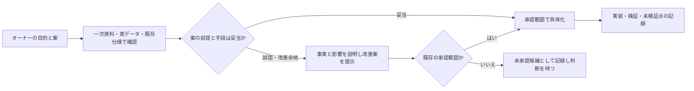

# AGENTS.md — Mixamo統合制作スタジオ開発ルール

このファイルはローカル開発エージェント向けの最初に読む案内です。Codexなどの `AGENTS.md` を読むエージェントはこれを遵守し、読まないツールには必要箇所を明示して渡すこと。設定ファイルを置くだけで全エージェントに強制適用されるわけではありません。

## 作業位置の記録（2026-10-20、オーナー指示・Claude Code と Codex 共通）

クレジット切れで Claude Code と Codex を行き来するため、作業位置を `docs/handoff/WORK_STATE.json` に必ず記録する。詳細は `docs/handoff/README_JA.md`。

1. 始める前に `python tools/work_state.py show` を実行し、`git log -5` と `git status` を確認する。`in_progress` のままなら、記録された段階から再開する。
2. 各段階に入る前に `work_state.py start` を実行し、コミットして push する（クレジットは予告なく切れる）。
3. コミットごとに `work_state.py done`（次にやること・未検証を含む）を実行し、同じコミットに含めて push する。
4. 機能の完成度は従来の台帳が正本。WORK_STATE.json には作業の位置だけを書く。
5. スクリーンショットなどの確認用ファイルは、オーナーが自分で開いて削除できる `D:\BAI\BAI_CREATER_STUDIO\_Claude確認画像\<日付付きフォルダ>\` に置く。クラウド側の共有領域に置いたままにしない（2026-10-20、オーナー指示）。

## オーナー要求最優先・スコープ凍結（2026-10-19、最優先）

この節は過去の「次の実装はPhase 00を最優先」等の古い実装順指示に優先する。既存の品質・安全要件は無効化しない。

1. **オーナーから明示された未完成機能と承認済みロードマップを最優先**する。指示なしに新機能を思いつきで挿入・実装しない。
2. **開発順序を固定**する。Phase Bの残課題を保持したまま、Phase E → F → リップシンク・表情・MMDエフェクト → C → D残り → G残り → H。Bの残課題をE/Fのブロッカーにしない。
3. 「次へ」「進められるところまで」は、**ロードマップ上の次の未完成・承認済み項目を進める**意味。提案機能への寄り道を意味しない。
4. 追加アイデアは**未承認の末尾候補**としてのみ記録できる。オーナーの承認なしに、実装や優先順位の繰り上げをしない。候補の発案・記録自体に時間を使い過ぎない。
5. 必要不可欠なバグ修正・依存作業のみ例外とし、対象の既存要件IDと必要理由を記載する。目的外機能への拡張は不可。
6. **コード変更の各コミット**でロードマップ・機能進捗台帳・テスト結果・未検証事項・Gitコミットを紐付ける。コードがあるだけで完了扱いにしない。
7. ユーザー側の動作確認は**Phase E全機能の実装が終わるまで求めない**。開発側の自動テストは各段階で実施し、ブラウザ/GPU実測ができない場合は未検証と明記する。
8. 引き継ぎ時にはこのファイルと進捗正本 `docs/roadmap/PHASE_E_IMPLEMENTATION_STATUS.json` を最初に確認し、既存Git作業環境を優先する。不要なZIP復元や全ソース再読み込みを避ける。
9. 新たな提案より**受け入れ条件を満たす既存依頼の完成**を優先する。計画外の実装は行わない。

## オーナー案の検証と改善提案（2026-10-20、オーナー指示）

オーナーの**目的・承認済みスコープ**を尊重する。一方、実現方法や技術上の前提を無検証で「正解」と扱わない。一次資料・実データ・既存仕様と照合し、誤認やより良い方法があれば理由を具体的に説明して提案する。誤りを見つけたら黙って合わせず、どの事実が違い、採用すると何が失われるかを伝える。提案が新機能・優先順位変更に当たるときは、承認までは候補に留める。

例: 一般的なSRTは発話の開始・終了時刻を持つ。歌詞タイムラインで「次の開始まで」を終了とみなすと、無音と発話の重なりが消えるため、原時刻を保った `[開始, 終了)` ブロックを提案する。形式の根拠は[米国議会図書館のSRT解説](https://www.loc.gov/preservation/digital/formats/fdd/fdd000569.shtml)。

## AIモデルの使い分け・クレジット節約（2026-10-20、オーナー指示）

作業ごとに**必要十分な性能のモデル**を選ぶ。高性能モデルはクレジット消費が大きいため、常用しない。

| 作業の段階 | 使うモデルの目安 |
|---|---|
| 設計・仕様が未確定、原因不明の不具合調査、複数モジュールにまたがる設計判断、セキュリティ・データ破損に関わる判断 | 高性能モデル（例：Opus 系） |
| 設計・受け入れ条件が細かく決まっていて実装するだけ、テスト追加、定型的な修正、文書の更新・翻訳 | 標準モデル（例：Sonnet 系） |
| ファイル検索・一覧作成・書式の機械的な変換・ログの要約などの単純作業 | 軽量モデル（例：Haiku 系） |

- サブエージェントやワーカーを起動するときは、上表に従ってモデルを明示的に指定する。迷ったら標準モデルを使い、行き詰まった場合だけ高性能モデルへ切り替える。
- 1つの作業の中でも、設計を固めた後の実装段階では標準モデルへ切り替える。
- 作業報告には、どの段階でどのモデル区分を使ったかを1行で記録する。
- 推論量（effort）も同じ考え方で、単純作業では低く設定する。

## 最初に必ず読む文書（優先順）

1. `docs/roadmap/README_JA.md` — 正本の入口
2. `docs/roadmap/UI_UX_DESIGN_STANDARD_JA.md` — **最重要UI/UX基準**
3. `docs/roadmap/PHASE_00_LOGGING_FIRST_JA.md` — **次のコード実装はログ・ローテーション最優先**
4. `docs/roadmap/PHASE_00_INTEGRATION_JA.md` — 2つのビューワー統合・スマート移植
5. `docs/roadmap/FEATURE_REGISTER.json` と `FEATURE_DETAIL_JA.md` — IDごとの機能仕様
6. `docs/roadmap/ROADMAP_JA.md` と `TRACEABILITY_JA.md` — 優先順位・由来
7. `WEBMCP_SPEC_JA.md`, `MCP_SETUP_JA.md` — AI操作仕様

## 絶対に守ること

- **親切で直感的なUIが最重要**。過密な一画面を避け、用途別タブ、固定操作領域と内部スクロール、注釈、ホバー/フォーカス説明、迷わない導線を標準とする。
- **AIなしで手動操作できること**。WebMCP・標準MCPは補助インターフェイスで、手動UIと同一APIを利用する。
- **非破壊・後方互換**。FBX/PMX/VRM/GLB/VMD・制作状態・お気に入り・Git履歴を勝手に削除・上書きしない。
- **現実の検証**。構文確認とブラウザでの実機確認を区別し、未検証を『動作確認済み』としない。
- **Phase 00実装順**：ログ出力とローテーション → UI/UX情報設計・操作検証 → 安全なコード・素材統合。ログは利用環境から診断ZIPを収集できるようにする。
- **ソース・依存関係を確認**。既存機能/要件IDへ統合できるものは重複実装しない。JIZURA等の外部ソースはライセンスを確認する。
- **仕様の同期**。要件変更時には台帳JSON/CSV・概要・詳細・トレーサビリティ・テスト方針を更新する。
- **Git**：ソースと文書の変更を明瞭なコミットに分け、検証済み段階のみタグを付ける。原本素材はGit管理対象にしない。

## 実装完了の条件

手動UI/ WebMCP/ 標準MCP（可能範囲と制限を明記）、保存と復元、権限・ログ、Windows/Linux、対応する自動テスト、実データテスト、操作・開発者用日本語文書が揃うこと。完成していない項目は未完成と明記する。

## 作業報告

完了ごとに変更した要件ID、機能のユーザー向け効果、テスト結果と未検証点、Gitコミット/タグ、移行上の注意を報告する。問題を見つけた場合は診断ログで再現可能性を高める。

## PMX登録の現行方針（v0.12.7）
PMXはテクスチャを含むZIPで登録する。従来のPMX＋テクスチャ個別複数選択UIは再導入しない。サーバーと画面のバージョン不一致を診断できること。詳細は `PMX_ZIP_UI_FIX_V0127_JA.md`。

## v0.15.9 Ollama任意連携
- 詳細: docs/ai/V0159_OLLAMA_OPTIONAL_JA.md
- 実機検証: docs/ai/V0159_TEST_REPORT_JA.md
