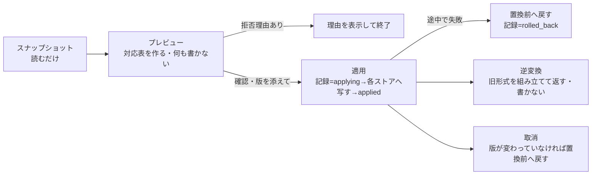

# 旧Studioの保存状態をv0.5の作品IDへ可逆に対応させる設計（2026-11-04）

対象: Issue [#63](https://github.com/baisound/BAI_CREATER_STUDIO/issues/63) と [#69](https://github.com/baisound/BAI_CREATER_STUDIO/issues/69) の残件「旧作品とv0.5作品を同じ作品IDと保存状態で開き、編集・復元できるようにする」。要件ID `DATA-008`（保存と復元）、`DATA-003`（作品と時計）。[再構築ロードマップ](V05_REBUILT_ROADMAP_20261102_JA.md)の順1〜2に属する。

この文書は設計だけを扱う。コードは書いていない。ここに書いた試験はまだ1本も実行していない。

## 0. はじめに読む要約

- **いま起きていること。** 旧画面（`/` と `camera.html`）と新画面（`/workspace/NN`）は、パソコン全体で1組の制作状態を保存する。v0.5（`/studio/v05`）は作品ごとに別々の保存ファイルを持つ。「現行編集を保存」を押すと、旧の状態がv0.5の作品IDの下に**写真のように丸ごと**保存される（スナップショット）。ただし、v0.5のタイムラインや3D場面には何も反映されない。
- **この設計でできるようにすること。** スナップショットの中身を項目ごとに調べ、v0.5で表せるものはv0.5の保存ファイルへ写す。表せないものは理由を付けて「写さずに保管」する。取込のたびに**取込記録（対応表）**を残す。取込記録があれば、v0.5の結果から旧形式の保存状態を組み立て直せる。取込を取り消すこともできる。
- **守ること。** 旧の保存ファイル、スナップショット、素材の原本には書き込まない。v0.5で表せないものを黙って捨てない。素材IDを推測で置き換えない。
- **最初の範囲。** 写せるのは、キャラクター1体の素材と位置、ステージの素材と位置、作品FPS、現在のフレームの4つ。カメラのキー・照明・動作の並び（コンビネーション）は、v0.5に保存先が無い。または時刻を持たない。どちらの場合も、理由を付けて保管だけする（§3）。
- **並行作業との境界。** カメラ・ステージの出力系（プレビューとMP4の一致、ロードマップ3）は、所有者のPCで別のClaudeが進めている。この設計は、その出力系のファイルを変えない。また、キャラクターとステージの「見た目の大きさ」が旧とv0.5で違う問題（§2.3）は、その作業の契約が決まってから WP-L8 で扱う。

## 1. 用語

| 用語 | 意味 |
|---|---|
| 旧保存 | `data/project_state.json`（コンビネーション）、`data/camera_project.json`（カメラ）、`data/project_state.workspace.json`（作業状態）の3つで1組。パソコン全体で1つ |
| スナップショット | 旧保存の1組を検証してそのまま書いた `data/studio_v05_snapshots/<作品ID>.json`。v0.5の作品IDごとに最新1件 |
| v0.5の保存 | `studio_v05_catalog.json`（作品一覧とFPS）、`studio_v05_arrangements/<ID>.json`（クリップ）、`studio_v05_scene_instances/<ID>.json`（3D場面）、`studio_v05_scene_models/<ID>.json`（旧1体枠）、`studio_v05_playheads/<ID>.json`（再生位置）、`studio_v05_render_ranges/`、`studio_v05_track_layouts/` |
| 取込記録 | この設計で新しく作る `data/studio_v05_legacy_imports/<ID>.json`。対応表と元データの複製を持つ |
| 写す | v0.5の既存の検証関数を通して、v0.5の保存ファイルへ書くこと |
| 保管 | v0.5へは写さず、取込記録に元の値と理由を残すこと |

## 2. 旧保存とv0.5保存の比較

### 2.1 保存の単位と版

| 観点 | 旧保存（①②） | v0.5（③） |
|---|---|---|
| 保存の単位 | パソコン全体で1組。`server.py:64`（`PROJECT=DATA/'project_state.json'`）、カメラは `data/camera_project.json` | 作品IDごとにファイルを分ける。`studio_v05_arrangement.py:44-50`、`studio_v05_scene_instances.py:164-188` |
| 作品の識別 | 作品IDは無い。`combination.title` は表示用 | UUID。`studio_project_catalog.py:19-28` |
| 版（競合検出） | 内容のハッシュ。`project_state_bundle.py:237-239`、`server.py:2184-2206`（`If-Match`） | 整数の `revision` をストアごとに持つ。`studio_v05_arrangement.py:73,79`、`studio_v05_scene_instances.py:193-201`、`studio_v05_playhead.py:18-24` |
| 一括保存 | 3ファイルを順に置き換え、失敗したら戻す。停電には耐えない（`project_state_bundle.py:160-234` の注記） | ストアごとに原子置換（`studio_project_catalog.py:51-59`）。ストアをまたぐ一括保存は無い |
| v0.5への橋 | スナップショットの保存・読込（`studio_project_snapshots.py:14-37`、`server.py:1494-1511`）、旧の現行状態への適用（`studio_project_activation.py:14-43`） | スナップショットからv0.5の各ストアへ写す処理は**無い** |

### 2.2 項目ごとの比較

| 対象 | 旧保存の形 | v0.5の形 | 差 |
|---|---|---|---|
| 素材参照（キャラクター） | `workspace.asset`。値は `integrated:<名>.glb/.vrm/.fbx`、`mmd:A:<名>.pmx`、`mmd:B:…`、`fbx:<ID>`、または**接頭辞の無い** `<名>.glb/.vrm`（旧形式）。`project_state_bundle.py:72-87`。画面側の正規化は `studio/js/viewport/character-placement.js:11`（接頭辞が無ければ `integrated:` を付ける） | `instances[].asset_id`。値の空間は同じ（`server.py:118-153` の `unified_assets()` が両方の正本）。受け付ける素材は `studio_v05_scene_model.py:17-25` の `supported_model()` | IDの空間は同じ。違いは、接頭辞の無い旧形式だけ。逆変換で元の文字列に戻すため、元の綴りを記録する |
| 素材参照（ステージ） | `workspace.stage.asset`。接頭辞は `integrated: mmd:A: mmd:B: fbx: library:`。`library:` は24桁の16進（`project_state_bundle.py:37,54-69`） | 同じく `instances[].asset_id`。`library` のGLBは `kind` が `stage`/`prop` のときだけ（`studio_v05_scene_model.py:22`） | IDは同じ。v0.5の `supported_model()` で拒否されるものは写せない（§3 `ASSET_UNSUPPORTED`） |
| 素材参照（動作） | `combination.timeline[].name` は**動作の名前**（Mixamo名）で、IDではない（`index.html:368`）。名前から素材への解決は、画面が実行時に行う。手動対応表 `manifest.mapping[name]` を使い、無ければ正規化名 `norm(name)` で探す。同じ正規化名が複数あると、**後に登録したもの**が勝つ（`index.html:233-238`、`server.py:155-159`） | `clips[].asset_id`（`fbx:<ID>`、`mmd:vmd:<名>` など）と、対象の `target_scene_instance_id`（`studio_v05_arrangement.py:87`、`studio_v05_multi_motion.py:58-91`） | 名前からIDへの変換が要る。解決結果は取込時点の登録状況に依存する |
| 配置（キャラクター） | `workspace.character = {position[m], rotation[度], scale(数1つ)}`。範囲は ±1000、±360、0.01〜100（`project_state_bundle.py:90-104`）。描画は `位置=position`、`回転=度→ラジアン`、`拡大=単位換算×scale`（`studio/js/viewport/placement.js:25-31`、`camera_3d.js:302-305`）。`character` が無いときは高さを自動で合わせる（`camera_3d.js:306-310`） | `transform = {position[3], rotation[3](度), scale[3]}`。範囲は ±100000、±360000、0.000001〜10000（`studio_v05_scene_instances.py:104-114`）。描画は `shared-scene-v57.js:27-40` | 数値の形は写せる（scale は3成分にそろえる）。**ただし見た目の大きさの意味が違う**（§2.3） |
| 配置（ステージ） | `workspace.stage = {asset, position, rotation, scale}`（上と同じ範囲） | キャラクターと同じ場面インスタンス | 同上。§2.3 |
| カメラ | `camera_project.json`。`fps`（1〜120の整数）、`duration`、`keys[]`（`frame, position, target, fov(5〜150), interpolation, customCurve, fStop`）、`easingPresets`、`custom_presets`、`sequence`、`rig`、`focus_tracking`、`bone_follow`（`bai_camera.py:12-59`） | 時刻を持たない視点が1つだけ: `camera = {position, target, fov(10〜120)}`（`studio_v05_scene_instances.py:117-130`）。他に `camera` トラックへカメラVMD素材を置ける（`studio_v05_arrangement.py:6-7`） | キー列・補間・レンズ・リグ・ショットの保存先がv0.5に無い。保存カメラをプレビューとMP4で一致させる作業（ロードマップ3）が並行中 |
| 照明 | `workspace.lights`（`scene_lighting.validate_lights`、`project_state_bundle.py:129-130`） | 保存先なし。`light` トラックは素材の配置だけ | 写せない |
| GLB内蔵アニメ | `workspace.clip`。GLB/VRMの何番目のアニメかを示す（`project_state_bundle.py:120-125`） | 保存先なし。v0.5は動作を別素材のクリップとして置く | 写せない |
| タイムライン | `combination.timeline` は名前の列だけで、**開始時刻も長さも無い**。他に `history`、`cursor`、`title`、`selected`、`playbackSpeed`、`updatedAt` を持つ（`index.html:366-374`、`project_state_bundle.py:16-34`） | `clips[] = {id, asset_id, name, category, track, lane, start[秒], duration[秒], source_start?, source_duration?, target_scene_instance_id?}`（`studio_v05_arrangement.py:69-94`） | 時刻を推測しない限り置けない（§3 `NO_TIMING`） |
| 時刻とFPS | フレーム単位。FPSはカメラの `fps`。現在位置は `workspace.frame`（0〜1000000、`camera.duration` 以下、`project_state_bundle.py:116-117,144-145`） | クリップは秒。作品FPSは任意項目 `catalog.projects[].fps`（1〜240、小数可、`studio_project_catalog.py:38-49`）。**未設定なら出力範囲は60fpsとして計算される**（`studio_v05_render_range.py:24`）。再生位置は秒（0〜86400、`studio_v05_playhead.py:18-33`） | 変換は `秒 = フレーム ÷ fps`。FPSが未設定のままだと、旧の30fpsが60fpsとして扱われる |
| 旧の別ストア（スナップショットに**入らない**） | `data/music_dance_project.json`（SCR-10。モデル・動作・音声のIDと30fpsの開始フレーム。`music_dance_project.py:11-19`）、`data/timeline_editor.json`（名前・開始F・長さF・速度・補間F。30fps固定。`server.py:1921-1934`、`index.html:796-802`） | 対応するのは `clips[]` と場面インスタンス | 全体保存の外にある。作品との対応が保存されていない（§8 Q4） |

### 2.3 見た目の大きさの差（重要）

数値をそのまま写しても、同じ見た目にはならない。

| 形式 | 旧（`character` または `stage` あり） | v0.5の場面インスタンス |
|---|---|---|
| PMX | 拡大 = 0.08 × scale。足の位置は合わせない（`normalize.fork.js:58-65`、`placement.js:25-31`） | 拡大 = 0.08 × scale[i]。読込時に**足を y=0 へ移す**（`multi-model-ui-v58.js:1463-1467`） |
| GLB / VRM | 拡大 = 1 × scale | 読込時に**高さを2.0mへ正規化し、XZの中心を原点へ移す**（`multi-model-ui-v58.js:1468`、`normalize.fork.js:13-25`）。そのうえで scale を掛ける |
| FBX | 拡大 = UnitScaleFactor ÷ 100 × scale | 高さを1.95mへ正規化し、中心を原点へ移す |
| ライブラリGLBステージ | 拡大 = 1 × scale | GLBと同じ正規化（ステージも2mへ縮む） |

したがって、写した結果には必ず警告 `UNIT_SEMANTICS_DIFFER` を付ける。見た目を合わせる換算は、ロードマップ3の作業がv0.5のステージ・カメラの単位を決めてから WP-L8 で行う（§8 Q1）。この設計で写すのは**数値**で、見た目の一致は約束しない。

## 3. 対応表

旧の各項目に、JSONの位置（JSON Pointer）、写し先、変換、逆変換、写せないときの理由コードを決める。表に無い項目は「未知の項目」として保管し、理由 `UNKNOWN_FIELD` を付ける。

| # | 旧の位置 | 写し先 | 変換 | 逆変換 | 状態と理由 |
|---|---|---|---|---|---|
| M1 | `/camera/fps` | `catalog.projects[ID].fps` | 作品FPSが未設定なら、旧の値を設定する。同じ値ならそのまま。違う値なら**取込全体を拒否**する | 作品FPS。整数でないときは旧形式へ戻せない | 拒否は `FPS_CONFLICT` |
| M2 | `/workspace/frame` | `playheads[ID].seconds` | `round(frame / fps, 4)` | `round(seconds × fps)`。取込直後の値は、記録した元のフレームと必ず一致する | 86400秒を超えると `OUT_OF_RANGE` で保管 |
| M3 | `/workspace/asset`（空でない）と `/workspace/character` | 場面インスタンス1件（`mutate(action='add')`） | `asset_id` には、接頭辞の無い旧形式なら `integrated:` を付ける（`character-placement.js:11` と同じ規則）。`transform` は `{position, rotation, scale:[s,s,s]}`。`character` が無いときは `{[0,0,0],[0,0,0],[1,1,1]}` | `asset` には記録した**元の綴り**を戻す。`character` が元に無く、transform が初期値のままなら、`character` を省く | 写す。警告 `UNIT_SEMANTICS_DIFFER`。素材が無い・使えないときは `ASSET_MISSING` / `ASSET_UNSUPPORTED` で保管 |
| M4 | `/workspace/stage` | 場面インスタンス1件 | M3と同じ。`scale:[s,s,s]` | `{asset, position, rotation, scale}` | M3と同じ。値が `null`（ステージなし）なら何も作らず、`null` を記録する |
| M5 | `/workspace/clip` | なし | — | 記録から戻す | 保管 `NO_V05_FIELD` |
| M6 | `/workspace/lights` | なし | — | 記録から戻す | 保管 `NO_V05_FIELD` |
| M7 | `/camera/keys` と `/camera/duration` | なし（既定）。§8 Q2 | — | 記録から戻す | 保管 `CAMERA_KEYS_NOT_SUPPORTED` |
| M8 | `/camera/easingPresets`、`custom_presets`、`sequence`、`rig`、`focus_tracking`、`bone_follow` | なし | — | 記録から戻す | 保管 `NO_V05_FIELD` |
| M9 | `/combination/timeline/<i>/name` | なし（既定）。§8 Q3 | 名前を素材IDへ解決した結果（候補ID、解決方法 `manual`/`normalized`、同名の件数）を記録する | 記録から戻す | 保管 `NO_TIMING`。解決できなければ `NAME_UNRESOLVED`。同名が複数あれば警告 `NAME_DUPLICATE_LAST_WINS` |
| M10 | `/combination/history`、`cursor`、`title`、`selected`、`playbackSpeed`、`updatedAt` など、`timeline` 以外の項目 | なし | — | 記録から戻す | 保管 `NO_V05_FIELD`。作品名は変えない |

**写す範囲の要点。** 既定で写すのはM1〜M4だけ。その他は保管し、画面の表に理由を出す。

### 3.1 理由コード

| コード | 区分 | 画面に出す文（例） |
|---|---|---|
| `UNIT_SEMANTICS_DIFFER` | 警告（写した） | 「位置・回転・拡大の数値は写しました。v0.5は読込時に大きさや足の位置を合わせるため、見た目が旧画面と違うことがあります」 |
| `NAME_DUPLICATE_LAST_WINS` | 警告 | 「同じ名前の動作が複数あります。旧画面と同じく、後から登録したものを候補にしました」 |
| `NO_V05_FIELD` | 保管 | 「v0.5にはこの設定の保存先がまだありません。元の値は取込記録に残しました」 |
| `CAMERA_KEYS_NOT_SUPPORTED` | 保管 | 「v0.5のカメラは時刻付きのキーをまだ保存できません。キー○件は取込記録に残しました」 |
| `NO_TIMING` | 保管 | 「旧のコンビネーションには開始時刻と長さがないため、タイムラインへは置きませんでした」 |
| `NAME_UNRESOLVED` | 保管 | 「この動作名に当たる登録素材が見つかりません」 |
| `ASSET_MISSING` | 保管 | 「素材 ○○ が登録一覧にないか、原本ファイルが見つかりません。別の素材への置き換えはしません」 |
| `ASSET_UNSUPPORTED` | 保管 | 「素材 ○○ はv0.5の3D場面に置けない形式です」 |
| `OUT_OF_RANGE` | 保管 | 「値がv0.5の範囲外です（例: 24時間を超える位置）」 |
| `UNKNOWN_FIELD` | 保管 | 「この取込処理が知らない項目です。元の値をそのまま残しました」 |
| `FPS_CONFLICT` | 取込全体の拒否 | 「作品のFPS（○）と旧保存のFPS（○）が違います。どちらかに合わせてから取り込んでください」 |
| `TARGET_NOT_EMPTY` | 取込全体の拒否 | 「この作品にはすでにクリップまたは3D場面があります。空の作品にだけ取り込めます」 |
| `ALREADY_IMPORTED` | 取込全体の拒否 | 「この作品にはすでに取込があります。先に取り消してください」 |
| `SOURCE_CHANGED` | 取込全体の拒否 | 「プレビュー後にスナップショットが変わりました。もう一度プレビューしてください」 |
| `NO_SNAPSHOT` | 取込全体の拒否 | 「この作品にはスナップショットがありません。先に［現行編集を保存］を押してください」 |

## 4. 取込記録（対応表の保存形式）

保存先は `data/studio_v05_legacy_imports/<作品ID>.json`。書き込みは `studio_project_catalog._atomic` を使い、一時ファイルから置き換える。

```json
{
  "schema": 1,
  "project_id": "<UUID>",
  "state": "applying | applied | rolled_back | reverted",
  "created_at": "<ISO8601 UTC>",
  "source": {
    "kind": "snapshot",
    "snapshot_saved_at": "<スナップショットのsaved_at>",
    "snapshot_sha256": "<スナップショットファイルのバイト列のSHA-256>",
    "bundle": { "...": "validate_bundle() を通した元の bundle をそのまま複製" },
    "manifest_mapping_sha256": "<取込時の manifest.mapping のSHA-256。M9の解決根拠>"
  },
  "assets": [
    {"asset_id": "mmd:A:x.pmx", "legacy_ref": "mmd:A:x.pmx", "sha256": "<原本のSHA-256。読めなければ null>", "available": true}
  ],
  "items": [
    {"pointer": "/workspace/stage", "status": "mapped", "codes": ["UNIT_SEMANTICS_DIFFER"],
     "legacy_value": {"...": "元の値"}, "target": {"store": "scene_instances", "instance_id": "<hex>"}},
    {"pointer": "/camera/keys", "status": "kept", "codes": ["CAMERA_KEYS_NOT_SUPPORTED"],
     "legacy_value": "<元の値>", "target": null}
  ],
  "pre_import": {
    "files": {"catalog": "<置換前のバイト列(UTF-8)。無ければ null>", "scene_instances": null, "playhead": null},
    "revisions": {"scene_instances": 0, "playhead": 0, "arrangement": 0}
  },
  "post_import": {"revisions": {"scene_instances": 2, "playhead": 1, "arrangement": 0},
                   "sha256": {"catalog": "...", "scene_instances": "...", "playhead": "..."}}
}
```

- `status` は `mapped`（写した。警告付きを含む）と `kept`（保管）の2つ。
- `source.bundle` は元の完全な複製。スナップショットは［現行編集を保存］で上書きされるため、取込記録だけで元へ戻せるようにする。サイズの上限は、スナップショットと同じ4MB（`studio_project_snapshots.py:8`）に `assets`・`items` の分を足して6MBとする。
- `pre_import.files` はカタログ全体を含む。カタログは全作品で共有するため、取消（§5.3）ではバイト列で戻さない。対象作品の `fps` だけを元に戻す。

## 5. 処理の流れ



### 5.1 プレビュー（`plan`）

入力は次の5つ。スナップショット（`studio_project_snapshots.read`）、`unified_assets()`、`manifest`（`readmeta()`）、対象作品の現在の各ストア、素材IDから原本パスを引く関数（サーバーの既存解決関数を注入する）。出力は `items`、拒否理由、件数の要約、`expected`（適用時に照合する各ストアのrevisionと `snapshot_sha256`）。ファイルには書かない。

空の作品の条件: アレンジのクリップが0件、場面インスタンスが0件、`camera` が `null`、`face_keys` が0件、旧1体枠（`scene_models`）の `model` が `null`、取込記録が無いか、`reverted` または `rolled_back`。

### 5.2 適用（`apply`）

1. `confirm: true`、`snapshot_sha256`、`expected` を受け取る。プレビューをもう一度実行し、`expected` と一致しなければ409を返す。
2. 置換前のバイト列とrevisionを `pre_import` に入れ、`state: "applying"` の取込記録を書く。
3. 次の順で、**既存の公開関数だけ**を使って書く。ファイルへ直接書かない。
   1. `studio_project_catalog.set_fps`（M1。必要なときだけ）
   2. `studio_v05_scene_instances.mutate(action='add')`（M3、M4。キャラクター、ステージの順）
   3. `studio_v05_playhead.update`（M2）
4. 途中で例外が起きたら、`pre_import.files` のバイト列で各ストアを戻し、`state: "rolled_back"` を書く。例外の内容は診断ログ（`diagnostic_logging`）にも出す。
5. 成功したら `post_import` を埋め、`state: "applied"` を書く。
6. モジュール内のロックで、同じ作品への取込・取消・逆変換を直列にする。他の画面からの同時編集は、各関数のrevision照合で検出する。この場合は4へ進む。

停電への耐性は、`save_bundle` と同じく保証しない。読込時に `state: "applying"` の記録が見つかったら、画面に「取込が途中で止まりました」と出し、取消だけを許す。

### 5.3 取消（`revert`）

`state: "applied"` で、各ストアのrevisionが `post_import.revisions` と等しいときだけ実行する。場面インスタンス・再生位置は `pre_import.files` のバイト列へ戻す。カタログは対象作品の `fps` だけを置換前の値へ戻す（項目が無かったなら削除する）。最後に `state: "reverted"` を書く。revisionが変わっていたら409を返し、変わったストアの名前を示す。一部だけ戻すことはしない。

### 5.4 逆変換（`export_legacy`）

取込記録と、v0.5の現在の値から、旧形式の bundle を組み立てて返す。旧の現行ファイルやスナップショットには書かない。

- 写した項目（M1〜M4）は、v0.5の現在の値から戻す。取込記録の `target` が指す場面インスタンスが削除されていたら、その項目は `null`（ステージ）または空文字（キャラクター）にして、差分に挙げる。
- 保管した項目は、`source.bundle` の値をそのまま戻す。
- 旧形式へ戻せない変更は、丸めたり切り捨てたりしない。`unrepresentable` に挙げて、その項目は元の値を使う。対象は、3成分が等しくない scale、±360を超える回転、±1000mを超える位置、0.01〜100の外の拡大、整数でないFPS、取込後に追加した場面インスタンス（旧はキャラクター1体とステージ1つだけ）。
- 結果は `validate_bundle()` を必ず通す。通らなければ500ではなく422を返し、項目を示す。
- 応答は `{bundle, changed:[pointer...], unrepresentable:[{pointer, reason}], asset_hash_changed:[asset_id...]}`。

**可逆性の定義（受け入れ試験で確かめる）**

- R1 元を壊さない: 取込・取消・逆変換の前後で、スナップショット、旧の現行3ファイル、参照素材の原本のSHA-256が一致する。
- R2 往復一致: 取込直後に編集せずに逆変換すると、`validate_bundle(source.bundle)` と深く等しい。接頭辞の無い素材名、`character` の有無、`stage: null` の扱いも含める。
- R3 取消: 取消のあと、場面インスタンス・再生位置のファイルは取込前とバイト単位で同じになる。カタログは対象作品の `fps` が取込前と同じになる。
- R4 編集後の逆変換: v0.5で位置などを変えたあとの逆変換は、その変更を旧形式へ反映する。表せない変更は `unrepresentable` に出し、黙って値を変えない。

## 6. API・MCP

| 操作 | HTTP | MCP（`mcp_server.py` と `webmcp.js` に同名で追加） |
|---|---|---|
| プレビュー | `GET /api/studio/v05/legacy-import/preview?id=<ID>` | `bai_studio_legacy_import_preview`（読み取り専用） |
| 適用 | `POST /api/studio/v05/legacy-import/apply` 本文 `{id, snapshot_sha256, expected, confirm:true}` | `bai_studio_legacy_import_apply` |
| 記録の読込 | `GET /api/studio/v05/legacy-import?id=<ID>` | `bai_studio_legacy_import_get`（読み取り専用） |
| 取消 | `POST /api/studio/v05/legacy-import/revert` 本文 `{id, confirm:true}` | `bai_studio_legacy_import_revert` |
| 逆変換 | `GET /api/studio/v05/legacy-import/export?id=<ID>` | `bai_studio_legacy_import_export`（読み取り専用） |

状態コードは次のとおり。拒否は409（`TARGET_NOT_EMPTY`、`ALREADY_IMPORTED`、`SOURCE_CHANGED`、`FPS_CONFLICT`、revisionの不一致）。スナップショットが無いときは404。本文の形が違うときは400。逆変換が `validate_bundle` を通らないときは422。ファイル操作の失敗は500で、置換前へ戻したかどうかを本文に書く。本文の大きさの上限は8192バイト（既存の `activate` と同じ。`server.py:1480`）。エラー文は日本語で返す。

## 7. 作業パッケージ（WP）

実装は標準モデル（Sonnet）で行う。WP-L8だけは、ロードマップ3の結果を読んで設計を決めるため、高性能モデルで設計してから実装する。各WPは1コミット以上とし、`work_state.py` の記録、台帳 `DATA-008` の試験記録、未検証の明記をコミットに含める。

### WP-L1 対応表を作る純関数

- 新しいファイル `studio_v05_legacy_import.py` に `plan(bundle, assets, manifest, target, asset_path) -> dict` を作る。ファイルへの書き込みはしない。
- §3の M1〜M10 と §3.1 の全コードを実装する。動作名の解決は `index.html:233-238` と同じ規則にする。`manifest.mapping[name]` があればそれを使い、無ければ `norm(name)` で探す。正規化は `name.lower()` から `.fbx` を取り除き、英数字だけを残す。同名が複数あれば後の登録が勝つ。素材のSHA-256は `asset_path` で原本パスを引いて計算する。
- 受け入れ試験 `tests/test_studio_v05_legacy_import_plan.py`
  - 表に従った試験。M1〜M10 のそれぞれに、写す場合・保管する場合・拒否する場合の fixture を1つ以上用意し、`status` と `codes` と `target` を照合する。
  - 接頭辞の無い `foo.glb` が `integrated:foo.glb` になり、`legacy_ref` に元の綴りが残る。
  - `character` が無いとき、初期値の transform が使われ、記録に「元は無かった」ことが残る。
  - `stage: null` では、インスタンスを作らず `legacy_value: null` を記録する。
  - FPSの3通り（未設定、同じ、違う → `FPS_CONFLICT`）。
  - 空でない作品の4条件（クリップ、インスタンス、camera、face_keys）と、旧1体枠に model がある場合は、それぞれ `TARGET_NOT_EMPTY`。
  - `UNKNOWN_FIELD`: `validate_combination` は `timeline` 以外の項目を通すため、未知の項目を混ぜて保管されることを確かめる。
  - 同じ入力に対して出力が同じになる（順序を含む）。
  - 実行の前後で fixture ディレクトリのファイルとSHA-256が変わらない。

### WP-L2 取込記録のストア

- `read_record`、`write_record` と、§4の形の検証を作る。壊れたファイルは上書きせず、「元のファイルはそのまま」という例外を出す（`studio_v05_scene_instances.py:46-50` と同じ方針）。6MBを超えたら拒否する。
- 受け入れ試験 `tests/test_studio_v05_legacy_import_record.py`
  - 保存して読み直すと一致する。
  - 項目の欠け、余分な項目、`project_id` の不一致、`state` の不正な値、サイズの上限超えを、それぞれ拒否する。いずれも元のファイルのバイト列は変わらない。
  - 一時ファイルが残らない。

### WP-L3 適用と取消

- §5.2 と §5.3 を実装する。各ストアへは既存の公開関数だけで書く。
- 受け入れ試験 `tests/test_studio_v05_legacy_import_apply.py`
  - 正常系: 適用後、場面インスタンス2件（キャラクターとステージ）、作品FPS、再生位置が写っている。`state` は `applied`。
  - 失敗の注入: 3段目の `playhead.update` で例外を起こす（monkeypatch）。カタログと場面インスタンスが取込前のバイト列に戻り、`state` が `rolled_back` になる。
  - 競合: プレビューのあとに場面インスタンスを別途1件追加してから適用すると409になり、何も書かれない。
  - 取消: 適用直後の取消で R3 を満たす。適用後に場面インスタンスを1件動かしてから取消すると409になり、全ファイルが変わらない。
  - 途中停止: `state: "applying"` の記録を置いた状態では、プレビューと適用が拒否され、取消だけが通る。
  - R1: 旧の現行3ファイル、スナップショット、fixtureの素材原本のSHA-256が、全試験の前後で一致する。
  - 二重取込: `applied` の作品へもう一度適用すると `ALREADY_IMPORTED` になる。

### WP-L4 逆変換と往復試験

- §5.4 を実装する。
- 受け入れ試験 `tests/test_studio_v05_legacy_import_roundtrip.py`
  - R2: 次の6つの bundle で、取込→逆変換が元と深く等しくなる。(a) PMXキャラクター＋ライブラリステージ＋照明＋カメラキー3件＋sequence、(b) 接頭辞の無いGLB名＋clip番号、(c) `workspace` 無し、(d) `stage: null`、(e) FBXキャラクターで `character` 無し、(f) コンビネーションの名前10件＋history。
  - R4: 位置を変えると、その値が `workspace.stage.position` に出る。scale を `[1,2,1]` にすると `unrepresentable` に出て、元の scale が使われる。回転を400度にした場合、取込後に追加したインスタンスがある場合も、それぞれ `unrepresentable` に出る。
  - 写したインスタンスを削除すると、`stage` が `null` になり、`changed` に出る。
  - 素材原本のハッシュが取込時と違うと、`asset_hash_changed` に出る。
  - 結果はいつも `validate_bundle` を通る。

### WP-L5 HTTPとMCP

- §6の5つのエンドポイントを `server.py` に追加し、`mcp_server.py` と `webmcp.js` に同名の道具を足す。サーバーへの追加は、既存の `project/activate` の書き方（`server.py:1476-1492`）に合わせる。
- 受け入れ試験
  - Python: `tests/test_studio_v05_legacy_import_http.py`。隔離サーバーで、プレビュー、適用、記録の読込、逆変換、取消を順に通す。各エラーの状態コード（400、404、409、422）と、日本語のエラー文を確かめる。
  - MCP: 既存のMCP道具一覧の試験に、5つの名前と引数の形を加える。標準MCPの実クライアントでの確認は、この環境では未検証と記録する。

### WP-L6 v0.5の画面

- 作品カードのスナップショット操作（`studio/v05/js/workspaces-v05.js:58,62-75`）の近くに、［旧保存を取り込む…］を足す。開くと、プレビューの対応表を「写すもの」「保管するもの（理由）」「警告」に分けて表示する。［取り込む］は確認を挟む。取込済みなら［取消］と［旧形式で確認（JSONを保存）］を出す。
- 取込や取消のあとに `bai:v05-project-changed` を送り、開いている編集画面を読み直させる。古いrevisionのまま編集して競合しないようにするため。
- UI/UX基準に合わせる。理由の文は §3.1 を使い、専門用語には注釈を付ける。操作の途中で画面全体が動かない。
- 受け入れ試験 `tests/studio-v05-legacy-import-ui.test.cjs`（隔離Chrome）
  - 拒否理由の表示。
  - 表の件数がAPIの要約と一致する。
  - 取り込むと、編集画面の3D場面にインスタンスが2件出て、再生位置が写っている。
  - 再読込しても同じ。
  - 取消でもとに戻る。
  - 保管した項目の理由の文が見える。

### WP-L7（所有者の承認後）旧の別ストアを任意で取り込む

- §8 Q4 で承認されたら、`music_dance_project.json` と `timeline_editor.json` を、利用者がチェックを入れたときだけ取り込む。これらは作品と結び付いていないため、既定では扱わない。
- 取込時に、両ファイルのSHA-256と内容を取込記録の `source.live` に複製する。
- 対応の方針は次のとおり。
  - `model_id` は M3 と同じ扱い。キャラクターと同じIDなら、インスタンスを共有する。
  - `motion_id` は、`motion` トラックのクリップにする。開始は `motion_start_frame/30`。長さは素材の長さ。長さを得られなければ `DURATION_UNKNOWN`。`motion_source_frame` が0でなければ `SOURCE_OFFSET_NOT_SUPPORTED`（v0.5は時間付きメディア以外の元区間を拒否する。`studio_v05_arrangement.py:58-67`）。
  - `audio_id` は、`music` トラックのクリップにする。`source_start` は `audio_source_frame/30`。
  - `timeline_editor` の各クリップは、名前を M9 の規則で解決して置く。速度が1でなければ `SPEED_NOT_SUPPORTED` で保管する。補間Fは警告 `BLEND_DROPPED` とし、値を記録する。
- 試験は WP-L1、L3、L4 と同じ観点で追加する。

### WP-L8（ロードマップ3のあと）見た目の大きさをそろえる

- §2.3 の差を、ロードマップ3で決まるv0.5のステージ・カメラの単位契約に合わせて解消する。候補は2つある。(a) 場面インスタンスに「旧の単位で置く」という印を足す。(b) 取込時に、正規化の分を打ち消す scale を計算する。どちらにするかは、その時点で所有者に確認する。
- カメラのキー（M7）は、v0.5に時刻付きカメラの保存先ができたら写す。
- 受け入れ試験: 実GPUの隔離Chromeで、旧 `camera.html` とv0.5の同じフレームの画像を比べ、キャラクターとステージの外接枠の差がしきい値以内であること。しきい値は WP-L8 の設計時に決める。

### WP-L9 実データでの確認（所有者のPC）

- 所有者の実スナップショット1件以上（実PMX、ライブラリGLBステージ、カメラキーを含むもの）を読み取り専用で複製し、隔離サーバーで、プレビュー、適用、再読込、逆変換、取消を通す。R1〜R4、保管した項目の一覧、実GPUでの表示を記録する。
- 文書は `docs/v05/LEGACY_IMPORT_REAL_DATA_<日付>_JA.md` に置く。

**順序。** L1 → L2 → L3 → L4 → L5 → L6 → L9。L7 は Q4 の承認後に行う。L8 はロードマップ3の完了後に行う。L1〜L6 は、カメラ・ステージの出力系のファイル（`camera*.js`、`camera_*.py`、`studio/v05/js/camera-render-*.js`、`shared-scene-v57.js`、`multi-model-*.js`、`spatial-*.js`、`studio_v05_media_render.py`）を変えない。

## 8. 所有者の判断が必要な点（既定つき）

| # | 問い | 既定（返事が無ければこれで進める） | 他の選択肢と影響 |
|---|---|---|---|
| Q1 | キャラクターとステージは、数値を写すだけで見た目は違ってよいか | 数値だけ写し、警告 `UNIT_SEMANTICS_DIFFER` を出す。見た目の一致は WP-L8 でロードマップ3のあとに行う | すぐに見た目を合わせるなら、v0.5の場面インスタンスの形式を変える必要がある。並行中のカメラ・ステージ作業とぶつかる |
| Q2 | 旧のカメラのキーをどう扱うか | 写さず、取込記録に保管する（`CAMERA_KEYS_NOT_SUPPORTED`） | 現在のフレームのカメラ姿勢を、v0.5の静止視点（`scene.camera`）へ1つだけ写す案もある。ただし、時刻の情報とfovの範囲外（5〜10、120〜150）が失われる |
| Q3 | 旧のコンビネーション（動作名の並び）をタイムラインへ置くか | 置かない（`NO_TIMING`）。解決した素材IDだけを記録する | 旧のチェイン再生と同じく、各動作の長さで前から順に並べる案もある。FBX動作の長さを読む処理が新しく要るうえ、v0.5でFBX動作をPMXへ適用できるかも未確認 |
| Q4 | SCR-10（曲とダンス）と旧タイムライン編集の保存も取り込むか | 取り込まない。WP-L7 は保留 | 取り込む場合でも、作品と結び付いていない全体の保存なので、利用者のチェックがあるときだけにする |
| Q5 | 空でない作品への取込を許すか | 許さない（`TARGET_NOT_EMPTY`）。空の作品を作り、スナップショットを保存してから取り込む | 足すだけの取込も作れる。この場合、取消は「作ったIDだけ消す」方式になり、試験が増える |
| Q6 | 逆変換の結果を旧の現行状態へ書き戻せるようにするか | 書き戻さない。JSONを返すだけ | 書き戻すなら、既存の［適用］（`studio_project_activation.py` の確認とバックアップ）を通す経路を別途設計する |

## 9. 自己批評と反映

最初の案を書いたあと、**データ破損と並行操作**、**利用者の分かりやすさ**の2つの観点から読み直した。見つけた点と、どう直したかを記す。

| 指摘 | 反映 |
|---|---|
| 最初の案は、スナップショットのファイル名だけを記録していた。［現行編集を保存］で上書きされると、元へ戻せなくなる | `source.bundle` に完全な複製を持たせ、SHA-256も記録した（§4） |
| 取消は全ファイルをバイト列で戻す案だった。カタログは全作品で共有するため、他の作品の変更まで戻してしまう | カタログは対象作品の `fps` だけを戻すようにした（§4、§5.3） |
| 取込の途中で他の画面が保存すると、取込の一部だけが残るおそれがあった | 各ストアのrevision照合で失敗させ、全体を置換前へ戻すようにした。開いている画面へ読み直しの通知を送るようにした（§5.2、WP-L6） |
| 動作名の解決は、取込時点の登録状況で変わる。結果が再現しない | `manifest.mapping` のSHA-256と、解決方法・同名件数を記録するようにした。既定では置かないので、時刻の誤りは生じない（M9） |
| 同じ素材IDでも、原本が差し替えられていることがある | 原本のSHA-256を記録し、逆変換で差を示すようにした（§4、§5.4） |
| 旧のフレームは最大1000000まである。v0.5の再生位置は86400秒が上限で、FPSが低いと上限を超える | `OUT_OF_RANGE` を追加した（M2） |
| v0.5のFPSが未設定だと、出力範囲は60fpsで計算される。旧の30fpsの作品がずれる | 未設定ならFPSを写すようにした。違う値なら全体を拒否するようにした（M1） |
| 旧1体枠（`scene_models`）にモデルがあると、場面インスタンスの初期化で `legacy-primary` が作られる。取込と重なる | 空の作品の条件に加えた（§5.1） |
| 逆変換で、範囲外の値を丸める案があった。黙って値を変えることになる | 丸めをやめ、`unrepresentable` に出すようにした（§5.4、R4） |
| 理由コードだけでは利用者に意味が伝わらない | 画面に出す日本語の文を、コードと対にして決めた（§3.1） |
| `validate_combination` は `timeline` 以外の項目を検査せずに通す。未知の項目を落とすおそれがあった | `UNKNOWN_FIELD` を設け、往復試験の fixture に含めた（§3、WP-L1） |

## 10. 範囲外と未検証

- この文書はコードも試験も含まない。§7の試験は、まだ1本も実行していない。
- 見た目の一致（§2.3）は、WP-L8 まで保証しない。
- カメラの保存は、スナップショットを作る時点で `bai_camera.validate` が正規化する（例: `interpolation` の既定値を足す、知らない項目を落とす。`bai_camera.py:12-59`）。この設計の「元」は正規化後の bundle で、正規化前の生ファイルとの差は扱わない。
- 旧①の2体表示（`modelA`/`modelB` のFBX、`index.html:229-233`）は、全体保存にもスナップショットにも入っていない。この設計の対象外。
- WebMCP、標準MCPの実クライアント、Windows/Linuxの差、実GPUでの表示は、各WPの実施時に確認する。確認できなかった範囲は未検証として記録する。

モデル区分: 調査・比較・設計・自己批評は高性能モデル。実装（WP-L1〜L7、L9）は標準モデルを想定。
