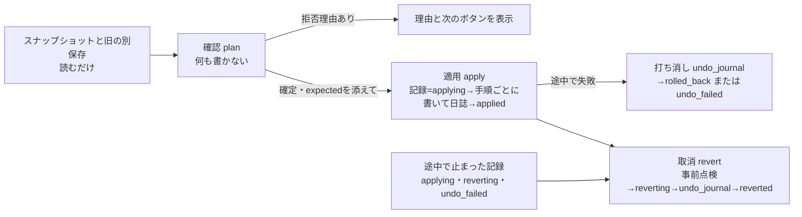

# 旧Studioの保存状態をv0.5の作品IDへ取り込む設計（2026-11-04、批評反映版）

対象: Issue [#63](https://github.com/baisound/BAI_CREATER_STUDIO/issues/63) と [#69](https://github.com/baisound/BAI_CREATER_STUDIO/issues/69) の未チェック項目「旧作品とv0.5作品を同じ作品IDと保存状態で開き、編集・復元できるようにする」。[再構築ロードマップ](V05_REBUILT_ROADMAP_20261102_JA.md)の「次の実施順2」と、[最短制作経路](V05_MINIMUM_WORKFLOW_20261023_JA.md)の順2の終了条件（旧作品からの復元後も参照・位置・**開始時刻**が一致する）に当たる。

要件ID: 主は `DATA-008`（制作プロジェクトの保存・読み込み）。HTTP・MCP・画面で同じ操作をそろえる部分に `CORE-004`・`UX-007`、操作ログに `OBS-004` を添える。初版にあった `DATA-003` は台帳では「補間・ブレンドカーブ」なので外した（`FEATURE_REGISTER.json` で確認）。

この文書は設計だけを扱う。コードは書いていない。ここに書いた試験はまだ1本も実行していない。初版（`1c1133d`）に3つの批評を受け、検証して採否を決めた結果を §12 に記す。

## 0. はじめに読む要約

- **いま起きていること。** 旧画面（`/` と `camera.html`）はパソコン全体で1組の制作状態を保存する。v0.5（`/studio/v05`）は作品ごとに別々の保存ファイルを持つ。作品カードの［現行編集を保存］を押すと、旧の状態がその作品IDの下に丸ごと保存される（スナップショット、`workspaces-v05.js:58,62-75`）。しかし、v0.5のタイムラインや3D場面には何も写らない。
- **この設計でできるようにすること。** スナップショットの中身を項目ごとに調べ、v0.5で表せるものはv0.5の既存の保存関数を通して写す。表せないものは理由を付けて「写さずに保管」する。利用者がチェックを入れたときは、曲とダンスの画面（SCR-10）と旧タイムライン編集の配置も、開始時刻付きで写す。取込の各手順は**取込記録（日誌）**に書き、あとで［取込を取消］できる。
- **歌ってみた動画で役に立つこと。** 写るのは、キャラクター、ステージ、作品FPS、再生位置、**曲とその開始時刻、ダンス（VMD）とその開始時刻**。カメラの動きは、v0.5に時刻付きの保存先がまだ無いため保管だけにする（§10 の所有者への質問）。
- **守ること。** 旧の保存ファイル、スナップショット、素材の原本には書き込まない。v0.5で表せないものを黙って捨てない。素材IDを推測で置き換えない。取消も含めて、v0.5の保存ファイルを直接書き換えたり、バイト列で書き戻したりしない。必ず公開関数（追加・削除・更新）を通す。
- **並行作業との境界。** カメラ・ステージの出力系（プレビューとMP4の一致、ロードマップ「次の実施順3」）は別の作業が進めている。この設計の WP-L1〜L7・L9 は、その出力系のファイルを変えない（§8 末尾）。見た目の大きさの差（§2.3）は WP-L8a で、時刻付きカメラは WP-L8b で扱う。

### 0.1 利用者の操作手順（画面の説明文と操作説明書に同じ文を載せる）

1. 旧画面（`/` または `camera.html`）で、取り込みたい作品を開いた状態にする。旧保存はパソコン全体で1組なので、いま開いている作品が取り込まれる。
2. v0.5のホームで［＋ 新規作成］を押し、空の作品を作る。
3. その作品カードの［現行編集を保存］を押す。
4. 同じカードの［旧保存を取り込む…］を押す。表示された「写るもの／写らないもの」と取込元の名前を確かめ、［取り込む］を押す。

## 1. 用語

| 用語 | 意味 |
|---|---|
| 旧保存 | `data/project_state.json`（コンビネーション）、`data/camera_project.json`（カメラ）、`data/project_state.workspace.json`（作業状態。`project_state_bundle.py:154,169` の `with_suffix`）の3つで1組。パソコン全体で1つ |
| スナップショット | 旧保存の1組を検証して書いた `data/studio_v05_snapshots/<作品ID>.json`（`studio_project_snapshots.py:14-27`）。作品IDごとに最新1件 |
| 旧の別保存 | 全体保存にもスナップショットにも入らない2つ。`data/music_dance_project.json`（SCR-10。`server.py:74`）と `data/timeline_editor.json`（旧タイムライン編集。`server.py:75`） |
| v0.5の保存 | `studio_v05_catalog.json`（作品一覧とFPS）、`studio_v05_arrangements/<ID>.json`（クリップ）、`studio_v05_scene_instances/<ID>.json`（3D場面）、`studio_v05_scene_models/<ID>.json`（旧1体枠）、`studio_v05_playheads/<ID>.json`（再生位置）、`studio_v05_render_ranges/`、`studio_v05_track_layouts/` |
| 取込記録 | この設計で新しく作る `data/studio_v05_legacy_imports/<作品ID>.json`。元データの複製と、取込の手順ごとの日誌を持つ（§4） |
| 写す | v0.5の既存の公開関数を通して、v0.5の保存へ書くこと |
| 保管 | v0.5へは写さず、取込記録に元の値と理由を残すこと |
| 打ち消す | 取込で足したものを、公開関数で削除・更新して取り除くこと。ファイルのバイト列を書き戻すことではない |
| presence | 旧の項目の「有り方」。`absent`（項目が無い）、`null`（項目はあるが値が null）、`value`（値がある）の3つ |

## 2. 旧保存とv0.5保存の比較

### 2.1 保存の単位と版

| 観点 | 旧保存 | v0.5 |
|---|---|---|
| 保存の単位 | パソコン全体で1組。`server.py:64`（`PROJECT=DATA/'project_state.json'`） | 作品IDごとにファイルを分ける。`studio_v05_arrangement.py:44-50`、`studio_v05_scene_instances.py:164-188` |
| 作品の識別 | 作品IDは無い。`combination.title` は表示用 | UUID。`studio_project_catalog.py:19-28` |
| 版（競合検出） | 内容のハッシュ。`project_state_bundle.py:237-239`、`server.py:2184-2206`（`If-Match`） | 整数の `revision` をストアごとに持ち、書くたびに1増える。`studio_v05_arrangement.py:92`、`studio_v05_scene_instances.py:362-366`、`studio_v05_playhead.py:22-24`。**カタログ（FPS）には revision が無い**（`studio_project_catalog.py:38-49`） |
| 一括保存 | 3ファイルを順に置き換え、失敗したら戻す。停電には耐えない（`project_state_bundle.py:160-234`） | ストアごとに原子置換（`studio_project_catalog.py:51-59`）。ストアをまたぐ一括保存は無い |
| v0.5への橋 | スナップショットの保存・読込（`studio_project_snapshots.py:14-37`、`server.py:1493-1511`）、旧の現行状態への適用（`studio_project_activation.py:14-43`、`server.py:1476-1492`） | スナップショットからv0.5の各ストアへ写す処理は**無い** |

### 2.2 項目ごとの比較

| 対象 | 旧保存の形 | v0.5の形 | 差 |
|---|---|---|---|
| 素材参照（キャラクター） | `workspace.asset`。値は `integrated:<名>`、`mmd:A:<名>.pmx`、`mmd:B:…`、`fbx:<ID>`、または**接頭辞の無い** `<名>.glb/.vrm`（`project_state_bundle.py:72-87`）。空文字はモデルなし。画面側の正規化は `studio/js/viewport/character-placement.js:11`（接頭辞が無ければ `integrated:` を付ける） | `instances[].asset_id`。値の空間は同じ（`server.py:118-153` の `unified_assets()`）。置ける素材は `studio_v05_scene_model.py:17-25` の `supported_model()` | 違いは接頭辞の無い旧形式だけ。元の綴りを記録する |
| 素材参照（ステージ） | `workspace.stage.asset`。`library:` は24桁の16進（`project_state_bundle.py:37,54-69`） | 同じく `instances[].asset_id`。`library` のGLBは `kind` が `stage`/`prop` のときだけ（`studio_v05_scene_model.py:22`） | `supported_model()` で拒否されるものは写せない |
| 配置 | `workspace.character = {position[m], rotation[度], scale(数1つ)}`。範囲は ±1000、±360、0.01〜100（`project_state_bundle.py:89-104`）。`stage` も同じ形 | `transform = {position[3], rotation[3](度), scale[3]}`。範囲は ±100000、±360000、0.000001〜10000（`studio_v05_scene_instances.py:104-114`）。**値は小数点以下6桁に丸めて保存**（`studio_v05_scene_model.py:59`） | scale は3成分にそろえる。見た目の大きさの意味が違う（§2.3） |
| presence | `workspace` 自体、`workspace.stage`・`lights`・`character` は、`absent`・`null`・`value` の3通りがありうる（`project_state_bundle.py:127-132`。stage は項目があるときだけ結果に入る） | 区別なし | 記録の `presence` で区別して残す |
| カメラ | `camera_project.json`。`fps`（1〜120の整数、`bai_camera.py:14-15`）、`duration`、`keys[]`、`easingPresets`、`custom_presets`、`sequence`、`rig`、`focus_tracking`、`bone_follow`（`bai_camera.py:12-59`）。知らない項目はスナップショットの時点で落ちる | 時刻を持たない視点が1つだけ（`studio_v05_scene_instances.py:117-130`）。`camera` トラックへカメラVMD素材は置ける（`studio_v05_arrangement.py:7`） | キー列の保存先がv0.5に無い |
| 照明・GLB内蔵アニメ | `workspace.lights`、`workspace.clip` | 保存先なし | 写せない |
| コンビネーション | `combination.timeline` は名前の列だけで、**開始時刻も長さも無い**。他に `history`、`cursor`、`title`、`selected`、`playbackSpeed`、`updatedAt`。`validate_combination` は他の項目も素通しする（`project_state_bundle.py:16-34`、34行で入力をそのまま返す） | `clips[]`（`studio_v05_arrangement.py:69-95`） | 時刻を推測しない限り置けない（[11/02の監査](../v05/FORMAT_IMPORT_LEGACY_AUDIT_20261102_JA.md)で「推測して配置しない」と決定済み） |
| 時刻とFPS | フレーム単位。FPSはカメラの `fps`。現在位置は `workspace.frame`（0〜1000000、`camera.duration` 以下、`project_state_bundle.py:144-145`） | クリップは秒。作品FPSは任意項目 `catalog.projects[].fps`（1〜240、小数可）。**未設定なら出力範囲は60fpsとして計算される**（`studio_v05_render_range.py:24`）。再生位置は秒（0〜86400、`studio_v05_playhead.py:19`） | `秒 = フレーム ÷ fps` |
| 曲とダンス（SCR-10） | `music_dance_project.json` = `{schema, fps:30固定, model_id, motion_id, audio_id, motion_start_frame, motion_source_frame, audio_start_frame, audio_source_frame, head_frame}`。IDは `unified_assets()` の素材ID。フレームは0〜216000（`music_dance_project.py:11-43`） | `motion` トラックと `music`/`audio` トラックのクリップ、動作の対象インスタンス（`studio_v05_multi_motion.py:58-91`） | IDと開始時刻があるので写せる。作品とは結び付いていない |
| 旧タイムライン編集 | `timeline_editor.json` = `{schema:1, clips:[{name, start, duration, speed, blend}], updatedAt}`。30fps固定のフレーム。検査は `server.py:1921-1934` | `motion` トラックのクリップ | 素材は**名前**で持つので、素材IDへの解決が要る（§3 T1） |

### 2.3 見た目の大きさの差（重要）

数値をそのまま写しても、同じ見た目にはならない。

| 形式 | 旧（`character` または `stage` あり） | 旧（`character` なし） | v0.5の場面インスタンス |
|---|---|---|---|
| PMX | 拡大 = 0.08 × scale。足の位置は合わせない（`normalize.fork.js:58-65`、`placement.js:25-31`） | 高さを1.8mへ合わせ、足をy=0へ（`camera_3d.js:303-311`） | 拡大 = 0.08 × scale[i]。読込時に足をy=0へ移す（`multi-model-ui-v58.js:1463-1467`） |
| GLB / VRM | 拡大 = 1 × scale | 高さを2.0mへ | 読込時に高さを2.0mへ、XZの中心を原点へ移す（`multi-model-ui-v58.js:1468`、`normalize.fork.js:5,13-25`）。そのうえで scale を掛ける |
| FBX | 拡大 = UnitScaleFactor ÷ 100 × scale | 高さを1.95mへ | 高さを1.95mへ、中心を原点へ |
| ライブラリGLBステージ | 拡大 = 1 × scale | — | GLBと同じ正規化（ステージも2mへ縮む） |

写した結果には必ず警告 `UNIT_SEMANTICS_DIFFER` を付ける。見た目を合わせる換算は WP-L8a で行う。それまでは「数値は写した。見た目の一致は未達」と記録し、完了扱いにしない（§9）。

## 3. 対応表

旧の各項目に、写し先、変換、状態と理由コードを決める。`pointer` は記録用のJSON Pointer で、**画面には出さない**（画面は §3.2 の表示名を使う）。

### 3.1 スナップショット（常に対象）

| # | 旧の位置 | 写し先 | 変換と判定 | 状態と理由 |
|---|---|---|---|---|
| M1 | `/camera/fps` | `catalog.projects[ID].fps` | 作品FPSが未設定（`absent`）なら旧の値を設定する手順を作る。値が同じ（`float(a)==float(b)`）なら手順なし。違う値なら、`fps_policy` が `"use_legacy"` のときだけ設定し、それ以外は**取込全体を拒否**する | 拒否は `FPS_CONFLICT` |
| M2 | `/workspace/frame` | 再生位置 | `seconds = round(frame / camera.fps, 4)`（旧のFPSで割る）。`workspace` が `absent` なら手順なし | 86400秒を超えると `OUT_OF_RANGE` で保管 |
| M3 | `/workspace/asset` と `/workspace/character` | 場面インスタンス1件（役割 `character`） | `asset` が空文字なら手順なし。空でなければ、接頭辞が無いとき `integrated:` を付けた `asset_id` で追加する。`character` が `value` なら `transform={position, rotation, scale:[s,s,s]}`、`absent`・`null` なら `{[0,0,0],[0,0,0],[1,1,1]}`。元の綴りは `legacy_ref`、`character` の有り方は `presence` に残す | 写す。警告 `UNIT_SEMANTICS_DIFFER`。素材が一覧に無い・`available` が偽なら `ASSET_MISSING`、`supported_model()` が偽なら `ASSET_UNSUPPORTED` で保管。`character` が `value` でも `asset` が空なら `NO_V05_FIELD` で保管 |
| M4 | `/workspace/stage` | 場面インスタンス1件（役割 `stage`） | `value` のときだけM3と同じ変換。`absent`・`null` は手順なし、`presence` だけ残す | M3と同じ |
| M5 | `/workspace/clip` | なし | 値が整数のときだけ保管 | `NO_V05_FIELD` |
| M6 | `/workspace/lights` | なし | `value` のときだけ保管。`presence` は常に残す | `NO_V05_FIELD` |
| M7 | `/camera/keys` と `/camera/duration` | なし | まとめて1項目で保管。キーの件数を表示に使う | `CAMERA_KEYS_NOT_SUPPORTED` |
| M8 | `/camera` の `easingPresets`、`custom_presets`、`sequence`、`rig`、`focus_tracking`、`bone_follow` | なし | 1項目ずつ保管 | `NO_V05_FIELD` |
| M9 | `/combination/timeline` | なし | 配列をそのまま1項目で保管する。各要素の `name` 以外の項目も値ごと残る。名前の解決はしない | `NO_TIMING` |
| M10 | `/combination` の既知の6項目 `history`、`cursor`、`title`、`selected`、`playbackSpeed`、`updatedAt`（`schema` は除く） | なし | 存在するものだけ1項目ずつ保管。作品名は変えない | `NO_V05_FIELD` |
| M11 | `/combination` の上記以外の項目（`schema`・`timeline` も除く） | なし | 1項目ずつ保管 | `UNKNOWN_FIELD` |

`UNKNOWN_FIELD` が付くのは M11 だけ。`workspace` は未知の項目を検査で拒否し（`project_state_bundle.py:113-114`）、カメラは知らない項目をスナップショットの時点で落とす（§11）ので、対象にならない。

### 3.2 曲とダンス（SCR-10、利用者がチェックを入れたときだけ。WP-L7a）

時刻はすべて `秒 = フレーム ÷ 30`（SCR-10は30fps固定、`music_dance_project.py:32-33`）。作品FPSに関係しない。

| # | 旧の位置 | 写し先 | 変換と判定 | 状態と理由 |
|---|---|---|---|---|
| S1 | `model_id` | 場面インスタンス | null なら手順なし。正規化後のIDが M3 の `asset_id` と同じならM3のインスタンスを共有し、手順を作らない。違えば、既定の transform で別のインスタンス（役割 `dance_model`）を追加する | 追加したときは警告 `PLACED_AT_ORIGIN`。素材の扱いはM3と同じ |
| S2 | `audio_id`、`audio_start_frame`、`audio_source_frame` | `music` または `audio` トラックのクリップ | トラックは `studio_v05_arrangement.classify(素材)` の結果（`music` か `audio`）。元の長さ `src` は `studio_v05_media_render.media_info()` の `duration_seconds`（`studio_v05_media_render.py:217-239`）。`start = audio_start_frame/30`、`source_start = audio_source_frame/30`、`duration = src − source_start`。 | 長さを得られなければ `DURATION_UNKNOWN`。`duration ≤ 0`（元区間の開始が曲の長さ以上）は `OUT_OF_RANGE` で保管。分類が音声でなければ `ASSET_UNSUPPORTED` |
| S3 | `motion_id`、`motion_start_frame` | `motion` トラックのクリップ | 素材の形式が VMD のときだけ。長さ = `(VMDの最終キーのフレーム + 1) / 30`（§5.8 の `vmd_last_frame`）。`start = motion_start_frame/30` | FBX・GLB動作は長さを読めないので `DURATION_UNKNOWN` で保管 |
| S4 | `motion_source_frame` | なし | 0 でなければ S3 を作らず保管する。v0.5は動作クリップの元区間を持てない（`studio_v05_arrangement.py:58-67`） | `SOURCE_OFFSET_NOT_SUPPORTED` |
| S5 | S3 の対象 | S3 のクリップの `target_scene_instance_id` | 対象は S1 のインスタンス、S1 が無ければ M3 のインスタンス。`studio_v05_motion_plan.compatible(モデル形式, 動作形式)`（`studio_v05_motion_plan.py:12-18`）が真のときだけ割り当てる | 割り当てられなければ警告 `MOTION_TARGET_UNSET`（クリップは置く） |
| S6 | `head_frame`、`fps` | なし | 保管。再生位置は M2 を使う | `NO_V05_FIELD` |

### 3.3 旧タイムライン編集（利用者がチェックを入れたときだけ。WP-L7b）

| # | 旧の位置 | 写し先 | 変換と判定 | 状態と理由 |
|---|---|---|---|---|
| T1 | `clips[i].name` | 素材ID | 旧画面と同じ規則で解決する（`index.html:231,235-238`）。`norm(x) = x.lower()` から末尾の `.fbx` を取り、`[a-z0-9]` 以外を消したもの。キー `key = manifest.mapping[name]` があればそれ（**値は素材IDではなく正規化名**）、無ければ `norm(name)`。候補は `manifest.files` のうち `kind` が `modelA`・`modelB` でないもの。`norm(entry.name) == key` の候補のうち、**配列の後ろにあるもの**を採る。素材IDは `"fbx:" + entry.id` | 候補0件は `NAME_UNRESOLVED`。2件以上は警告 `NAME_DUPLICATE_LAST_WINS`。採った素材が `unified_assets()` で `available` でなければ `ASSET_MISSING` |
| T2 | `clips[i].start`、`duration`、`speed` | `motion` トラックのクリップ | `speed == 1` のときだけ。`start/30`、`duration/30` 秒。対象はS5と同じ規則（S1→M3の順） | `speed ≠ 1` は `SPEED_NOT_SUPPORTED` で保管。対象なしは `MOTION_TARGET_UNSET` |
| T3 | `clips[i].blend` | なし | 0 でなければ値を記録して、クリップは置く | 警告 `BLEND_DROPPED` |
| T4 | `updatedAt` | なし | 保管（表示に使う） | `NO_V05_FIELD` |

`timeline_editor.json` が `server.py:1921-1934` と同じ検査を通らないときは、ファイル全体を `LIVE_SOURCE_INVALID` で保管し、他の取込は続ける。`music_dance_project.json` は `music_dance_project.read()`（`music_dance_project.py:52-61`）が例外を出したとき同じ扱いにする。

### 3.4 理由コードと画面の文

文はサーバーが `error`（拒否）または各項目の `message` に入れて返し、画面はそのまま表示する。拒否の文には必ず、次に押すボタンの名前を入れる。HTTPの応答は既存の `self.bad(status, msg, code)`（`server.py:232-235`）で `{"error": 文, "error_code": コード}` にする。

| コード | 区分 | HTTP | 文（全文。試験はこの文と完全一致で照合する） |
|---|---|---|---|
| `UNIT_SEMANTICS_DIFFER` | 警告 | — | 位置・回転・大きさの数値は写しました。v0.5は読み込むときに大きさや足の位置を合わせるため、旧画面と見た目が違うことがあります。 |
| `PLACED_AT_ORIGIN` | 警告 | — | 曲とダンスの画面のモデルは位置を保存していないため、原点に置きました。 |
| `MOTION_TARGET_UNSET` | 警告 | — | 動作のクリップは置きましたが、動かすキャラクターを決められませんでした。クリップを開いて［対象モデルを保存］で選んでください。 |
| `NAME_DUPLICATE_LAST_WINS` | 警告 | — | 同じ名前の動作が複数あります。旧画面と同じく、後から登録したものを使いました。 |
| `BLEND_DROPPED` | 警告 | — | 動作のつなぎ（補間フレーム）はv0.5にまだ無いため、使いませんでした。値は取込記録に残しました。 |
| `FPS_KEPT_USER_CHANGE` | 警告（取消時） | — | 取込のあとで作品のFPSが変えられていたため、FPSはいまの値のままにしました。 |
| `NO_V05_FIELD` | 保管 | — | v0.5にはこの設定の保存先がまだありません。元の値は取込記録に残しました。 |
| `CAMERA_KEYS_NOT_SUPPORTED` | 保管 | — | v0.5のカメラは、時刻付きの動きをまだ保存できません。カメラのキー{n}件は取込記録に残しました。 |
| `NO_TIMING` | 保管 | — | 旧の動作の並びには開始時刻と長さがないため、タイムラインへは置きませんでした。 |
| `NAME_UNRESOLVED` | 保管 | — | この動作名に当たる登録素材が見つかりません。 |
| `ASSET_MISSING` | 保管 | — | 素材「{name}」が登録一覧にないか、元のファイルが見つかりません。別の素材への置き換えはしません。 |
| `ASSET_UNSUPPORTED` | 保管 | — | 素材「{name}」は、この場所には置けない形式です。 |
| `DURATION_UNKNOWN` | 保管 | — | 素材「{name}」の長さを読み取れないため、タイムラインへは置きませんでした。 |
| `SOURCE_OFFSET_NOT_SUPPORTED` | 保管 | — | ダンスを途中から始める設定は、v0.5の動作クリップではまだ使えません。 |
| `SPEED_NOT_SUPPORTED` | 保管 | — | 再生速度を変えた動作は、v0.5ではまだ置けません。 |
| `OUT_OF_RANGE` | 保管 | — | 値がv0.5で扱える範囲の外です（再生位置は24時間まで）。 |
| `UNKNOWN_FIELD` | 保管 | — | 旧画面が保存した、この取込処理の知らない項目です。元の値をそのまま残しました。 |
| `LIVE_SOURCE_INVALID` | 保管 | — | このファイルは形が正しくないため、取り込みませんでした。元のファイルはそのままです。 |
| `FPS_CONFLICT` | 拒否 | 409 | 作品のFPS（{project}fps）と旧保存のFPS（{legacy}fps）が違います。［作品のFPSを{legacy}fpsに変えて取り込む］を押すと、作品のFPSを変えてから取り込みます。 |
| `TARGET_NOT_EMPTY` | 拒否 | 409 | この作品には、すでにクリップか3D場面があります。ホームの［＋ 新規作成］で空の作品を作り、その作品カードで［現行編集を保存］→［旧保存を取り込む…］の順に押してください。 |
| `ALREADY_IMPORTED` | 拒否 | 409 | この作品には取込済みです。やり直すときは、［取込を取消］を押してから、もう一度［取り込む］を押してください。 |
| `SOURCE_CHANGED` | 拒否 | 409 | 確認したあとに、スナップショットか曲とダンスなどの保存が変わりました。［もう一度確認する］を押してください。 |
| `TARGET_CHANGED` | 拒否 | 409 | 確認したあとに、この作品が別の画面で変更されました。［もう一度確認する］を押してください。 |
| `IMPORT_INTERRUPTED` | 拒否 | 409 | 前回の取込または取消が途中で止まっています。［取込を取消］を押して、取込前に戻してください。 |
| `NOTHING_TO_REVERT` | 拒否 | 409 | この作品には取り消せる取込がありません。 |
| `REVERT_BLOCKED` | 拒否 | 409 | 取り消すと、あとから加えた次の内容も消えるため、止めました：{list}。先にこれらを外してから［取込を取消］を押してください。 |
| `LEGACY_SLOT_CHANGED` | 拒否 | 409 | この作品の旧1体枠が、取込のあとで変わりました。3D場面を開いて状態を確かめてから、もう一度操作してください。 |
| `NO_SNAPSHOT` | 拒否 | 404 | この作品にはスナップショットがありません。作品カードの［現行編集を保存］を先に押してください。 |
| `PROJECT_NOT_FOUND` | 拒否 | 404 | 作品が見つかりません。ホームの一覧を開き直してください。 |
| `BAD_REQUEST` | 拒否 | 400 | 取込の要求の形が正しくありません。画面を開き直してください。 |
| `REQUEST_TOO_LARGE` | 拒否 | 413 | 取込の要求が大きすぎます。画面を開き直してください。 |
| `SNAPSHOT_UNREADABLE` | 拒否 | 422 | スナップショットを読めません。元のファイルはそのままです。作品カードの［現行編集を保存］をもう一度押してください。 |
| `RECORD_UNREADABLE` | 拒否 | 422 | 取込記録を読めません。元のファイルはそのままです。診断ZIPを保存して開発者に渡してください。 |
| `RECORD_TOO_LARGE` | 拒否 | 422 | 取込記録が6MBを超えるため、取り込めません。カメラのキーや動作の並びが非常に多い可能性があります。 |
| `APPLY_FAILED` | 失敗 | 500 | 取込の途中でファイル操作に失敗しました。{rolled}。 |
| `UNDO_FAILED` | 失敗 | 500 | 取消の一部ができませんでした：{list}。［取込を取消］をもう一度押してください。直らないときは診断ZIPを保存してください。 |

`{rolled}` は「取込前の状態に戻しました」または「取込前に戻しきれませんでした。［取込を取消］を押してください」。`{list}` は §3.5 の表示名を「、」で並べたもの（例：「取り込んだキャラクターの表情キー3件、ロックされたステージ」）。

### 3.5 画面に出す表示名

内部の名前・JSON Pointer・コードは画面に出さない。次の表の表示名を使う。`{name}` は `unified_assets()` の `name`、無ければIDの最後の `:` より後ろ。

| 内部 | 表示名 |
|---|---|
| M1 / 作品FPS | 作品のFPS |
| M2 / 再生位置ストア | 再生位置 |
| M3 | キャラクター「{name}」 |
| M4 | ステージ「{name}」 |
| M5 | GLBに入っているアニメの番号 |
| M6 | 照明 |
| M7 | カメラの動き（キー{n}件） |
| M8 | カメラの補間・プリセット・ショット・リグ・追従の設定 |
| M9 | 動作の並び（{n}件） |
| M10 | 動作の並びの編集履歴・選択などの状態 |
| M11 | 旧画面の不明な項目「{key}」 |
| S1 | ダンスのモデル「{name}」 |
| S2 | 曲「{name}」 |
| S3 | ダンス「{name}」 |
| T2 | 旧タイムラインの動作「{name}」 |
| 場面インスタンスのストア | 3D場面 |
| アレンジのストア | タイムライン |

## 4. 取込記録（保存形式）

保存先は `data/studio_v05_legacy_imports/<作品ID>.json`。書き込みは `studio_project_catalog._atomic`（`studio_project_catalog.py:51-59`）を使う。大きさの上限は6MB（スナップショットの上限4MB＋旧の別保存の上限 64KiB・256KiB＋日誌）。v0.5の保存ファイルのバイト列は**持たない**。

```json
{
  "schema": 1,
  "project_id": "<UUID>",
  "state": "applying | applied | reverting | reverted | rolled_back | undo_failed",
  "created_at": "<ISO8601 UTC>",
  "updated_at": "<ISO8601 UTC>",
  "source": {
    "snapshot": {"saved_at": "<saved_at>", "sha256": "<スナップショットファイルのバイト列のSHA-256>"},
    "bundle": {"...": "validate_bundle() を通した元の bundle をそのまま複製"},
    "presence": {"/workspace": "value", "/workspace/character": "absent", "/workspace/stage": "null", "/workspace/lights": "absent"},
    "live": {
      "music_dance": {"sha256": "<ファイルのバイト列のSHA-256>", "value": {"...": "検査済みの内容"}},
      "timeline_editor": null
    },
    "include": ["music_dance"],
    "fps_policy": "keep_if_same"
  },
  "target_before": {"fps": {"presence": "absent"}, "scene_revision": 0, "arrangement_revision": 0},
  "assets": [
    {"asset_id": "mmd:A:x.pmx", "legacy_ref": "mmd:A:x.pmx", "sha256": "<原本のSHA-256。読めなければ null>"}
  ],
  "items": [
    {"id": "M4", "pointer": "/workspace/stage", "label": "ステージ「x」", "status": "mapped",
     "codes": ["UNIT_SEMANTICS_DIFFER"], "legacy_value": {"...": "元の値"}, "step": 3},
    {"id": "M7", "pointer": "/camera/keys", "label": "カメラの動き（キー12件）", "status": "kept",
     "codes": ["CAMERA_KEYS_NOT_SUPPORTED"], "legacy_value": {"keys": [], "duration": 300}, "step": null}
  ],
  "steps": [
    {"n": 1, "kind": "fps", "status": "done", "before": {"presence": "absent"}, "after": 30},
    {"n": 2, "kind": "scene_add", "role": "character", "status": "done", "asset_id": "mmd:A:x.pmx",
     "transform": {"position": [0,0,0], "rotation": [0,0,0], "scale": [1,1,1]},
     "pre_ids": [], "instance_id": "<32桁の16進>"},
    {"n": 4, "kind": "clip_place", "role": "music", "status": "pending", "asset_id": "library:…",
     "track": "music", "start": 2.0, "duration": 180.5, "source_duration": 182.5, "pre_ids": [], "clip_id": null},
    {"n": 5, "kind": "clip_source", "status": "pending", "clip_step": 4, "source_start": 2.0},
    {"n": 7, "kind": "clip_assign", "status": "pending", "clip_step": 6, "instance_step": 2},
    {"n": 8, "kind": "playhead", "status": "pending", "seconds": 4.0}
  ],
  "undo": {"warnings": [], "failures": []},
  "error": null
}
```

- `items[].status` は `mapped`（写した。警告付きを含む）と `kept`（保管）の2つ。`label` は §3.5 の表示名。
- `steps[].status` は `pending`（まだ・または途中で止まった）、`done`、`undone`（打ち消し済み、または打ち消す必要がなかった）、`undo_failed`。
- `steps[].kind` は `fps`、`scene_add`、`clip_place`、`clip_source`、`clip_assign`、`playhead` の6つ。手順の順番は常に「`fps` → `scene_add`（キャラクター、ステージ、ダンスのモデル）→ `clip_place`・`clip_source`・`clip_assign`（曲、ダンス、旧タイムラインの順）→ `playhead`」。
- `pre_ids` は、その手順の直前にあったインスタンスIDまたはクリップIDの一覧。手順の途中で止まって新しいIDを書けなかったときに、打ち消す相手を特定するために使う（§5.3）。
- `state` が `rolled_back` か `reverted` の作品へもう一度取り込むときは、古い記録を `data/studio_v05_legacy_imports/history/<作品ID>-<UTC時刻 YYYYMMDDThhmmssZ>.json` へ移してから新しい記録を書く。消さない。

## 5. 処理の流れ



### 5.1 入力の収集（`collect`）と確認（`plan`）

`collect(data_root, project_id, include, assets, manifest, asset_path)` だけがファイルを読む。`plan(inputs, *, include, fps_policy)` はファイルに触れない純関数。

`collect` が読むもの：
1. スナップショット。`studio_project_snapshots.LOCK` の中で、ファイルの**バイト列を1回だけ**読み、同じバイト列からSHA-256と `json.loads` を行う。`studio_project_snapshots.read()` と同じ検査（大きさ、`schema`、`project_id`）をし、`bundle` に `validate_bundle()` を通す。ファイルが無ければ `NO_SNAPSHOT`、壊れていれば `SNAPSHOT_UNREADABLE`。
2. 対象作品の現在の状態。`studio_project_catalog.load()`、`studio_v05_scene_instances.read()`、`studio_v05_scene_model.read()`、`studio_v05_arrangement.read()`、`studio_v05_playhead.read()`、取込記録。
3. `include` にあるときだけ、旧の別保存。`music_dance_project.read()`、`timeline_editor.json`（§3.3 の検査）。各ファイルのバイト列のSHA-256も取る。ファイルが無ければ `None`（既定値の `DEFAULT` は使わない）。
4. 長さ。S2の音声は `media_info(data_root, asset_id, assets)`、S3のVMDは `asset_path(asset_id)` のバイト列から `vmd_last_frame()`。失敗は `None`。

`plan` に渡す `inputs` の形（試験の fixture もこの形で作る）：

```python
{
  "project_id": "<UUID>",
  "snapshot": {"saved_at": "...", "sha256": "...", "bundle": {...}},
  "target": {
    "fps": {"presence": "absent"},                 # または {"presence": "value", "value": 30}
    "scene": {"revision": 0, "instances": [], "camera": None, "face_keys": []},
    "scene_model": {"model": None},
    "arrangement": {"revision": 0, "clips": []},
    "record_state": None                            # 記録が無ければ None。あれば state の文字列
  },
  "live": {"music_dance": None, "timeline_editor": None},   # {"sha256": "...", "value": {...}} または None
  "assets": [...],                                  # unified_assets() の結果
  "manifest": {"files": [...], "mapping": {...}},   # readmeta() の結果
  "durations": {"<asset_id>": 182.5},               # 長さを得られなかった素材は入れない
}
```

`plan` の判定の順番（最初に当たったもので拒否する）：
1. `record_state` が `applied` → `ALREADY_IMPORTED`。`applying`・`reverting`・`undo_failed` → `IMPORT_INTERRUPTED`。
2. 空でない作品 → `TARGET_NOT_EMPTY`。空の条件は、`arrangement.clips` が0件、`scene.instances` が0件、`scene.camera` が `None`、`scene.face_keys` が0件、`scene_model.model` が `None`、のすべて。
3. M1 の `FPS_CONFLICT`。

`plan` の出力：

```python
{
  "ok": True,                        # 拒否なら False
  "reject": None,                    # 拒否なら {"code": "...", "status": 409, "message": "..."}
  "source_info": {"title": "...", "snapshot_saved_at": "...", "character": "表示名", "stage": "表示名",
                  "music_dance_updated": None, "timeline_editor_updated": None},
  "summary": {"mapped": ["キャラクター「x」", "..."], "kept": ["カメラの動き（キー12件）", "..."],
              "warnings": 2, "mapped_count": 5, "kept_count": 9},
  "items": [...],                    # §4 と同じ形
  "steps": [...],                    # §4 と同じ形。status はすべて pending、ID は None
  "expected": {"snapshot_sha256": "...", "fps": {"presence": "absent"},
               "scene_revision": 0, "arrangement_revision": 0,
               "live_sha256": {"music_dance": None, "timeline_editor": None}}
}
```

- `source_info.title` は `combination.title`。無ければ「（名前なし）」。
- 同じ入力に対して、出力は順番まで同じにする（`items` は表の番号順、同じ番号の中は配列の順）。
- 素材のSHA-256は `plan` では計算しない（数百MBになりうる。`server.py:64` の上限は400MB）。適用のときに、写す手順が参照する素材だけを計算する（§5.2）。

### 5.2 適用（`apply`）

入力は `{id, expected, include, fps_policy, confirm: true}`。`fps_policy` は `"keep_if_same"`（既定）か `"use_legacy"`。

1. モジュールのロック `_LOCK` を取る（サーバーでは外側で既存の `PROJECT_LOCK` も取る。`server.py:64`。スナップショットの保存と同じロックなので、取込中にスナップショットが書き換わらない）。
2. `collect` と `plan` をやり直す。拒否なら拒否を返す。`expected.snapshot_sha256` か `expected.live_sha256` が違えば `SOURCE_CHANGED`。`expected.fps`・`scene_revision`・`arrangement_revision` が違えば `TARGET_CHANGED`。何も書かない。
3. 写す手順が参照する素材の原本SHA-256を計算して `assets` に入れる。`asset_path` が `None` を返したら `sha256: null`。
4. 古い記録があれば history へ移す（§4）。`state: "applying"`、全手順 `pending` の記録を書く。
5. 手順を順に実行する。各手順の**直前**に `pre_ids` を書いた記録を保存し、**直後**に `status: "done"` と新しいIDを書いた記録を保存する。呼ぶ関数は次のとおりで、ファイルへ直接は書かない。

| kind | 呼ぶ関数（すべて既存の公開関数。`studio_project_catalog.clear_fps` だけ新設） | 新しいIDの取り方 |
|---|---|---|
| `fps` | `with studio_project_catalog.LOCK:` の中で、カタログの対象作品の `fps` の有り方が `expected.fps` と同じか確かめ（違えば `TARGET_CHANGED` として打ち消しへ）、`set_fps(path, id, after)` | — |
| `scene_add` | `before = read(...)`。`mutate(scene_root, legacy_root, catalog, id, action="add", revision=before["revision"], assets=assets, asset_id=..., transform=...)`（`studio_v05_scene_instances.py:190-192,319-331`） | 戻り値の `instances` のIDの集合から、`pre_ids` の集合を引く。**ちょうど1件でなければ例外**（「最後の要素」と決め打ちしない） |
| `clip_place` | `before = studio_v05_arrangement.read(...)`。`place(arr_root, catalog, id, asset_id, track, start, duration, before["revision"], assets, layout_root=layouts, source_duration=...)`（`studio_v05_arrangement.py:69-95`。音声では `server.py:1469` と同じく `source_duration` と `source_has_audio` を渡す） | 戻り値の `clip["id"]` |
| `clip_source` | `edit_clip(..., clip_id, revision, "update", start=..., duration=..., track=..., source_start=...)`（`studio_v05_arrangement.py:108-142`）。`source_start` が0なら手順を作らない | — |
| `clip_assign` | `studio_v05_multi_motion.assign(arr_root, scene_root, legacy_root, catalog, id, clip_id, revision, instance_id, assets, layout_root=layouts)`（`studio_v05_multi_motion.py:58-91`） | — |
| `playhead` | `cur = studio_v05_playhead.read(...)`。`update(root, catalog, id, seconds, cur["revision"])` | — |

6. どれかの手順で例外が起きたら、その例外の型と文を `error` に書き、§5.3 の `undo_journal` を実行する。全部打ち消せたら `state: "rolled_back"`、1つでも打ち消せなければ `state: "undo_failed"`。応答は500 `APPLY_FAILED`。ただし手順5の `TARGET_CHANGED` と、各関数の「Revision conflict」は409 `TARGET_CHANGED`（同時編集による競合で、打ち消しは同じく行う）。
7. 成功したら `state: "applied"` を書き、`diagnostic_logging.event('v05_legacy_import_apply', project_id=..., state=..., steps=..., duration_ms=...)` を出す。失敗時も同じ名前で `state` と `error` を出す（`OBS-004`）。

### 5.3 打ち消し（`undo_journal`）

適用の失敗、途中で止まった記録の後始末、利用者の取消（§5.4）は、すべてこの1つの関数で行う。`steps` を**番号の大きい順**に1つずつ処理する。`status` が `undone` の手順は飛ばす。`pending` の手順も処理する（途中で止まった可能性があるため）。各手順のあとで記録を保存する。何度実行しても同じ結果になる（すでに無いものは「打ち消し済み」とする）。

| kind | 打ち消し方 |
|---|---|
| `playhead` | **何もしない**（`undone` にする）。再生位置は画面が位置を動かすたびに保存される（`asset-workflow-v06.js:72`）ので、照合も復元もしない |
| `clip_assign`・`clip_source` | 何もしない。そのクリップは `clip_place` の打ち消しで消える |
| `clip_place` | 相手のID = `clip_id`。`clip_id` が `None` なら、いまのクリップのうち `pre_ids` に無く、`asset_id`・`track`・`start` が手順と同じものを探す。0件なら打ち消し済み。2件以上なら `undo_failed`。相手があれば `edit_clip(..., action="delete", revision=いまのrevision)` |
| `scene_add` | 相手のID = `instance_id`。`None` なら `clip_place` と同じ探し方（`asset_id` で照合）。相手があれば `mutate(action="remove", instance_id=..., revision=いまのrevision)`（`studio_v05_scene_instances.py:342-348`） |
| `fps` | `with studio_project_catalog.LOCK:` の中で、いまの対象作品の `fps` が `after` と等しければ元へ戻す。`before` が `absent` なら `clear_fps(path, id)`、`value` なら `set_fps(path, id, before.value)`。等しくなければ戻さず、`undo.warnings` に `FPS_KEPT_USER_CHANGE` を足す |

- 「いまのrevision」は、呼ぶ直前に `read()` で読む。呼んだ関数が「Revision conflict」を出したら読み直して最大3回やり直す。3回とも失敗したら、その手順を `undo_failed` にして `undo.failures` に `{n, kind, label, reason}` を足し、次の手順へ進む（止めない）。
- 打ち消しはすべて公開関数を通すので、revision は増える一方になる。初版の「バイト列で戻す」方式では revision が0へ戻り、遠隔同期（`remote-playhead-v24.js:18`、「revisionが前と同じなら変化なし」）が変化を見落とした。この方式ではその問題が起きない。
- 新設する `studio_project_catalog.clear_fps(path, project_id)` は、`LOCK` の中で対象作品の `fps` 項目を削除し、`modified` を更新して `_atomic` で書く。作品が無ければ `CatalogError`。`set_fps` と同じ並びに置く。これは取消に必要な依存変更で、`DATA-008` の範囲とする。

### 5.4 取消（`revert`）

1. `_LOCK`（サーバーでは `PROJECT_LOCK` も）を取る。記録が無い、または `reverted`・`rolled_back` なら `NOTHING_TO_REVERT`。
2. `applied` のときだけ事前点検をする。次のどれかに当たれば `REVERT_BLOCKED` を返し、何も変えない。
   - 取り込んだインスタンスを対象にした表情キーがある（`scene.face_keys[].instance_id`）。
   - 取り込んだインスタンスが `locked`。
   - 取込で作っていないクリップが、取り込んだインスタンスを `target_scene_instance_id` に持つ。
   - 取り込んだクリップのトラックが、トラック配置でロックされている（`studio_v05_track_layout.get(...)["locked"]`）。
3. `state: "reverting"` を書いてから `undo_journal` を実行する。全部打ち消せたら `state: "reverted"`、できなければ `undo_failed`（500 `UNDO_FAILED`）。
4. `applying`・`reverting`・`undo_failed` の記録には、事前点検をせずに `undo_journal` を実行する。全部打ち消せたら、`applying` からなら `rolled_back`、それ以外なら `reverted`。
5. 取り込んだキャラクターやステージを、取込のあとで動かしたり大きさを変えたりしていても取り消せる。その場合も、動かした分ごと削除する。再生位置は取消の前後で変えない。
6. 成功・失敗とも `diagnostic_logging.event('v05_legacy_import_revert', ...)` を出す。

モジュールの中だけで `_LOCK` を持ち、ほかの画面からの編集は各関数の revision 照合で検出する。モジュールは `studio_v05_scene_instances._LOCK` などを取らない（取ると、各関数の中のロックと順番が食い違って止まるおそれがある）。

### 5.5 既存のUndoとの関係

- 取込と取消は、それぞれ1つの操作単位で、既存のUndoの対象外。取り込んだものを戻すときは［取込を取消］を使う。
- 既存の関数の性質で、次のことが起きる。どちらも既存の動作で、この設計では変えない。画面の取消の確認文に書く。
  - インスタンスの削除（取消）は、表情キーのUndo履歴を空にする（`studio_v05_scene_instances.py:348`）。
  - 動作の対象の割り当て（取込）は、タイムラインの一括移動のUndoを空にする（`studio_v05_multi_motion.py:88`）。

### 5.6 試験専用の逆変換（`_export_legacy_for_test`）

「黙って捨てていない」ことを試験で確かめるための判定役。**HTTP・MCP・画面には出さない**（§12 の指摘「逆変換の公開は計画外」を採用）。旧の現行ファイルやスナップショットには書かない。

入力は取込記録と、v0.5のいまの状態（`target` と同じ形に `playhead` を足したもの）。出力は `{bundle, changed:[pointer], unrepresentable:[{pointer, reason}], asset_hash_changed:[asset_id]}`。

- `workspace` は `presence["/workspace"]` が `value` のときだけ出す。`character`・`stage`・`lights` も `presence` に従って、`absent` なら項目を出さず、`null` なら `null` を出す。値の大きさで判断しない。
- キャラクター・ステージは、記録の `instance_id` のインスタンスから戻す。
  - 各数値は、いまの値が `round(元の値, 6)` と等しければ**元の値**を返す。違えば、いまの値を返す。
  - `presence` が `absent`・`null` で、いまの transform が既定値のままなら、`presence` どおりに戻す。既定値から変わっていれば `value` として出し、`changed` に入れる。
  - 3成分が等しくない scale、±360を超える回転、±1000mを超える位置、0.01〜100の外の拡大、`visible: false` は、`unrepresentable` に出し、元の値を使う。
  - インスタンスが削除されていたら、キャラクターは `asset` を空文字、`clip` を `None` にし、`character` を出さない。ステージは `null`。どれも `changed` に入れる。
  - 記録に無いインスタンスがあれば、`/workspace` に `unrepresentable`（理由 `EXTRA_INSTANCE`）。
- `asset` は記録の `legacy_ref`（元の綴り）を返す。
- `camera.fps` は常に元の値。作品FPSが取込後に変わっていれば `/camera/fps` を `unrepresentable` に出す（理由 `FPS_CHANGED`。保管しているキーのフレーム番号の意味が変わるため）。
- `workspace.frame` は `round(seconds × 元のfps)`。`seconds` が取込時の `round(frame/fps, 4)` と等しければ元のフレーム。`camera.duration` を超えるときは `unrepresentable`（理由 `FRAME_EXCEEDS_DURATION`）にして元の値。
- 保管した項目は `source.bundle` の値をそのまま返す。
- 素材原本のSHA-256が記録と違えば `asset_hash_changed` に出す。
- 結果は必ず `validate_bundle()` を通す。通らなければ例外を出す（試験の失敗にする）。

### 5.7 非破壊と取消の定義（受け入れ試験で確かめる）

- **R1 元を壊さない。** 確認・適用・打ち消し・取消の前後で、次のSHA-256が一致する：スナップショット、旧の現行3ファイル、`music_dance_project.json`、`timeline_editor.json`、`manifest.json`、`mmd_assets.json`、`integrated_v02/user_assets.json`、参照した素材の原本、対象作品の `studio_v05_render_ranges`・`studio_v05_track_layouts`・`studio_v05_scene_models` の各ファイル、**他の作品**の全ストアのファイル。カタログは、対象作品以外の行がJSONとして等しい。
- **R2 往復一致。** 取込直後に編集せずに `_export_legacy_for_test` を実行すると、`bundle` が `validate_bundle(source.bundle)` と深く等しく、`changed`・`unrepresentable` が空。
- **R3 取消。** 取消のあと、対象作品の `instances`・`face_keys`・`camera`・`clips` が取込前と等しい。各ストアの revision は取込直後より**大きい**。作品FPSの有り方と値が取込前と同じ（取込後に利用者が変えたときは、いまの値のままで `FPS_KEPT_USER_CHANGE`）。再生位置は比べない。
- **R4 編集後の逆変換。** v0.5で位置などを変えたあとの逆変換は、その変更を旧形式へ反映する。表せない変更は `unrepresentable` に出し、黙って値を変えない。

### 5.8 VMDの長さ（`vmd_last_frame(raw: bytes) -> int`）

新しいモジュールの中に置く小さな読み取り関数。ヘッダ30バイト＋モデル名20バイトのあと、`uint32`（リトルエンディアン）の骨キー数、骨キー1件111バイト（名前15、フレーム `uint32` は先頭から15バイト目）、`uint32` の表情キー数、表情キー1件23バイト（フレームは15バイト目）。全キーのフレームの最大値を返す。キーが0件、または長さが足りなければ `ValueError`。カメラ・照明などの区画は読まない。

## 6. HTTP・MCP

既存の作品単位の操作（`/api/studio/v05/project/activation-preview`、`/project/activate`、`/project/snapshot`）に名前と書き方をそろえる。サーバーの書き方は `server.py:1476-1492`（`activate`）に合わせ、`PROJECT_LOCK` の中で呼ぶ。本文の上限は8192バイトで、超えたら413（`server.py:1480`）。MCPの引数名は、同じ系統の `bai_studio_project_*` に合わせて **`id`** とする（`mcp_server.py:57-60`）。

| 操作 | HTTP | MCP（`mcp_server.py` の `TOOLS`（192行）と `run`（56行）、`webmcp.js` の `def(...)`（13行付近）に同名で追加） | 引数 |
|---|---|---|---|
| 確認 | `GET /api/studio/v05/project/legacy-import-preview?id=<ID>&include=music_dance,timeline_editor&fps_policy=keep_if_same` | `bai_studio_project_legacy_import_preview`（読み取り専用） | `id`（必須）、`include`（文字列の配列、省略は空）、`fps_policy`（省略は `keep_if_same`） |
| 記録の読込 | `GET /api/studio/v05/project/legacy-import?id=<ID>` | `bai_studio_project_legacy_import_get`（読み取り専用） | `id` |
| 適用 | `POST /api/studio/v05/project/legacy-import/apply` 本文 `{id, expected, include, fps_policy, confirm:true}` | `bai_studio_project_legacy_import_apply` | 同左。`confirm` は `true` 必須 |
| 取消 | `POST /api/studio/v05/project/legacy-import/revert` 本文 `{id, confirm:true}` | `bai_studio_project_legacy_import_revert` | 同左 |

- 確認は拒否のときも200で返し、`ok: false` と `reject` を入れる（画面が理由と次のボタンを出すため）。記録の読込は、記録が無ければ200で `{"record": null}`。
- 適用・取消の拒否は §3.4 の状態コードと `error_code`。本文の項目が過不足なら400 `BAD_REQUEST`。
- 適用・取消の成功の応答は `{record, project}`。`project` はカタログの対象作品の行（FPSの表示を更新するため）。
- 500の本文には `state`（`rolled_back` か `undo_failed`）を入れる。
- 旧の現行ファイルは変えないので、`sync_bump()`（`server.py:186-189`、旧画面への通知）は**呼ばない**。v0.5の画面への通知は §7.3。
- 標準MCP・WebMCPは、手動UIと同じHTTPを呼ぶだけ。実クライアントでの確認ができなければ未検証と記録する。

## 7. 画面（WP-L6）

### 7.1 置き場所

- 作品カード（`workspaces-v05.js:58`）の既存の ［現行編集を保存］［保存状態を確認］ の行に、ボタンを**1つだけ**足す：`<button class="small" data-v05-legacy-import="${i}">旧保存を取り込む…</button>`。取消やその他の操作はカードに置かず、開いた対話画面にまとめる。
- 対話画面は新しいファイル `studio/v05/js/legacy-import-ui-v188.js` が作る `<dialog id="v188LegacyImport">`。`studio/v05/index.html` で `workspaces-v05.js` の直後に読み込む。既存の `#baiDialog`（OK/取り消しの2ボタン固定）は使わない。
- 対話画面は 1280×720 の画面に収まり、内容が長いときは対話画面の中だけがスクロールする。背面の作品一覧は動かない。

### 7.2 対話画面の中身（上から順に）

1. 見出し：「旧画面の保存を、この作品へ取り込む」
2. 取込元：「旧保存の名前：{title}／スナップショットを保存した日時：{日本時間}／キャラクター：{表示名}／ステージ：{表示名}」。別の作品を取り込む誤りを防ぐ。
3. 要約（固定の形）：「写るもの：{summary.mapped を「、」で}」と「写らないもの（取込記録に残ります）：{summary.kept を「、」で}」の2行。
4. 追加の取込（チェックボックス、既定は**オフ**）：
   - 「曲とダンスの画面（SCR-10）の曲とダンスも取り込む（最終更新：{日本時間}）」
   - 「旧タイムライン編集の動作も取り込む（{n}件、最終更新：{日本時間}）」
   - 下に注釈：「この2つは作品ごとではなく、パソコン全体で1つの保存です。取り込みたい作品の内容になっているか、旧画面で確かめてから選んでください。」
   - ファイルが無いものはチェックボックスを無効にし、「保存がありません」と出す。チェックを変えたら確認をやり直す。
5. 詳細（`<details>`、最初は閉じる）：表「項目｜結果（写す／写さない／注意）｜理由（§3.4 の文）」。行数は `items` の件数と同じ。
6. 用語の注釈：「スナップショット」「FPS」「取込記録」は `<abbr title="…">` で説明を付ける。説明文は「スナップショット＝［現行編集を保存］で作品に残した、旧画面の保存の写し」「FPS＝1秒あたりのコマ数」「取込記録＝何をどこへ写し、何を写さなかったかの記録。取消に使います」。
7. ボタン（主ボタンは状態に応じて1つ。ほかに［閉じる］）：

| 状態 | 主ボタン | 押したとき |
|---|---|---|
| 取り込める | ［取り込む］ | 対話画面の中に確認文「この作品へ取り込みます。あとで［取込を取消］で戻せます。」と［取り込む（確定）］［やめる］を出す。［やめる］は何も送らない |
| `FPS_CONFLICT` | ［作品のFPSを{legacy}fpsに変えて取り込む］ | 上と同じ確認のあと、`fps_policy: "use_legacy"` で適用 |
| `SOURCE_CHANGED`・`TARGET_CHANGED` | ［もう一度確認する］ | 確認をやり直す |
| ほかの拒否 | なし | 拒否の文だけを出す |
| 取込済み（`applied`） | ［取込を取消］ | 確認文「取り込んだキャラクター・ステージ・クリップを、あとで動かした分も含めて削除します。再生位置はそのままです。表情キーのUndo履歴は空になります。」と［取消（確定）］［やめる］ |
| `applying`・`reverting`・`undo_failed` | ［取込を取消］ | 確認文「前回の操作が途中で止まっています。取込前に戻します。」と［取消（確定）］［やめる］ |

8. 結果の行（`role="status"`）：成功なら「取り込みました：写したもの{n}件、写さなかったもの{m}件、注意{k}件」、取消なら「取込を取り消しました」と警告の文。

### 7.3 ほかの画面への知らせ

適用・取消が成功したら、対話画面は次の順に実行する。

1. `window.dispatchEvent(new CustomEvent('bai:v57-scene-changed',{detail:{projectId}}))`。受け手は3D場面（`multi-model-ui-v58.js:2275`）、タイムラインの再描画（`asset-workflow-v06.js:239`）、場面と媒体の橋（`scene-media-bridge-v70.js:50`）。発信の書き方は `scene-instances-v57.js:93` と同じ。
2. 編集画面の作品セレクター `#v06project` の値が `projectId` なら、`document.getElementById('v06project').dispatchEvent(new Event('change'))`。既存の処理（`asset-workflow-v06.js:224`）がタイムラインの revision を読み直し、`bai:v05-project-changed` を送る。古い revision のまま編集して競合するのを防ぐ。
3. 応答の `project` を `window.dispatchEvent(new CustomEvent('bai:project-selected-fps',{detail:{project}}))` で送る（受け手は `project-fps-ui-v32.js:29`）。
4. 再生位置は、既存の2秒ごとの確認（`asset-workflow-v06.js:62`、`remote-playhead-v24.js:18`）が新しい revision を見つけて反映する。revision は増える一方なので見落とさない。
5. MCP・WebMCPから取り込んだときは、開いている画面へは知らせない（既存の場面インスタンスのMCP操作と同じ）。作品を開き直すと反映される。この制限を操作説明書に書く。

## 8. 作業パッケージ（WP）

実装は標準モデルで行う。WP-L8a・L8b は、前提となるロードマップの作業の結果を読んで設計を決めるため、高性能モデルで設計してから実装する。

**各WPの完了条件（共通）**
1. 書いた自動試験がすべて成功する。取込の試験では `skipTest`・`pytest.skip`・`test.skip` を使わない。fixture が `validate_bundle` を通らなければ失敗にする（既存の `tests/test_studio_v05_snapshots.py:19-20` のような skip をしない）。3D描画の確認だけは別の試験に分け、`skip3d()`（`tests/helpers/studio-harness.cjs:39-40`）で飛ばされたら未検証と記録する。
2. 既存の試験を壊さない：`python -m pytest -q` と `npm run test:node-all`。変更前から失敗している試験（WORK_STATE.json の `unverified` にある `test_v05_timeline_drag_static` 1件、node-all 10件）は、件数が増えていないことを確かめて記録する。
3. 台帳と文書を同期する：`FEATURE_REGISTER.json` と `FEATURE_REGISTER.csv` の `DATA-008` の `detail`（状態は `要検証` のまま）、`FEATURE_DETAIL_JA.md` の DATA-008 節、`TRACEABILITY_JA.md`、`PHASE_E_IMPLEMENTATION_STATUS.json`、この設計書の該当WPに「実装済み・試験結果・未検証」を1〜3行で追記。
4. Issue #69 に、WPの番号、コミット、試験結果、未検証を1件のコメントで記録する（チェックは付けない。§9）。
5. `python tools/work_state.py start` と `done` を、AGENTS.md「作業位置の記録」のとおりに行い、同じコミットに含めて push する。

### WP-L1 確認の純関数

- 新しいファイル `studio_v05_legacy_import.py`。中身は `class LegacyImportError(ValueError)`（属性 `code`、`status`、`message`）、`MESSAGES`（§3.4 の表をそのまま写した `{コード: 文}` の辞書）、`LABELS`（§3.5）、`plan(inputs, *, include=(), fps_policy="keep_if_same") -> dict`、`vmd_last_frame(raw) -> int`。この段階では `collect` は作らない。
- 実装する範囲は §3.1 の M1〜M11 と §5.1 の判定・出力。S・T は WP-L7a・L7b で足す。
- fixture は `tests/fixtures/legacy_import/` に固定のJSONで置く。カメラは長いので、各ファイルは `camera_overrides` だけを持ち、読み込み関数 `tests/legacy_import_fixtures.py` の `load_bundle(name)` が `copy.deepcopy(bai_camera.DEFAULT)` に上書きしてから `validate_bundle()` を通す。

| fixture | 中身 |
|---|---|
| `bundle_a.json` | `asset: "mmd:A:test.pmx"`、`character: {position:[1.5,0,-2], rotation:[0,90,0], scale:1.2}`、`stage: {asset:"library:0123456789abcdef01234567", position:[0,0,0], rotation:[0,0,0], scale:2}`、`lights` に値、`frame: 120`、カメラ `fps:30, duration:300`、キー3件、`sequence` に値 |
| `bundle_b.json` | `asset: "foo.glb"`（接頭辞なし）、`clip: 2`、`character`・`stage` なし |
| `bundle_c.json` | `workspace` なし |
| `bundle_d.json` | `stage: null`、`character: null`、`lights: null` |
| `bundle_e.json` | `asset: "fbx:0123456789abcdef01234567"`、`character` なし |
| `bundle_f.json` | `combination.timeline` に名前10件（1件は `{"name":"Run","color":"red"}`）、`history` 2件、`title`、未知の項目 `"legacyNote":"x"` |
| `bundle_g.json` | `asset` がPMX、`character` に値、**`stage` の項目なし** |
| `bundle_h.json` | `character` が既定値と同じ `{position:[0,0,0], rotation:[0,0,0], scale:1}` |
| `bundle_i.json` | `character.position: [0.1234567, 1.0000001, -2.5]`（7桁） |
| `bundle_j.json` | カメラ `fps:1, duration:100000`、`frame: 100000`（10万秒 → `OUT_OF_RANGE`） |

`lights` の値は、`scene_lighting.validate_lights` を通る最小の値（`{"schema":1,"duration":300,"items":[]}`）を使う。通らなければ、既存の照明の試験が使っている値に替える。素材一覧 `assets` は試験の中で作る（PMX、ライブラリのステージ、`integrated:foo.glb`、FBXモデルを `available: true` で）。

- 受け入れ試験 `tests/test_studio_v05_legacy_import_plan.py`
  - M1〜M11 の各行について、写す・保管・拒否の場合を1つ以上用意し、`status`・`codes`・`steps` を照合する（表駆動）。
  - `foo.glb` が `integrated:foo.glb` になり、`legacy_ref` に `foo.glb` が残る。
  - `presence` が a〜j のそれぞれで正しい（例：g は `/workspace/stage` が `absent`、d は3つとも `null`）。
  - FPS の4通り：未設定 → `fps` 手順あり、同じ → 手順なし、違う＋`keep_if_same` → `FPS_CONFLICT`、違う＋`use_legacy` → 手順あり。
  - 空でない作品の5条件（クリップ、インスタンス、カメラ、表情キー、旧1体枠）が、それぞれ `TARGET_NOT_EMPTY`。
  - 記録の状態ごとの拒否：`applied` → `ALREADY_IMPORTED`、`applying`・`reverting`・`undo_failed` → `IMPORT_INTERRUPTED`、`reverted`・`rolled_back` → 拒否しない。
  - f で、`legacyNote` が `UNKNOWN_FIELD`、`history`・`title` が `NO_V05_FIELD`、`timeline` が `NO_TIMING` の1項目で、`color` も値に残る。
  - `summary` の表示名と件数、`source_info` が期待どおり。`items[].label` に `/` や英大文字の連続（`[A-Z_]{6,}`）が無い。
  - `MESSAGES` の全コードが §3.4 の表と一致する（表の文を試験にも写して照合）。
  - 同じ入力を2回渡すと、出力が `==` で等しい。
  - 実行の前後で fixture ディレクトリのファイルとSHA-256が変わらない。
  - `vmd_last_frame` が `tests/fixtures/minimal.vmd` で正の整数を返し、30バイトに切ったバイト列で `ValueError`。

**実装済み（2026-11-04）**：`studio_v05_legacy_import.py`（`plan`・`vmd_last_frame`・`MESSAGES`・`LABELS`）、`tests/legacy_import_fixtures.py`、`tests/fixtures/legacy_import/bundle_a〜j.json`、`tests/test_studio_v05_legacy_import_plan.py`。試験 36 件合格（skip なし）。pytest 全体は 644 合格・既存失敗 1 件（`test_v05_timeline_drag_static`）、`npm run typecheck` 出力なし、`npm run test:node-all` は fail 11（既知10＋1件、JS・サーバー未変更のため未特定）。未検証：`collect`・適用・取消・HTTP/MCP・画面・実データ（WP-L2 以降）。実装で補った点：`plan` の出力に `presence`・`assets`、各 `items` に整形済みの `messages`、拒否の `reject.params` を足した（§5.1 の出力に項目が無いが、§4 と §7.2 が必要とするため）。

### WP-L2 取込記録のストア

- 新しいファイル `studio_v05_legacy_import_record.py`：`read_record(root, project_id) -> dict | None`、`write_record(root, project_id, record)`、`validate_record(record, project_id)`、`archive_record(root, project_id, now)`（history へ移す）。§4 の形を検査する。壊れたファイルは上書きせず `RECORD_UNREADABLE` の例外（`studio_v05_scene_instances.py:46-50` と同じ方針）。6MBを超えたら `RECORD_TOO_LARGE` で書かない。
- 受け入れ試験 `tests/test_studio_v05_legacy_import_record.py`
  - 保存して読み直すと等しい。無ければ `None`。
  - 項目の欠け、余分な項目、`project_id` の不一致、`state` や `steps[].kind`・`status` の不正な値、6MB超えを、それぞれ拒否する。どの場合も元のファイルのバイト列は変わらない。
  - `archive_record` のあと、history に同じ内容のファイルが1つでき、元の場所には無い。
  - 一時ファイルが残らない。

**実装済み（2026-11-04）**：`studio_v05_legacy_import_record.py`（`read_record`・`write_record`・`validate_record`・`archive_record`・`RecordInvalid`）、`tests/test_studio_v05_legacy_import_record.py`。試験 35 件合格（skip なし）。pytest 全体は 679 合格・既存失敗 1 件（`test_v05_timeline_drag_static`）、`npm run typecheck` 出力なし。JS・サーバー未変更のため node 試験は未実行。未検証：呼び出し元が無い（WP-L3 以降）。実装で補った点：形の検査の失敗は `RecordInvalid`（`ValueError`）、作品IDは小文字UUIDだけ許す（パス混入防止）、history の同名は `-2` 以降を付けて上書きしない、`items`・`steps` は §4 の必須項目の存在のみ検査し手順ごとの追加項目は通す、6MB超の既存ファイルは `RECORD_UNREADABLE`。

### WP-L3 適用・打ち消し・取消

- `studio_v05_legacy_import.py` に `collect`、`apply(data_root, request, assets, manifest, asset_path)`、`undo_journal(data_root, record, assets)`、`revert(data_root, request, assets)` を足す。`studio_project_catalog.py` に `clear_fps` を足す（§5.3）。
- 受け入れ試験 `tests/test_studio_v05_legacy_import_apply.py`（`tmp_path` の下に data を作る。カタログには対象作品と**他の作品1件**を入れる）
  - 正常系：bundle_a で、インスタンス2件、作品FPS 30、再生位置4.0秒、`state: "applied"`、全手順 `done`。
  - 失敗の注入（monkeypatch）：`playhead.update` で例外 → `rolled_back`、インスタンス0件、FPS項目なし、他の作品の行が等しい。2件目の `scene_add` で例外 → 同じ。
  - 途中停止の再現：`mutate` を「本物を呼んだあと例外を出す」ものに替える（新しいIDを記録に書けない状況）→ 打ち消しが `pre_ids` と `asset_id` から相手を見つけて削除し、`rolled_back`。
  - 打ち消しの失敗：`mutate(action="remove")` が3回とも「Revision conflict」→ `undo_failed`、`undo.failures` に1件。もう一度 `revert` すると（monkeypatch を外して）`rolled_back`。
  - 競合：確認のあと、別途インスタンスを1件足してから適用 → `TARGET_CHANGED`、何も書かれない。確認のあとスナップショットを保存し直す → `SOURCE_CHANGED`。確認のあと `set_fps` で値を変える → `TARGET_CHANGED`。
  - 取消（R3）：適用直後の取消 → `reverted`。インスタンス・クリップ・FPSが取込前と同じで、revision は取込直後より大きい。
  - 取消の実際の使い方：適用後に再生位置を3回動かし、ステージを1回動かしてから取消 → 成功。再生位置は最後に動かした値のまま。
  - 事前点検：取り込んだPMXに表情キーを1件足す → `REVERT_BLOCKED`、何も変わらない。ステージを `locked` にする → `REVERT_BLOCKED`。
  - FPSを取込後に24へ変えてから取消 → 24のまま、`FPS_KEPT_USER_CHANGE`。
  - 二重取込：`applied` へもう一度適用 → `ALREADY_IMPORTED`。`reverted` の作品へ適用 → 成功し、古い記録が history に1件。
  - 同時実行：2つのスレッドで同時に適用 → 一方が `applied`、他方が `ALREADY_IMPORTED`。
  - ログ：`studio_v05_legacy_import.event` を monkeypatch で受け取り、成功・失敗・取消で1回ずつ呼ばれ、`state` が入っている。
  - R1：§5.7 のファイル群のSHA-256が、全試験の前後で一致する。

**実装済み（2026-11-04）**：`studio_v05_legacy_import.py` に `collect`・`apply`・`undo_journal`・`revert`・`event`、`studio_project_catalog.clear_fps`、`tests/test_studio_v05_legacy_import_apply.py`。試験 51 件合格（skip なし）。pytest 全体は 730 合格・既存失敗 1 件（`test_v05_timeline_drag_static`）、`npm run typecheck` 出力なし。JS・サーバー未変更のため node 試験は未実行。未検証：サーバー経由（外側の `PROJECT_LOCK`、WP-L5）・HTTP/MCP・画面・実データ。`clip_*` 手順は plan がまだ作らないため、手で組んだ手順で実行・打ち消しだけ確認（WP-L7a で plan が作る）。設計の穴を次のように解釈した：(1) `apply` の拒否順は「記録の状態（`ALREADY_IMPORTED`/`IMPORT_INTERRUPTED`）→ expected の食い違い（`SOURCE_CHANGED`/`TARGET_CHANGED`）→ その他の plan の拒否」（§5.2 の2と試験が両立するため）。(2) 適用が失敗して `undo_failed` になった記録を再び取り消すと `rolled_back`（`error` を持つ記録は取込が完成しなかったとみなす。適用済みの取消が失敗した記録は `reverted`）。`applying` の記録に `error` が無ければ印 `ImportInterrupted` を足す。(3) 届いていない（`pending`）`fps` 手順は、いまの値が違っても `FPS_KEPT_USER_CHANGE` を出さない。(4) `collect` は L7a・L7b まで `live` を読まず `live=None`・`durations={}`。(5) `undo.warnings` は `{code, message}`。(6) 拒否だけの操作は `event` を出さない。(7) `LegacyImportError.state` を足した。(8) 読めないストア（`SceneInstancesError` の旧1体枠以外）は元の例外のまま伝わる（何も書かない）。

**WP-L3 追記（レビュー反映）**：(a) **started の印**：`fps`・`scene_add`・`clip_place` は、始める直前の保存で `started: true`（と `pre_ids`）を書く。`undo_journal` は `pending` で `started` の無い手順を何も探さず `undone` にする（plan が全手順に `pre_ids: []` を入れるため、探すと利用者が足した同じ素材のインスタンス・クリップや、利用者の FPS を消すおそれがあるため）。`FPS_KEPT_USER_CHANGE` は `started` の手順にだけ出す。`fps` の照合（`TARGET_CHANGED`）は `started` を書く前に行う。(b) **拒否の順番**：記録の状態 → expected の食い違い → その他の plan の拒否（レビューで妥当と判定）。(c) **`rolled_back` と `reverted` の使い分け**：`error` を持つ記録（取込が完成しなかった）は `rolled_back`、完成した取込（`applied` から）の取消は `reverted`（同じく妥当）。最終保存（`applied`）に失敗したときは `state` を `applying` に戻してから打ち消す。(d) **WP-L5 の受け入れ条件**：HTTP 側は `with PROJECT_LOCK:` で囲む。他の編集 API が `PROJECT_LOCK` を取らないため、取消の事前点検と打ち消しの間に入った変更は守られない、という時間差が残る（各関数の revision 照合で競合は検出するが、事前点検の対象は保証しない）。この時間差を操作説明書と Issue #69 に記録する。

### WP-L4 試験専用の逆変換と往復試験

- `studio_v05_legacy_import.py` に `_export_legacy_for_test(record, current)` を足す（§5.6）。HTTP・MCP・画面からは呼ばない。
- 受け入れ試験 `tests/test_studio_v05_legacy_import_roundtrip.py`
  - R2：bundle_a〜j の全部で、取込→逆変換が元と深く等しく、`changed`・`unrepresentable` が空（j は再生位置を写さないので frame は元の値）。
  - R4：ステージの位置を変える → `workspace.stage.position` に出て `changed` に入る。scale を `[1,2,1]` → `unrepresentable`、元の scale。回転400度 → `unrepresentable`。`visible: false` → `unrepresentable`。インスタンスを1件足す → `EXTRA_INSTANCE`。作品FPSを60へ変える → `FPS_CHANGED`、`camera.fps` は元の30。再生位置を `camera.duration` より後ろへ → `FRAME_EXCEEDS_DURATION`。
  - キャラクターを削除 → `asset` が空文字、`clip` が `None`、`character` 無し、3つとも `changed`。ステージを削除 → `stage: null`。
  - 素材原本を書き換える → `asset_hash_changed` に出る。
  - どの結果も `validate_bundle` を通る。

**実装済み（2026-11-04）**：`studio_v05_legacy_import.py` に `_export_legacy_for_test(record, current)`、`tests/test_studio_v05_legacy_import_roundtrip.py`（試験 32 件、skip なし）。R2 は bundle_a〜j の全部で合格、R4 は設計の全項目を試験化。試験結果の全体は WORK_STATE.json と `PHASE_E_IMPLEMENTATION_STATUS.json` に記録。HTTP・MCP・画面からは呼ばない（`server.py` に名前が無いことも試験）。設計の穴の解釈：(1) `current` は `collect` の target に `playhead` と任意の `asset_sha256` を足した形。(2) `unrepresentable` の `pointer` は項目単位（`/workspace/stage/scale`、`/workspace/stage/visible` など）で、理由は `SCALE_NOT_UNIFORM`・`SCALE_OUT_OF_RANGE`・`POSITION_OUT_OF_RANGE`・`ROTATION_OUT_OF_RANGE`・`INSTANCE_HIDDEN`・`EXTRA_INSTANCE`・`FPS_CHANGED`・`FRAME_EXCEEDS_DURATION`・`ASSET_CHANGED`（取込後にインスタンスの素材が記録と違う場合。設計に無い理由で、黙って値を変えない方針による）。(3) 元が `absent`・`null` の character が既定値のままなら presence どおり、変えたら `value` で出して `changed` は `/workspace/character`。表せない変更を含むときは presence どおりに戻して `unrepresentable` に出す。(4) 再生位置は記録に `playhead` 手順がある（j は無い）ときだけ逆変換し、取込時の秒と同じなら元のフレーム。(5) `asset_hash_changed` は記録の `sha256` が null の素材と `current` に無い素材を比べない。(6) 数値は成分ごとでなく項目（position・rotation・scale）単位で、1成分でも範囲外なら項目全体が元の値。未検証：サーバー経由・HTTP/MCP・画面・実データ（WP-L5 以降）。

### WP-L7a 曲とダンス（SCR-10）を写す

Issue #63 の「曲とダンスの画面で保存した配置も、現在の撮影画面と同じ時刻で再生されません」と、順2の終了条件「開始時刻が一致」に当たる承認済みの範囲。所有者の承認を待たない（§12）。

- `plan` に §3.2 の S1〜S6 を、`collect` に `music_dance` の読み込みと長さの取得を足す。`include` に `"music_dance"` があるときだけ動く。
- fixture：`tests/fixtures/legacy_import/music_dance_full.json`（`model_id` はbundle_a と同じPMX、`motion_id: "mmd:vmd:dance.vmd"`、`audio_id: "library:00112233445566778899aabb"`、`motion_start_frame: 60`、`audio_start_frame: 30`、`audio_source_frame: 15`）、`music_dance_offset.json`（`motion_source_frame: 10`）、`music_dance_other_model.json`（`model_id` が別のPMX）。
- 受け入れ試験 `tests/test_studio_v05_legacy_import_music_dance.py`
  - full：曲のクリップが `start 1.0`、`source_start 0.5`、`duration = 長さ − 0.5`。ダンスのクリップが `start 2.0`、長さ `(最終フレーム+1)/30`、対象がキャラクターのインスタンス。インスタンスは2件のまま（共有）。
  - 取込直後のクリップについて `round(start × 30)` が元の開始フレームと等しい（往復の確認）。
  - offset：ダンスは置かず `SOURCE_OFFSET_NOT_SUPPORTED`、曲は置く。
  - other_model：インスタンスが3件、`PLACED_AT_ORIGIN`、ダンスの対象は新しいインスタンス。
  - 長さが取れない（`durations` に無い）→ `DURATION_UNKNOWN`。
  - FBX動作 → `DURATION_UNKNOWN`。
  - 失敗の注入：`clip_assign` で例外 → クリップもインスタンスも消えて `rolled_back`。
  - 取消で、クリップ2件とインスタンスが消え、`music_dance_project.json` のSHA-256が変わらない。
  - チェックなし（`include` が空）なら、SCR-10 のファイルを読まない（ファイルを壊れたJSONにしても拒否されない）。

### WP-L7b 旧タイムライン編集を写す

- `plan` に §3.3 の T1〜T4 を、`collect` に `timeline_editor.json` の読み込みを足す。`include` に `"timeline_editor"` があるときだけ動く。
- 受け入れ試験 `tests/test_studio_v05_legacy_import_timeline_editor.py`
  - 名前の解決：`mapping` あり、`mapping` なしで正規化名、同名2件で後ろが勝つ（`NAME_DUPLICATE_LAST_WINS`）、`modelA` の項目は候補にしない、該当なし（`NAME_UNRESOLVED`）。`mapping` の値を素材IDとして扱わないこと（値に `fbx:` を入れた fixture で `NAME_UNRESOLVED` になる）。
  - `speed: 1.5` → `SPEED_NOT_SUPPORTED`。`blend: 6` → 置いて `BLEND_DROPPED`。
  - 開始と長さの秒が `start/30`、`duration/30`。
  - 形の壊れたファイル → `LIVE_SOURCE_INVALID`、ほかは取り込まれる。
  - 取消でクリップが消える。

### WP-L5 HTTP と MCP

- §6 の4つを `server.py` に、同名の道具を `mcp_server.py` と `webmcp.js` に足す。`server.py` では `asset_path` に `resolve_asset`（`server.py:47-56`。`ValueError` なら `None`）を、`manifest` に `readmeta()` を渡す。
- 受け入れ試験
  - `tests/test_studio_v05_legacy_import_http.py`：隔離サーバー（`conftest.py:40` の `BAI_DATA_DIR`）で、確認 → 適用 → 記録の読込 → 取消を順に通す。400、404、409（`FPS_CONFLICT`・`TARGET_NOT_EMPTY`・`ALREADY_IMPORTED`・`REVERT_BLOCKED`）、413 の状態コード、`error_code`、日本語の `error` が §3.4 と一致することを確かめる。
  - `tests/test_studio_v05_legacy_import_mcp.py`：`mcp_server.TOOLS` に4つの名前があり、引数のスキーマが §6 と同じ。`webmcp.js` の本文に `def('bai_studio_project_legacy_import_preview'` などの4つが含まれる。標準MCPの実クライアント、WebMCPの実ブラウザでの呼び出しは未検証と記録する。

### WP-L6 v0.5の画面

- §7 のとおり。`workspaces-v05.js:58` にボタン1つ、新しいファイル `studio/v05/js/legacy-import-ui-v188.js`、`studio/v05/index.html` に読み込み1行。操作説明書 `docs/v05/LEGACY_IMPORT_GUIDE_JA.md` に §0.1 の手順、§7.2 の画面の説明、§7.3 の5の制限を書く。
- 受け入れ試験 `tests/studio-v05-legacy-import-ui.test.cjs`（隔離Chrome、1280×720。ポートは `grep -rn "port: 89" tests/` で使われていない番号を選ぶ）
  - 準備：`harness.startServer` の隔離データに、既存の試験と同じAPIで素材を登録する（PMX は `/api/pmx-zip-upload` に `minimal_pmx.zip`、VMD は `/api/mmd-upload` に `minimal.vmd`、ステージは `/api/library-assets/upload?kind=stage` に `synthetic_test_model.glb`、曲は `/api/library-assets/upload?kind=audio` に試験内で作る1秒の無音WAV。呼び方は `tests/studio-v05-legacy-import-bridge.test.cjs` と `tests/studio-v05-vertical-real-media.test.cjs` を写す）。登録したIDで旧の3ファイルと `music_dance_project.json` を `server.dataDir` に書き、作品を作って `/api/studio/v05/project/snapshot` を呼ぶ。
  - カードのボタン：IDを持つ作品カードごとに、`[data-v05-legacy-import]` がちょうど1つ。カードの `button` の数が変更前より1つだけ多い。
  - 対話画面：取込元の行に `title` と保存日時が出る。要約の1行目が「写るもの：」、2行目が「写らないもの（取込記録に残ります）：」で始まる。詳細の表の行数がAPIの `items` の件数と同じ。
  - 内部の名前を出さない：対話画面の `innerText` が `/scene_instances|playhead|arrangement|catalog|\/workspace\/|\/camera\/|[A-Z_]{6,}/` に当たらない。
  - 注釈：「スナップショット」「FPS」「取込記録」の各語が、空でない `title` を持つ `abbr` の中にある。
  - 配置が動かない：対話画面を開く前と閉じた後で、`#baiProjectList` の `boundingBox` の差が1px以内。対話画面の `boundingBox` が画面の内側に収まる。
  - ［やめる］：［取り込む］→［やめる］の前後で、`server.dataDir` の下の `studio_v05_*` 全ファイルのSHA-256が変わらない。
  - 取込：曲とダンスにチェックを入れて［取り込む（確定）］→ APIのインスタンスが2件、クリップが2件。編集画面のタイムライン `#v07timeline` のクリップ要素の数がAPIのクリップ数と同じ。結果の行の文が §7.2 の8の形。
  - 再読込：ページを読み直して対話画面を開くと、主ボタンが［取込を取消］。
  - 取消：再生位置をAPIで3回動かしてから［取込を取消］→［取消（確定）］→ APIのインスタンス0件、クリップ0件、FPSが取込前と同じ。
  - 拒否の文：作品FPSを24にしてから開く → 主ボタンの文が「作品のFPSを30fpsに変えて取り込む」、文が §3.4 の `FPS_CONFLICT` と完全一致。押すと取り込まれ、FPSが30。空でない作品 → `TARGET_NOT_EMPTY` の文と完全一致、主ボタンなし。
  - 3D描画：別の試験 `tests/studio-v05-legacy-import-ui-3d.test.cjs` で、取込のあと3D場面を開き、読み込まれたモデル数が2。`skip3d()` で飛ばされたら未検証と記録する。

### WP-L9 実データでの確認（所有者のPCで、開発側が1コマンドを実行する）

所有者に動作確認を頼むものではない（AGENTS.md スコープ凍結 第7項）。所有者のPCで動く開発側のエージェントが実行し、結果を記録する。

- 新しい台本 `tools/legacy_import_real_check.py`。使い方：
  `python tools/legacy_import_real_check.py --data "D:\BAI\BAI_CREATER_STUDIO\data" --out "D:\BAI\BAI_CREATER_STUDIO\_Claude確認画像\<日付>_legacy_import"`
- 台本がすること：
  1. `--data` から、旧の3ファイル、`music_dance_project.json`、`timeline_editor.json`、`manifest.json`、`mmd_assets.json`、`integrated_v02/`、参照されている素材の原本を、一時フォルダへ**読み取りだけで**複製する。複製前に元のSHA-256を取る。
  2. 一時フォルダを `BAI_DATA_DIR` にして `server.py` を空いているポートで起動する。
  3. 作品を作り、スナップショットを保存し、確認（チェックは両方オン）、適用、記録の読込、`_export_legacy_for_test` による R2、再生位置を3回動かしてから取消（R3）を通す。
  4. `CHROMIUM_PATH` があれば、取込後の3D場面の画像を `--out` に保存する。無ければ「画像は未検証」と書く。
  5. 最後に元の data のSHA-256を取り直し、R1 を判定する。
  6. `--out` に `report_JA.md`（日本語。合否、写したもの・保管したものの一覧、警告、未検証）と `report.json` を書く。
- 見た目の判定は、開発側が画像を見て記録する。結果の文書は `docs/v05/LEGACY_IMPORT_REAL_DATA_<日付>_JA.md`。
- 受け入れ条件：R1〜R3 がすべて合格。合格しなければ、見つかった欠落を Issue #69 に記録し、該当WPへ戻る。

### WP-L8a 見た目の大きさをそろえる（ロードマップ「次の実施順3」のあと）

- 前提：「次の実施順3」で、保存カメラとステージ位置をプレビューとレンダーへ渡す単位の約束が決まっていること。
- §2.3 の差を、その約束に合わせて解消する。候補は (a) 場面インスタンスに「旧の単位で置く」印を足す、(b) 取込時に正規化を打ち消す scale を計算する。どちらにするかは、L8a の設計時に開発側が決める（所有者には尋ねない）。
- 受け入れ試験：実GPUの隔離Chromeで、旧 `camera.html` とv0.5の同じフレームの画像を比べ、キャラクターとステージの外接枠の差がしきい値以内。しきい値は L8a の設計で決め、**決まるまで L8a を完了にしない**。

### WP-L8b カメラの動きを写す（v0.5に時刻付きカメラの保存先ができたあと）

- 前提：順6（ステージ・撮影、Issue #40/#63）で、v0.5に時刻付きカメラの保存先ができていること。
- M7（カメラのキー）を写す。旧のキーを、既存の `camera_vmd*.py` で別名のカメラVMDにして `camera` トラックに置く案もあるが、どちらにするかは順6の設計に合わせて決める。
- 試験は WP-L1、L3、L4 と同じ観点で追加する。

**順序。** L1 → L2 → L3 → L4 → L7a → L7b → L5 → L6 → L9。L8a は「次の実施順3」の完了後、L8b は順6で時刻付きカメラの保存先ができた後。L7a・L7b を L5・L6 より前に置くのは、HTTP・画面を最初から曲とダンスのチェック付きで作り、作り直しを避けるため。

L1〜L7b と L9 は、カメラ・ステージの出力系のファイル（`camera*.js`、`camera_*.py`、`studio/v05/js/camera-render-*.js`、`shared-scene-v57.js`、`multi-model-*.js`、`spatial-*.js`、`studio_v05_media_render.py`）を**変えない**。`studio_v05_media_render.media_info()` は呼ぶだけ。L5・L6 は `server.py`、`mcp_server.py`、`webmcp.js`、`studio/v05/index.html` という共有ファイルを触るので、作業の前に `git fetch origin main` で並行ブランチの変更を取り込み、衝突を最小にする。

## 9. 完了判定

| 段階 | この設計で達するもの | まだ達しないもの |
|---|---|---|
| L1〜L6 | スナップショットのキャラクター、ステージ、作品FPS、再生位置を、同じ作品IDへ非破壊で写し、取消せる。写さないものを理由付きで画面に出す | 見た目の大きさの一致、カメラの動き、曲とダンスの開始時刻 |
| ＋L7a・L7b | 曲とダンス（VMD）の開始時刻、旧タイムラインの動作の開始時刻を写す | FBX・GLB動作の長さ、ダンスの途中開始、速度変更、見た目の大きさ、カメラの動き |
| ＋L9 | 所有者の実データで R1〜R3 を確認 | 同上 |
| ＋L8a・L8b | 見た目の大きさとカメラの動きの一致 | WP-L8a・L8b の設計で残ると決めたもの |

- Issue #69 の「旧作品とv0.5作品を同じ作品IDと保存状態で開き、編集・復元できるようにする」は、**L1〜L9 と L8a・L8b がすべて終わるまでチェックしない**。途中の結果はコメントで記録する。
- `DATA-008` の台帳の状態は `要検証` のままにする。`detail` に、写せる範囲と写せない範囲を書き足すだけにする。
- ロードマップの表（順2の行）は「旧作品の完全復元」を未達のまま残し、段階ごとに達した範囲だけを書き足す。

## 10. 決めたことと理由、所有者への質問

### 10.1 開発側で決めたこと（初版の Q1〜Q6）

| 初版 | 決めたこと | 理由 |
|---|---|---|
| Q1 見た目の違い | 数値だけ写し、警告 `UNIT_SEMANTICS_DIFFER` を出す。見た目の一致は L8a。それまで完了扱いにしない | 別案は並行中のカメラ・ステージ出力系の形式を変える必要があり、ぶつかる。L8a の (a)/(b) の選択も技術の判断なので、所有者には尋ねない |
| Q3 動作の並びをタイムラインへ | 置かない（`NO_TIMING`）。名前の解決もしない | 11/02の監査で「推測して配置へ書かない」と決めている。並びには時刻が無い |
| Q4 SCR-10 と旧タイムライン編集 | 取り込む（WP-L7a・L7b）。利用者がチェックを入れたときだけ | Issue #63 本文の困りごとと、順2の終了条件（開始時刻の一致）に含まれる承認済みの範囲。時刻を持つ旧データはこの2つだけ |
| Q5 空でない作品への取込 | 許さない（`TARGET_NOT_EMPTY`） | 非破壊の原則に沿う安全な既定。足し込む取込は新しい機能になる |
| Q6 旧の現行状態への書き戻し | 作らない。逆変換も試験専用に縮める | 旧へ戻す経路は既存の［適用］（`studio_project_activation.py`）がある。書き戻しや逆変換の公開は所有者が求めていない |
| 取消の範囲 | 取り込んだものを、あとで動かした分ごと削除できる。再生位置は戻さない。表情キーなど、あとから加えた内容が消える場合は止める | 再生位置は頻繁に保存されるので、照合すると実質取り消せない。所有者が「確かめてから戻す」ことができるようにする |
| FPSが違うとき | 拒否し、［作品のFPSを○fpsに変えて取り込む］を出す | 対象は空の作品なので、FPSを変えても失うものが無い。取消で元に戻る |

### 10.2 所有者への質問（1件。返事が無ければ既定で進める）

| # | 問い | 既定 | 他の選択肢と影響 |
|---|---|---|---|
| Q1 | 旧画面のカメラの動き（キー）を、v0.5に時刻付きカメラの保存先ができるまで（順6）、写さずに保管だけしてよいか | **保管だけ**にする。歌ってみた動画のカメラワークは、順6（WP-L8b）で時刻付きのまま写す | 取込の時点の再生位置のカメラの向き1つだけを、v0.5の静止視点へ写す案もある。書き出しの構図が初期値のままになるのを避けられるが、カメラの動きは失われ、旧の画角（5〜150度）のうち10〜120度の外は写せない。選ぶ場合は WP-L3 に1手順を足す |

## 11. 範囲外と未検証

- この文書はコードも試験も含まない。§8 の試験は、まだ1本も実行していない。
- 見た目の一致（§2.3）は WP-L8a まで、カメラの動きは WP-L8b まで保証しない。
- カメラの保存は、スナップショットを作る時点で `bai_camera.validate` が正規化する（既定値を足す、知らない項目を落とす。`bai_camera.py:12-59`）。この設計の「元」は正規化後の bundle で、正規化前の生ファイルとの差は扱わない。
- 旧①の2体表示（`modelA`/`modelB` のFBX、`index.html:233`）は、全体保存にもスナップショットにも入っていない。対象外。
- MCP・WebMCP から取り込んだときは、開いている画面へは知らせない（§7.3 の5）。
- WebMCP、標準MCPの実クライアント、Windows/Linuxの差、実GPUでの表示は、各WPの実施時に確認する。確認できなかった範囲は未検証として記録する。

## 12. 批評への対応

3つの批評（データの安全性、スコープと計画への適合、試験のしやすさと分かりやすさ）を、コードとIssueで確かめてから採否を決めた。

| 指摘（批評の観点） | 採否 | 確かめたことと反映先 |
|---|---|---|
| 失敗時の巻き戻しをバイト列で書き戻すと、他の画面の編集とカタログの他の作品の変更を消す（安全 C1、計画 8、試験 4） | 採用 | 取込記録から v0.5 のバイト列をなくし、打ち消しは公開関数の削除・更新だけにした（§4、§5.3） |
| バイト列で戻すと revision が巻き戻り、遠隔同期が見落とす（安全 I1） | 採用 | `remote-playhead-v24.js:18` が「revisionが同じなら変化なし」と判定することを確認。打ち消しは revision を増やす一方に（§5.3）。R3 を「内容が等しく、revision が大きい」に（§5.7） |
| 元のファイルが無かったときの扱いが無い（安全 I2、試験 4） | 採用（不要化） | バイト列で戻さないので、ファイルの削除は起きない |
| applying で止まったときの取消が定義と両立しない。途中のIDが残らない（安全 I3、試験 3） | 採用 | 手順ごとの日誌、`pre_ids` による相手の特定、途中停止用の取消、`IMPORT_INTERRUPTED` を追加（§4、§5.3、§5.4）。コード名は `IMPORT_INCOMPLETE` 案ではなく `IMPORT_INTERRUPTED` にそろえた |
| 巻き戻し自体の失敗の状態が無い（安全 M6） | 採用 | `undo_failed` を追加し、取消のやり直しを許す。名前は `rollback_failed` ではなく、取消の失敗にも使うため `undo_failed` |
| FPS に競合検出が無く、取消で利用者の変更を戻す（安全 I4、試験 4） | 採用（一部変更） | カタログに revision が無いことを確認（`studio_project_catalog.py:38-49`）。適用時は `LOCK` の中で照合し `TARGET_CHANGED`。取消は、いまの値が取込で設定した値のときだけ戻す。違うときは409にせず、いまの値を残して `FPS_KEPT_USER_CHANGE` を出す（あとで変えたFPSは利用者の意図なので、取消全体を止めない）。「項目が無い」状態へ戻す公開関数が無いので `clear_fps` を新設 |
| 再生位置は頻繁に保存されるので、取消が実質できない（安全 I5、試験 1） | 採用 | `asset-workflow-v06.js:72` で確認。再生位置は照合も復元もしない（§5.3）。あわせて、位置を直したあとでも取消せるようにした（§5.4 の5） |
| 往復一致が満たせない（6桁丸め、項目なしとnull、stage 項目なし）（安全 I6） | 採用 | `studio_v05_scene_model.py:59` の丸めと `project_state_bundle.py:127-132` を確認。`presence`、丸めの規則、fixture g・h・i を追加（§3.1、§5.6、WP-L1） |
| 逆変換で422になる経路が `unrepresentable` から漏れている（安全 I7） | 採用 | `project_state_bundle.py:122-123,144-145`、`bai_camera.py:14-15` を確認。削除時の `clip` の扱い、FPS変更、duration 超え、非表示を追加（§5.6、WP-L4） |
| R1 の範囲が狭い（安全 I8） | 採用 | §5.7 R1 に列挙 |
| M10 と `UNKNOWN_FIELD` が矛盾（安全 I9） | 採用 | M10 を既知の6項目に限り、それ以外を M11 `UNKNOWN_FIELD` に。timeline の要素内の項目は、配列ごと保管するので個別のコードを付けない（§3.1） |
| `plan` の `target` の形、`mutate` の呼び方と新IDの取り方（安全 軽微1・2） | 採用 | §5.1、§5.2 の表 |
| 手動対応表の値は素材IDではない（安全 軽微3） | 採用 | `index.html:235-238` で、`manual[name]` を `clips.get` に渡し、`clips` のキーが `norm(entry.name)` であることを確認。T1 に規則と試験を書いた |
| スナップショットのハッシュと内容を別々に読むと食い違う（安全 軽微4） | 採用 | §5.1 の1 |
| カタログ全体を記録に持つと上限を圧迫（安全 軽微5） | 採用（不要化） | バイト列を持たない |
| 旧1体枠の変化で読込が例外になる（安全 軽微7） | 採用 | `studio_v05_scene_instances.py:174-175` を確認。`LEGACY_SLOT_CHANGED`（409） |
| 逆変換を許す状態が無い（安全 軽微8） | 不採用（不要化） | 逆変換を試験専用にしたため、状態による制限は要らない |
| 素材のSHA-256を毎回計算すると重い（安全 軽微9） | 採用 | 確認では計算せず、適用時に写す素材だけ計算（§5.1、§5.2 の3） |
| 引用行のずれ、PMX の1.8m（安全 照合結果） | 採用 | `camera_3d.js:303-311`、`normalize.fork.js:5`、`project_state_bundle.py:154,169` に直した（§1、§2.3） |
| 逆変換の HTTP・MCP・画面公開は計画外（計画 1） | 採用 | 所有者の要求は「v0.5で開き、編集・復元できる」で、旧形式の取り出しではない。試験専用の内部関数に縮めた（§5.6）。窓口は4本、カードのボタンは1つ |
| SCR-10 の取込を承認待ちにするのは誤り（計画 2、試験 2） | 採用（順序は変更） | Issue #63 本文に「曲とダンスの画面で保存した配置も、現在の撮影画面と同じ時刻で再生されません」、最短制作経路の順2に「旧作品からの復元後も…開始時刻が一致」とあることを確認した。承認済みの範囲として WP-L7a・L7b に。順序は「L6 の後」ではなく L4 の後・L5 の前にした。HTTPと画面を最初からチェック付きで作り、作り直しを避けるため |
| 完了判定が無い（計画 3） | 採用 | §9 |
| 要件ID `DATA-003` は誤り（計画 4） | 採用 | 台帳で `DATA-003` は「補間・ブレンドカーブ」と確認。主を `DATA-008` にし、`CORE-004`・`UX-007`・`OBS-004` を添えた。ロードマップの表の「`DATA-003/008`」という表記の食い違いは、この設計では直さず、ここに記録する |
| Undo・権限とログ・文書同期が抜けている（計画 5） | 採用 | §5.5、§5.2 の7、§8 の共通の完了条件 |
| 画面への通知の選び方が規約と合わない。`sync_bump()` を使う（計画 6） | 一部採用 | `bai:v05-project-changed` は作品の選択の通知（`workspaces-v05.js:77`）で、3D場面は `bai:v57-scene-changed`（`multi-model-ui-v58.js:2275`）を受けると確認。§7.3 に file:line 付きで決めた。`sync_bump()` は旧画面への通知（`/api/sync`、`studio/js/features/project.js:594`）で、取込は旧の現行ファイルを変えないため**呼ばない** |
| HTTP の名前・MCP の引数名・413・既存の `PROJECT_LOCK`（計画 7） | 採用 | §6。モジュールの `_LOCK` も残す（サーバーを通らない直接呼び出しの試験のため） |
| M9 の名前解決は作り込みすぎ（計画 9） | 採用 | 解決は旧タイムライン編集の取込（T1、WP-L7b）へ移した |
| WP-L8 を L8a・L8b に分ける（計画 10） | 採用 | §8 |
| 所有者への質問はほとんど開発側で決められる（計画 11） | 採用 | §10.1。残したのはカメラの1件だけ（§10.2）。所有者の主用途（歌ってみた）ではカメラが重要で、静止視点へ1つ写すかどうかは成果物の見え方を左右するため |
| WORK_STATE.json の内容が古い（計画 12） | 採用 | 今回の判断事項と「最初に読む」に置き換えた |
| 作品カードが混み合う（計画 13、試験 6） | 採用 | カードのボタンは1つ（§7.1） |
| 「歌ってみた」に役立つ順序になっていない（試験 2） | 一部採用 | SCR-10 の曲とダンスを承認済みとして早めた（WP-L7a）。カメラは保管のままとし、所有者への質問に残した。「素材画面で開く」リンクと「書き出しまでに残る作業」の一覧は、承認されていない新しい画面機能なので入れない |
| UI の受け入れ条件を数値で自動判定に。［やめる］の試験。seed の手順（試験 5） | 採用 | WP-L6 の試験 |
| 文に次のボタン名を。内部名・Pointer を日本語に。要約と取込元の表示（試験 6、10） | 採用 | §3.4、§3.5、§7.2、§0.1 |
| ［現行編集を保存］の名前が分かりにくい（試験 6） | 不採用 | 既存のボタン名を変えるのは今回の範囲の外。手順（§0.1）と注釈で補う |
| `unrepresentable` の理由にも日本語の文を（試験 6） | 不採用（不要化） | 逆変換を画面に出さないため |
| 試験が黙って skip される（試験 7） | 採用 | §8 の共通の完了条件1、fixture は `tests/fixtures/legacy_import/` に固定 |
| ログ・ロック・`SOURCE_CHANGED`・MCP試験ファイル名の試験が無い（試験 8） | 採用 | WP-L3、WP-L5。既存に MCP の道具一覧の試験は無い（`tests/test_v05_workflow_entry.py:19-21` は文字列の有無だけ）ので、新しい試験ファイルを指定した |
| WP-L9 は1コマンドの台本に。しきい値が未定のうちは L8 を完了にしない（試験 9） | 採用 | WP-L9、WP-L8a |

モデル区分: 批評の検証・採否判断・設計の改訂は高性能モデル。実装（WP-L1〜L7b、L5、L6、L9）は標準モデルを想定。
