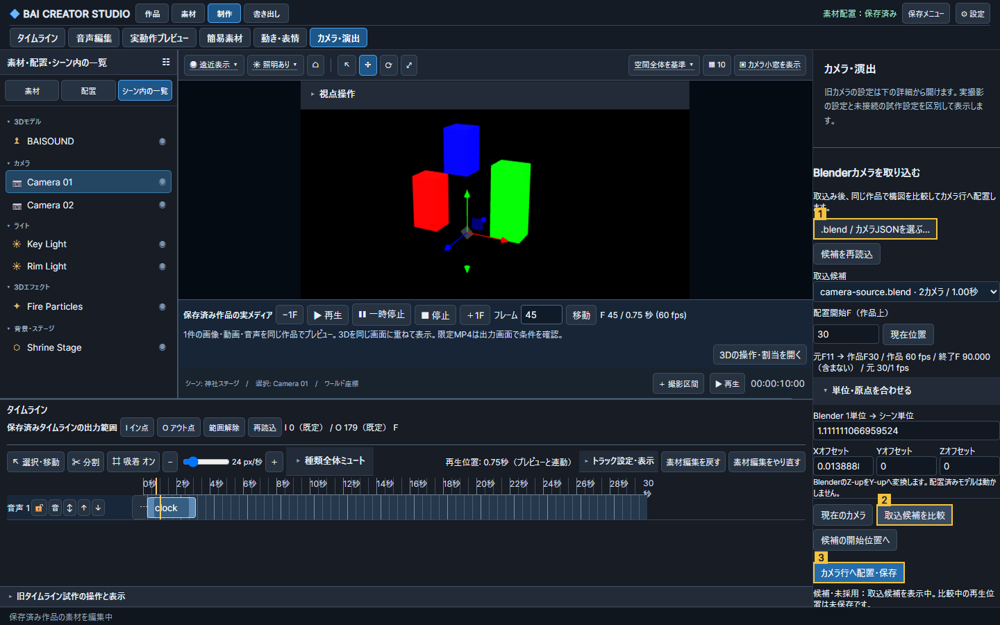

# CAM-019-B1：Blenderカメラの取込

Issue #238。Owner指定の次作業。直接取込を実装し、生成Blenderシーンの限定経路を検証済み。CinemaOperator本体の登録/起動/Bake連携とは分け、追加アドオンなしの既存カメラ取込を先行する。

## 選んだ経路と境界

実Blender 5.2.2 Windows/Ubuntuがある。生成fixtureで`frame_set`によるカメラマーカー切替、評価済みワールド行列、`calc_matrix_camera`の透視/平行・シフトを取得できることを確認した。`.blend`を別プロセス（factory-startup / disable-autoexec）で読み、同梱の読取り専用exporterで評価済みJSONへ変換する。JSONも同じ取込APIで検査する。元ファイルを保存し直さず、開いているBlenderを操作しない。GLBだけでは元FPS・切替・シフトを十分に保持できないため、B1のカメラ入力にはしない。

- 元fps/fps_base、開始/終了F、解像度/ピクセル縦横比/単位、カット、評価済み行列/投影とレンズ/シフト/DOF値を保存。
- 元開始Fを作品の配置開始Fへ対応付ける。作品FPSでBlenderをサブフレーム評価し、カット境界と終了の補助標本も保持する。異なるカメラを補間しない。FPS変更後は再取込を求め、古い標本を新しいFPSで合格扱いしない。
- BlenderのZ-upをStudioのY-upへ変換。正のスケールとXYZオフセットで原点/単位を合わせる。初期値はBlenderの単位情報。モデルの自動正規化とは別であり、モデルや素材を勝手に移動しない。
- 実投影行列を保持し、シフト・センサーフィット・平行投影を通常のFOVへ近似しない。元の撮影比率で3Dをレターボックス表示し、狭い操作画面や16:9のMP4で構図を引き伸ばさない。
- 透視/平行を対応対象とする。パノラマ・非剛体のカメラ行列・無効行列は理由付き拒否。DOF等は元値を保持し、未適用項目を明示し、了承なしに採用しない。無効なスクリプトドライバーの評価結果を採用せず、Blender側の評価済みJSONを案内する。
- 初期上限：元blend 100MiB / JSON 32MiB / 120秒 / 30,000標本。失敗・停止時も元ファイル、既存候補、採用済み作品を保持する。

## 操作（Operate：既存UIの拡張）

上位3タスクは「取込」「既存カメラと候補を比較」「作品のカメラ行へ配置・保存」。既存のカメラ・演出の右操作欄へ短い入口を置き、カメラの実プレビュー/タイムラインは既存画面を使う。独立した大きな別ヘッダーを追加しない。単位/原点の詳細と保存メタデータは折畳み、長い名前は全文を確認できる。

候補は別名・不変ファイルで保存するが、取込だけでは作品配置を変更しない。「現在のカメラ」「取込候補」で同じ作品時刻を比較。「カメラ行へ配置・保存」で開始F・配置/シーンrevision・FPS・原本hash・カメラ行のロック/重なりを再検査し、クリップを1操作で追加する。既存カメラは削除せず、重なれば開始F変更か既存クリップ移動を案内する。既存の素材編集Undo/Redoを使い、候補ファイルはUndoで削除しない。選択・作品・入力の変更/画面離脱で一時比較を解除する。

読込中/候補・未採用/比較中/配置済み/拒否を文字で区別。ラベル、キーボード、focus-visible、失敗時の入力への復帰、狭幅の操作到達性を検証する。旧カメラ設定は保持する。アドオン本体の模倣/同梱はしない。

## 保存・共通API

候補はプロジェクト識別子と入力hash・正規化track hashへ結ぶ。名前からファイルパスを作らない。登録カメラは独自sourceの読み取り専用素材として既存inventoryへ出す。カメラ行の配置は既存arrangementへ追加し、履歴は同じファイルの1回の原子的置換で確定。保存/候補取得/レンダー時にhashを再検査する。任意のローカルパス読取りAPIは作らない。

標準MCP/WebMCPは評価済みJSONの取込、候補一覧/取得、context、採用を同じサービスで扱う。手動UIには`.blend`ファイル選択も備える。標準MCP単独のBlender GUI操作/任意パスからのファイル読取を実装済みとは呼ばない。

## 受入・試験

1. 生成Blenderシーンの親/制約/ロール/センサーFit/シフト・透視/平行・カットを、開始/中間/終了/境界前後で行列と目印の画素位置まで照合。
2. 元開始Fが0以外、30/29.97/60fpsと異なる作品FPS、縦横比/ピクセル縦横比、単位換算とオフセットを検証。
3. 候補取込/比較だけでは作品・旧カメラ不変。採用/保存再読込/移動・長さ/Undo/Redo/競合/ロック/重なり/破損hash/不正JSON/停止でfail closed。
4. 同じ時刻のプレビューと実MP4を比較。既存VMDカメラ/表情/接地の回帰。Windows/Linux、実Blender/実GPU/ブラウザー/両MCPを区別。
5. 番号付きスクリーンショットとJSONを正本/Owner確認画像フォルダーへ保存。実制作の原本/識別子/画像は公開しない。公開用は生成fixtureだけ。

重要UI改修のため3視点で設計/実装を批評し、Root Judgeが必須指摘を解消して採用する。パノラマ/DOF再現、全制約/全ドライバー/全版、CinemaOperator実アドオン往復、一般のBlenderシーン往復は今回の限定合格へ含めない。

## 実装前の3視点批評・Root Judge固定事項

- Critic1/3：開始Fは比較前に入力し、「元開始F→作品開始F、作品FPS、配置終了F」を表示する。候補区間外は現在の保存カメラを表示し、勝手に先頭/末尾へ固定しない。DOF等の実際の未適用項目だけを採用ボタン直前に出し、通常のラベル付きチェックボックスで「この差を了承して配置」を選ぶ。
- Critic2 P1：元fpsを`r=source_fps/source_fps_base`とし、元区間は整数`[source_start, source_end+1)`。長さ`D=(source_end+1-source_start)/r`、作品開始Fを`p`、作品FPSを`q`として、作品時刻`t`の元Fは`source_start+(t-p/q)*r`。作品区間も半開。元カットFを越えたちょうどから新カメラ。作品Fへ丸めてカット位置を変更せず、標本に元カット時刻と直前の補助点を含める。同一カメラ間は位置の線形/回転slerp・投影行列の線形補間。異なるカメラ/投影形式間はカットとして扱う。元範囲を越える末尾延長は拒否する。
- Critic2 P1：通常描画と`captureFrame`は共通の取込投影/レターボックス描画関数を呼び、リサイズでも保存投影を復元する。解除/区間外/VMD復帰は取込専用カメラを外し、既存カメラ/制御を保持する。projection/inverse/up/view-offset/viewport/scissorの状態を漏らさない。
- Critic2 P2：比較APIは候補hash・単位/offset・開始F・FPS・scene/arrangement revisionを含む比較条件を返す。採用時に全条件を再照合する。どれかを変更したら比較を解除し、新条件で比較するまで採用を無効化する。

Root Judge：上記を採用し、実装着手可。実装・画素/実機の合格ではない。

## 使い方

1. 作品を選び、「制作 → カメラ・演出」右欄の「.blend / カメラJSONを選ぶ…」でファイルを選ぶ。取込だけではカメラ行を変更しない。
2. 配置開始Fを入力し、「候補の開始位置へ」→「現在のカメラ」「取込候補を比較」で同時刻の構図を確認する。必要なら「単位・原点を合わせる」で倍率/XYZを設定する。
3. 「カメラ行へ配置・保存」で確定する。既存カメラと重なる場合は開始Fか既存クリップを移動する。採用後は通常の時計、素材編集Undo/Redo、動画書出しを使う。

比較用に保存作品の終端を越えて移動できるが、一時範囲と比較中の再生位置は保存しない。解除すると元位置へ戻る。採用後は実配置に従って共通時計の終端を更新する。入力や作品を変更したら再比較する。DOFが有効な元データでは「未適用」の表示を読み、了承を選ぶまで採用できない。

### Blenderの実行環境

サーバー環境変数`MIXAMO_BLENDER`にBlender実行ファイルを設定する。未設定時はPATHの`blender`を探す。これは既存のBlender処理と同じ設定で、秘密鍵は不要。未検出なら理由を表示して作品を保持する。新しい設定はサーバー再起動で反映する。

Blender側で評価済みJSONを作る場合の例（実行前に必要な親/制約/ドライバーを確認する）:

```powershell
blender --background --factory-startup --disable-autoexec camera.blend --python-exit-code 1 --python tools/export_blender_camera.py -- --output camera.json --sample-fps 60
```

`sample-fps`は取込先作品と同じFPS。Studioが解釈するJSONは`bai-blender-camera-v1`であり、一般のBlender設定JSONではない。既定圧縮Zstandard、非圧縮、gzipの.blend署名を受理する。アップロードの一時.blendは取込終了時に片付け、元.blendは保存し直さない。

## 実装レビューと試験記録

3視点の実装批評で、折畳み内の不正入力への復帰、Enter後のfocus、採用後の共通時計更新、元尺の許容誤差を指摘。修正後に3名ともソース確認の限定PASS。親担当が実Chromeで操作/時刻/非保存を測定した。Critic自身の再操作、スクリーンリーダー・200%拡大・全Tab順はNOT TESTED。

既存回帰で、非同期シーン再読込中の時計イベントが旧VMD視点を復帰先へ混ぜる失敗を検出。保存済み視点を確定した直後に復帰snapshotを再取得し、旧active clipを解除するよう修正した。初回の失敗ログは非公開ローカルに保持する。診断メッセージ追加の一時試験も1回失敗（診断変数の参照位置）、訂正して原因を特定した。

機械処理用の結果・指摘ID・判定は[同名STATUS JSON](BLENDER_CAMERA_IMPORT_B1_STATUS_20261113.json)。番号付き画像の①取込、②比較、③配置保存は生成fixtureだけを使用し、実制作ファイル/識別子を公開しない。



### 未完・未検証

- Blender5.2.2以外、全制約/全ドライバー/追加アドオン依存・任意の実制作.blend、長尺と大規模カメラ。スクリプト自動実行は有効化しない。
- LinuxのStudioブラウザー/GPU/実MP4。Ubuntuは実Blenderの評価/画像とPythonを確認し、その生成データをWindows Chrome/MP4で照合した。
- DOFのボケ効果、パノラマ/反転/せん断、一般シーンの往復、カメラ分割。既存の移動/元区間・長さ/Undo・保存は対応する。
- CinemaOperator実アドオンの登録/起動/操作/Bake/往復は未実装。Issue #238とCAM-019全体、順3全体を完了扱いにしない。

モデル区分：原因調査・設計判断・実装/実機検証は親担当の高性能モデル、規定の3視点批評は既存Criticを再利用。新しい実装ワーカーは起動していない。

最終確認：Windows/Ubuntu Python各64成功、Node関連5成功＋既存VMD/表情/口の回帰1成功、型成功。既存回帰の並行GPU実行時のcapture読込待ち時間切れは残し、単独再実行で成功を確認した。一括初回は5成功1失敗のまま記録する。

実装`54a5ec9`を[PR #311](https://github.com/baisound/BAI_CREATER_STUDIO/pull/311)へ統合。公開用の[統合記録](../../qa/blender-camera-main-sync-20261113.json)とローカル確認の詳細を分け、後者はOwner指定Evidenceへ保持する。
