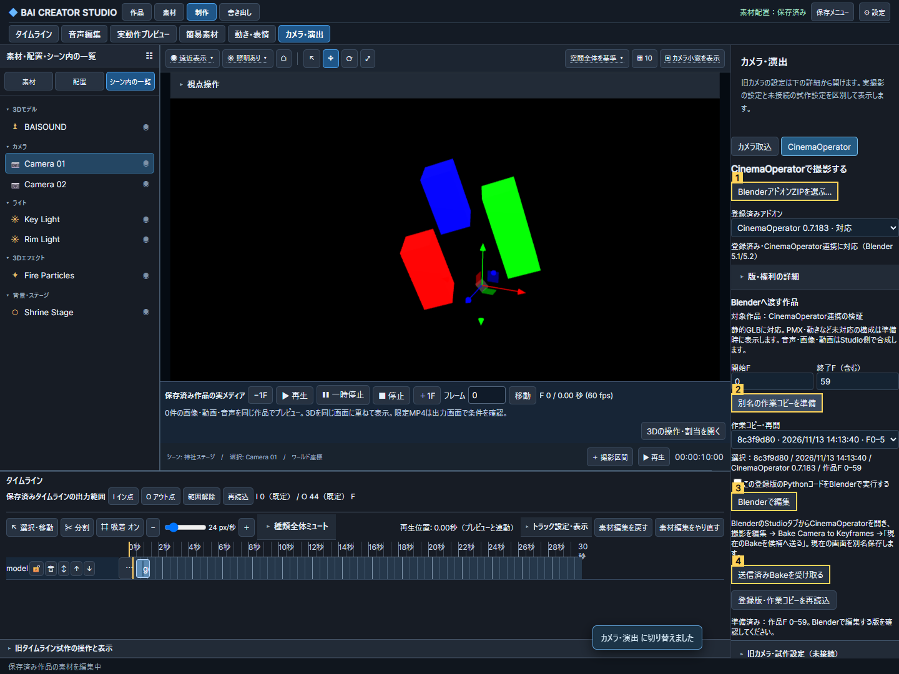

# CAM-019：CinemaOperator本体の登録・起動・Bake連携

Issue #238、既承認設計A〜Dの実装単位。B1の評価済みカメラ取込/比較/採用を再利用する。アドオン本体・配布物・実素材はGitへ含めない。

## 実装前の境界と3タスク

Operateとして既存「カメラ・演出」を拡張。上位タスクは①ZIPを検査・登録、②対象作品/区間の別名コピーをBlenderで編集、③Bake済みカメラをStudio候補に戻して比較・採用。登録とコード実行を分け、選択した配布セット内のZIP名/版を表示する。作品・区間・対応/未対応素材を起動前に示す。詳細/権利/ハッシュは折り畳む。

- ZIP：サイズ/展開量/件数/圧縮率/重複/暗号化/シンボリックリンク/絶対パス/親逸脱を静的検査。`bl_info`はASTのliteralだけ読む。配布セットの内側を明示選択する。ハッシュ別不変保存。未知版は登録できるが実行不可。既存0.7.183の確認済み内側ZIPだけを初期アダプター対象にする。
- 実行：ユーザーがローカル画面で対象アドオンと作品/範囲を確認して操作したときだけ、別プロセスのBlenderを可視起動。通常のBlender設定/開いているシーンを変更しない。MCPのopenは`requires_local_action`。任意実行パスは受け付けない。
- シーン：原本を別名コピーし、作品FPS/区間/変換/素材hashとscene/arrangement revisionをmanifestへ固定。初期の橋渡しは静的GLB（既存正規化/legacy単位、配置変換、表示区間）。PMX/VRM/FBX、割当モーション/表情/口、親子配置など再現できない構成は一覧で理由付き拒否。隠して撮影成功にしない。一般シーン往復の完成とは区別する。
- Blender：実CinemaOperatorをそのまま登録し、元のUIとBake操作を使う。Studio補助パネルは「Bake済みカメラを戻す」だけを扱う。作成済みBakeのカメラ印/範囲/キー/マーカー・FPS/範囲/投影を検査し、B1 exporterで評価済みJSONへ戻す。未Bakeなら拒否。元のカメラ・アドオン設定・作業コピーを保持。
- 候補：戻したJSON/作業blend/入力ZIP/manifestのhashを記録。作品条件が変われば再準備を案内。明示取込まで作品を変更せず、取込後もB1の比較/採用が必要。候補と紐付く登録版/セッションは削除不可。削除操作は無参照版の登録解除に留めファイルを保持する。
- 中止/失敗：一時処理の失敗と既存作業コピーを分離。準備は時間制限付き別プロセス。起動後は外部Blenderを勝手に終了しない。再起動/保存再読込で同じセッションと候補を表示。作業コピーはアドオン版ごとに固定する。

## 受入と記録

生成GLBの位置/大きさ/同時刻をStudio/Blenderで照合。確認済み実アドオン0.7.183の可視UI・撮影編集・Bake・別名保存再読込・候補比較/採用・MP4を実行する。ZIP異常/未知版/未Bake/範囲欠落/切替重複/古いrevision/途中失敗/参照中解除を検査。Windows/Ubuntu・手動/両MCP・実GPU/MP4を区別し、未確認をNOT TESTEDとする。

公開する画像は生成fixtureだけ。番号付き画面・指摘ID/優先度/根拠/対処/検証をJSONに残し、Owner指定の確認フォルダーにも保存・読み戻す。公開記録は製品機能と試験結果へ限定し、所有データの集約値やローカル実行情報を外部コメントへ送らない。

状態：静的GLBの代表経路を実装・限定検証。PMX/動き等を含むA〜D全体とCAM-019全体は未完了。

## 3視点の設計指摘を採用した固定契約

- Critic1/3 P2：BlenderのStudioタブに実CinemaOperatorのコンソール/Bake入口と「現在のBakeを候補へ送る」を置く。送信操作はメモリー中の現在状態を別名blendへ保存し、評価済みJSONと原子的receiptを確定する。Studioは「送信済みBakeを受け取る」と明記し、Ctrl-S前の古い作業ファイルを暗黙に読むことはしない。内側ZIP・未対応版の理由を表示し、段階移行後のfocusを登録/開始F/起動/比較へ戻す。
- Critic2 P1：sessionのscene/arrangement revision・FPS・原本hash・manifest hashを戻す時、B1比較時、B1採用時に再検査する。古いBlenderシーン由来のカメラを新しい作品へ無言採用しない。採用済み作品の再生は固定した候補データを使う。
- Critic2 P1：作品F `p` はBlenderF `p+1`、native fps/baseの商=作品FPS。作品区間は`[開始F,終了F+1)`、Blender範囲は`開始F+1..終了F+1`（終端標本はB1と同じ）。元GLBの正規化は一度だけ、作品変換後のワールドをZ-upへ変換し、戻す候補の倍率は1/offset0。途中出現/消失は全timeline_windowsの半開区間で保持。重複切替、未Bake、フレーム/FPS変更は拒否する。
- Critic2 P2：送信ごとに別名blend/JSONを作りhash固定。書込完了後にreceiptを原子的置換し、読取中変更はhash不一致で拒否する。送信snapshotの時刻を表示し、失敗後も作業コピー/登録版は保持する。

Root Judge：上記を必須として実装を進める。設計判定であり、実画面/往復合格ではない。

## 操作と現在の対応範囲

「制作 → カメラ・演出 → CinemaOperator」で、①アドオンZIPを検査して内側ZIPを選び登録、②作品と開始/終了Fを確認して別名作業コピーを準備、③実行する版を確認して「Blenderで編集」。実BlenderのStudioタブからCinemaOperatorを開き、本来の撮影コンソールで調節する。

Blenderの「Bake Camera to Keyframes」から範囲を選択してBakeし、「現在のBakeを候補へ送る」を押す。これはCtrl-S前の現在状態を別名snapshotへ保存する。Studioの④「送信済みBakeを受け取る」で送信日時/作業コピーを確認し、B1の「候補の開始位置へ → 現在/候補を比較 → カメラ行へ配置・保存」へ進む。取込だけでは作品に採用しない。

撮影対象は静的GLB（通常の2m正規化/legacy単位・配置変換・タイムライン表示区間）。音声/画像/動画はStudioで合成する。PMX/VRM/FBX、スキン、割当動作/表情/口、親子配置、必須glTF拡張や外部URIは未対応として準備を止める。0.1〜120秒、GLB32個以内・1個100MiB/合計200MiB、Blender5.1/5.2、確認済みCinemaOperator0.7.183の内側ZIPを対象とする。実機確認は5.2.2 LTS。別版の静的登録と実行可否を分け、互換版へ無断更新しない。

Blender起動には既存の`MIXAMO_BLENDER`設定を使う。プロセス・設定フォルダー・作業blendを分離し、通常のBlender設定と素材原本を変更しない。準備時に専用プロファイルだけへ初期設定を作り、繰り返しの初回案内を避ける。ready通知を確認できなければ成功表示しない。起動済みBlenderを無断終了せず、保存した作業コピーを再選択して再開できる。標準MCP/ネイティブWebMCPのopenはローカルの手動操作を案内し、外部ツールからコードを実行しない。

## 検証と制限

- Python：Windows/Ubuntu各79成功。ZIP逸脱/重複/リンク/圧縮爆弾/CRC破損、静的登録、無参照版の登録解除、参照版拒否、未Bake、条件/原本/receipt変更を検査。型チェック成功。
- Node：関連6成功（CinemaOperator/B1実Blender取込/VMDカメラ・動き・表情/口/MP4、純カメラ計算3）。実Chrome/RTX4070SUPER。CinemaOperator単一カメラとA/B PROGRAM（元F1/31の2カット）を実Bakeし、60F MP4のF0/15/30/59の優勢色マスク重心を実Blender画像と照合。色管理/材質の一致ではなく構図の位置を検査する。
- 可視UI：Studioの実行操作から実BlenderのCinemaOperatorコンソールを開き、50mmへ変更。本来のBake範囲/確定ダイアログからBakeし、未Ctrl-Sの状態をsnapshotで戻してStudio比較・採用まで確認。別名snapshot/保存した作業blendを保持した。
- Ubuntu：実Blender5.2.2で静的シーン準備、実アドオンBake、snapshot返却、候補比較条件と採用を確認。Linuxブラウザー/GPU/MP4はNOT TESTED。
- 被写体保護：メッシュ・配置・親子/parent inverse・表示曲線/その評価状態をfingerprintで照合。実Blenderで直接移動/未タグ親/parent inverse/表示muteの4負例を拒否し、復元後は返却/採用できることをWindows/Ubuntuで確認した。カメラとアドオン補助物以外の編集はStudioへ戻さない。

初回のZIP区切り検査失敗（WindowsのZipInfo正規化）をorig_filename検査で修正した。可視UIで発見したコンソール入口の無効状態を、本来のVIEW操作と初期ショットへの接続で修正。参照画像の色管理差による色抽出失敗は優勢色マスクへ測定器を修正し、構図比較と色品質を区別した。Ubuntu検証用スクリプトのimport/path/一覧形状の先行失敗はローカルに保持し、製品の形式制限は緩めていない。

3視点の実装批評では、送信日時と再開コピーの識別、被写体変更の検知、親/表示評価の抜けを修正した。Critic1/3はコード/画像の限定PASS、Critic2の必須指摘も実負例で解消。Root Judgeは上の代表範囲だけを統合可とする。Critic自身の実操作、実スクリーンリーダー/200%拡大/全Tab順はNOT TESTED。

一般Blenderアドオン互換、別版・全ドライバー・全撮影項目、全長尺、PMX等/動作を伴う同一作品の橋渡し、DOFのボケ再現は未完。登録/起動/Bakeの代表経路の成功をCAM-019全体や順3全体の完成にしない。アドオン本体・マニュアル画像・生ログ・ローカル実行情報をGitへ含めない。

機械可読の指摘/試験/未確認：[STATUS JSON](CINEMAOPERATOR_BRIDGE_STATUS_20261113.json)。公開画像は生成fixtureの①登録、②準備、③Blender起動、④送信済みBake受取。

モデル区分：原因調査・設計・実装・実機検証は親担当の高性能モデル、既存Criticを3視点の批評に再利用。新規実装ワーカーなし。

追加確認：標準MCPのZIP検査・準備、ChromeネイティブWebMCPの登録・準備、両MCPのBake候補受取/同一候補ID・一覧/起動拒否を実呼出で照合。3個の同一区間コピーを識別して選べることを確認。MCPの登録解除ツールの実呼出はNOT TESTED（同じサービスの参照拒否/解除はPythonと手動APIで検証）。
