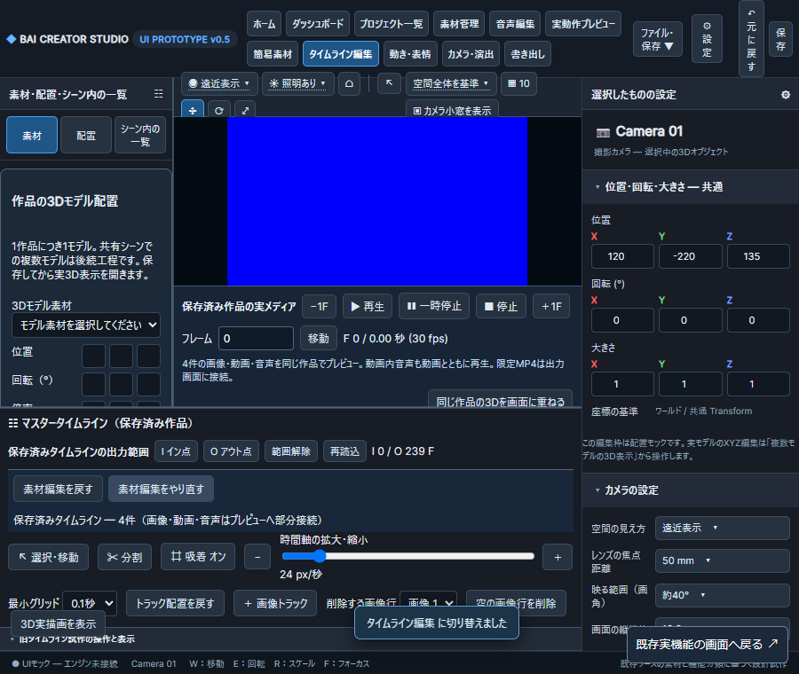

# 順3 G3-C：素材クリップの編集履歴（2026-11-12）

対象：DATA-002/008、RENDER-001/006、Issue #81/#63/#82。Ownerの「OGVは要望していない・優先度低い・次へ」を受け、長尺OGVを低優先の互換性残件へ戻す。OGV短尺対応を削除せず、長尺未検証も完了にしない。元の7段階は維持する。登録台帳の今回の読取ではOGVは0件、動画はMP4が1件。

## 実装契約（着手時）

現行は一括移動の直前取消のみ。通常の配置/移動/端調整/分割/削除と、やり直しの共通経路がない。既存の素材配置データにクリップ編集履歴を保存し、専用の「素材編集を戻す」「素材編集をやり直す」を同じAPI/両MCPへ接続する。

- 最大32操作、履歴の総容量上限8MiB。古いものから除外し、現クリップを失わない。履歴は素材の実バイトを含まない。
- Undo/Redoも単調増加revisionを使い、作品を混ぜない。新規編集でRedoを破棄。保存再読込で継続。
- 配置/単体編集/分割/一括移動/モーション対象のメタデータ変更を記録。行配置・音量/ミュート・PMX表情/口・カメラの別保存履歴は含めない。アプリ全体のUndoへ拡大しない。
- 既存一括UndoのAPIとMCP名は保ち、一括移動以外を勝手に取り消さない。旧保存の有効な一括取消情報も保持する。
- 変更されるクリップの元/先トラックのロック、復元先の行、時刻/元尺を検査。削除した行を無断再作成しない。競合・履歴なし・壊れた履歴・書込み失敗は保存しない。
- 保存クリップIDと元位置、長さ・順序・対象モデルを正確に戻す。素材本体は変更しない。履歴の生snapshotをタイムライン表示用APIへ送らず、可否/件数を送る。

## 受け入れと試験の境界

隔離画像/動画/音声の配置、元区間変更、分割、移動、削除、一括移動をUndo/Redoし、保存再読込と前後クリップ値を比較。実Chrome手動ボタン、公式SDK継続stdio、ネイティブWebMCPから同じ結果を得る。分割後の移動を戻した元区間と画素/PCMを短尺MP4で照合。ロック/古いrevision/削除済み行/異常履歴/書込み失敗、32件と容量境界を確認。Windows/Ubuntu Python、Windowsブラウザーを分けて記録する。

G3-C全体、全媒体の実作品/実GPU/Linuxブラウザー・全操作への一般化はこの段階だけで完了にしない。モデル区分：高性能（設計・安全性・実装・検証）、サブエージェントなし。

## 使い方

タイムライン上部の「素材編集を戻す」「素材編集をやり直す」を使う。操作結果は作品へ自動保存され、開き直しても継続する。履歴がないボタンは無効。新しい素材編集をするとやり直しの履歴が消える。上部の旧モックの「元に戻す」やアプリ共通Ctrl+Zを接続したという意味ではない。

両MCPはbai_studio_arrangement_getで現在のrevisionを取り、bai_studio_clip_undo / bai_studio_clip_redoへproject_id・revisionを渡す。HTTPはPOST /api/studio/v05/arrangement/history/undo または /redo。旧bai_studio_batch_undoは直前が一括移動の場合だけを取り消し、通常の分割や移動を誤って取り消さない。

別方式のシーン内モデルへの動作割当、VMD候補採用等が配置revisionを変えると、以前のクリップ履歴は失効して誤復元を拒否する。次の通常クリップ編集から新しい履歴を開始する。従来のtarget_model_id指定のメタデータ履歴は対象だが、別保存のシーン実体や候補採用の履歴を変更しない。旧保存のschemaは維持し、読取だけでは履歴を書き込まない。

## 実測と回帰

WindowsのChrome156.0.8078.80、公式MCP SDKの継続stdio、実document.modelContext.registerToolのネイティブWebMCPと手動ボタンを使用。Ubuntu WSLはSDK/API/FFmpegだけでLinuxブラウザーを使っていない。

合成動画＋生成WAV＋青画像、および前回と同じ実214秒480pコピー（SHA-256 c895d1da79dfddb4c93210b778b74d727be225ac5c07a2c5d6c5a399093f89d6）＋生成WAV/画像を、各OSの隔離作品で使った。実MP4の先頭から約5秒までを使う8秒の出力であり、230秒全尺の履歴検証ではない。動画は作品1秒/4秒/元0.5秒、音声は作品2秒/3秒/元0.7秒。動画を3秒で分割し右片を5秒へ移動、音声を削除した。

Undoで3操作を戻すと、同じクリップID・順序・元素材位置へ戻り、出力240Fの32×18 RGB framemd5署名と8kHz/mono PCMの全バイトSHA-256が操作前と一致。Redoで編集後と一致し、操作前の署名とは異なることを確認した。AAC320kの通常出力で、H264/AACへ完成した動画を再読込して測定している。OSごとに生成したWAV/画像は異なるので、OS間の出力バイト一致を主張しない。実MP4だけは同じ入力hashを確認した。

- Windows最終の実動画＋関連回帰はNode5成功・0失敗・0skip。合成/1280px・900px操作と強制再描画の最終追加はNode2成功・0失敗・0skip。
- Ubuntuの合成と同じ実MP4は各Node1成功・0失敗・0skip。WindowsとUbuntuのPython回帰は各141成功・0失敗・0skip、対象モデルメタデータの追加1件を含む履歴対象17件も各OSで成功（16件は回帰141件と重複）。
- 新規履歴17件では、32操作・容量境界、画像/動画/音声、削除した行、追加の編集によるRedo破棄、旧一括履歴、外部revision変化、異常履歴/時刻/元尺/重複ID、OSError書込失敗注入を確認。
- Windows型とPython/Node構文成功。元の素材/登録後バイトと以前の完成物はhash不変。ガード対象は作業木data5ファイル/exports不在。

[合否とソースhash](../../qa/clip-history-evidence-20261112.json)、[Windows実動画](../../qa/clip-history-windows-real-20261112.json)、[Ubuntu実動画](../../qa/clip-history-linux-real-20261112.json)、[Windows合成](../../qa/clip-history-windows-generated-20261112.json)、[Ubuntu合成](../../qa/clip-history-linux-generated-20261112.json)。素材本体/実MP4/実映像の画像はGitHubへ含めず、画面画像は生成した青背景だけを使用した。

## 発見した関連不具合と先行失敗

一括編集だけ元素材尺の検査が欠けていたため、単体編集と同じsource_window判定を加え、元尺超過時は保存/履歴不変を検証した。

画像行削除の回帰は2回の失敗と診断で、再描画によって選択した画像行2が行1へ戻り、クリップがある行1の削除として拒否されることを確認。未変更main69db20fの同じ隔離試験は1回成功。同じ作品では再描画直前の選択を保つ修正を入れ、強制再描画を加えた回帰を成功させた。許容値・待機上限を緩めていない。

新試験の初回はbrowser evaluateへNode側のbefore値を渡していなかったReferenceError。値を引数で渡して修正した。Windows Python初回は制限環境のWinError10013でHTTP16件失敗・125成功、通常環境で同じ141件成功。先行一括の3成功1失敗と単独失敗、診断失敗、修正挿入失敗を含む中間ログはqa/clip-history-*として保持し、最終合格に数えない。

## 再実行

PowerShellでCHROMIUM_PATHをChrome実行ファイルへ、BAI_TEST_CONCURRENCY=1を指定し、node tests/run-guarded.cjs tests/studio-v05-clip-edit-history.test.cjs tests/studio-v05-direct-timeline.test.cjs を実行。既定は合成素材。実動画の短区間を試す場合だけBAI_HISTORY_REAL_VIDEOに既存MP4の読取パスを指定し、BAI_HISTORY_OUTは数値結果の保存先とする。BAI_HISTORY_SCREENSHOTを指定する場合は合成素材だけでOwner指定確認先へ保存する。Ubuntuは同じMP4の/mnt/d/...パスとBAI_HISTORY_API_ONLY=1でLinuxのNode/python3/FFmpegを使用する。

## 次の位置

G3-Cのクリップ編集履歴の限定経路は検証済み。G3-C全体、行/ミュート/表情/カメラ/全体Undo、任意実作品/実GPU/Linuxブラウザー・全競合は未完。OGV長尺は低優先。次はG3-Dの既存完成物を守る出力失敗/中断・再開の証拠を整理し、実制作に影響する不足を選ぶ。G3-AやG3-E/F、順3全体、順4/5、既存証拠ゲートと依存監査の未解決も保持する。

## main・制作画面の同期

[PR #286](https://github.com/baisound/BAI_CREATER_STUDIO/pull/286)をmain078c1b6へ統合。利用者main/既存codex-nextをfast-forwardし、起動元を確認した8765番のPythonをPID21332から34300へ非表示再起動。HTML/asset-workflow-v06.js/webmcp.jsの全バイトがmainと一致し、既存作品のGETに新しいedit_history件数が返ることを確認した。履歴snapshotをGETへ送っていない。

旧Chromeタブ1055945654は取得できなかったため、同じ制作URLを同じChromeの新タブ1055946273で開き、タイムライン編集の新しい2ボタンと既存2クリップを確認して保持した。過去の履歴がない旧作品では両ボタン無効で、新しい編集から保存履歴が作られる。既存作品へ試験編集を加えていない。

利用者data/exports/studio.zipの515ファイルと変更一覧は前後一致。集約SHA-256は89b7599826236e16936fcb87ea33d705d29801d3515c1d8e78474896cfe4286d。[同期証拠](../../qa/clip-history-main-sync-20261112.json)。[Issueの確認画像](https://github.com/baisound/BAI_CREATER_STUDIO/issues/81#issuecomment-6807836348)は合成素材だけで、配信PNGと確認原本のバイト一致も確認。

GitHub自動checkの登録なし。ローカル検証と区別する。次はG3-Dの出力失敗/再開・旧完成物保持の不足。OGV長尺は低優先、G3-C/順3全体や既存未解決は維持する。
