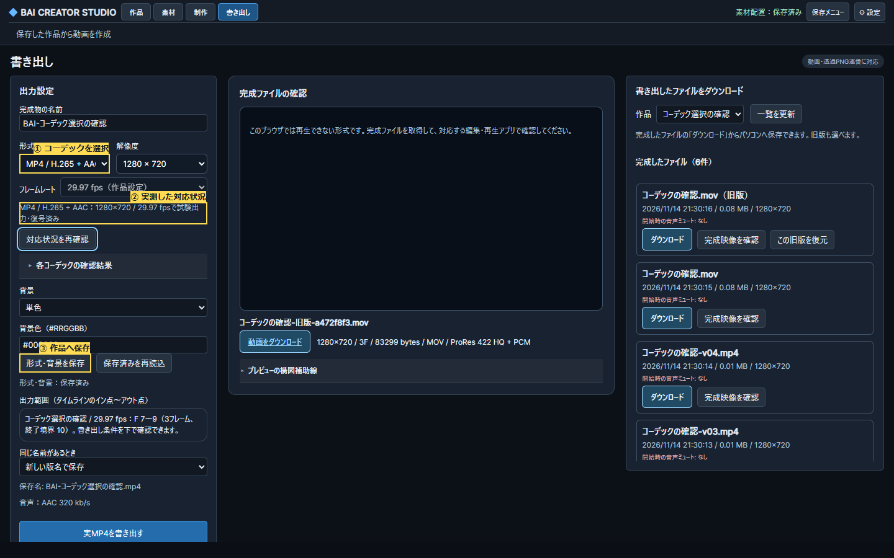

# コーデックの対応確認と選択（#330、実装と限定検証）

RENDER-004/006、O-RENDER-01。上位3操作は①使える形式を確認、②形式/背景を作品へ保存、③同じ作品範囲を出力して受け取る。既存の形式欄と保存/完成一覧を拡張し、画面は増やさない。

固定候補：MP4 H.264/AAC、H.265/AAC、VP9/AAC、AV1/AAC、MOV ProRes422 HQ/PCM、既存RGBA PNG/WAV ZIP。動画は不透明。任意encoder/FFmpeg文字列は受け付けない。H.264を既定に維持し、旧呼出し/旧設定/版管理/PNG再開を保持する。

FFmpeg/ffprobe実体・更新情報、プリセット、解像度、作品FPSをキーとして短い実映像/音声の試験出力をキャッシュする。encoder列挙だけでは合格にせず、フレーム数/寸法/FPS/映像と音声codecの検品と実復号まで通す。検査中/失敗理由を表示し、未対応の組合せを選択・保存・投入で拒否する。他の形式が使えないときも旧完成物は取得できる。ジョブはencoderと設定を固定し、完成物も選択codecで検査する。

AACは既存320kb/s、ProResは48kHz/stereo/24bit PCM。音声欠如で無音形式へ黙って切り替えない。MP4とMOVは同じ名前でも拡張子ごとに版管理する。ブラウザ再生対応とファイルの実復号を区別し、再生できない形式は取得して外部アプリで確認できる。

受入：Windows/Linuxで全固定候補を実測し、有効な候補だけ非0In/29.97fpsで出力・復号・音声時刻・保存再読込・旧版保持/復元。解像度/FPS違い、encoder不在/失敗/破損/無音声/競合、手動/API/標準MCP/native WebMCP、既存PNG再開とMP4回帰。実GPU/実モデル/全codecの長尺・聴感は別に未検証を保持する。表示の番号付き画像と検証JSONを保存。

モデル区分：設計/実装/調査は高性能、3視点UI批評は標準。既存のOperate画面を保つ。

## 操作と互換性

書き出し画面で「形式」を選ぶ。現在の解像度・作品FPSで実測済みの候補だけが選べる。「形式・背景を保存」で解像度も保存し、出力ボタンで別名の完成物を作る。MOVはProRes422 HQ/PCM、不透明。MP4各形式はAAC320kb/s。透過は既存のRGBA PNG/WAV ZIPを使う。音声素材がない作品も従来の無音トラックを含め、音声encoder不在で勝手に映像のみへ変えない。

「各コーデックの確認結果」に未対応理由をまとめ、再確認ボタンではキャッシュを使わず再測定する。保存済み形式が環境変更で使えなくても、H.264へ黙って置き換えない。設定再読込/解像度変更の際は旧測定を失効し、作品/解像度/FPS一致の結果だけで保存/出力を有効化。検査失敗でも旧完成物を取得できる。ブラウザーに再生能力がないMOV等はplayerへ渡さず、取得して外部アプリで確認する案内を出す。

従来のAPI省略呼出しは黒背景H.264/AAC。旧設定に解像度がない場合は720p。保存revision指定時は形式と解像度の一致も必須。MOV/.mp4/.zipを別の名前として版管理し、同じ拡張子内の明示置換/旧版復元でも元バイトを保持する。標準MCP/WebMCPも同じAPI。任意encoder・シェル文字列は受け付けない。

ProResの大容量化への必要な保護（RENDER-004/006）として、動画の作業ファイルは2GiB以内を監視し、超過時に子処理を止め、未完成物を回収して旧完成物を保持する。2GiBの実負荷試験は未実施で、試験では閾値を下げた実ProResで拒否と保護を確認する。

## 原因を確認した修正と試験の読み方

3Fの実出力で単一コンテナのframes:v制限が音声を4096/4805標本で終了させることを検出。既存filterの正確なフレームtrimを使い、出力側のframes:v制限を除去した。完成物は映像codec/寸法/FPS/フレーム数と音声codec/48kHz/stereo/尺（16標本以内）、全映像/音声の実復号で検査する。Ubuntuの1F MP4ではmovie時刻の丸めも検出したためmovie_timescaleを48000へ固定し、許容差を緩めず24/29.97/60fpsの1/3/17/60Fを確認する。

先行失敗は、旧試験がMOVを危険な拡張子としていたこと、音声末尾欠け、Ubuntuの1F時刻、容量試験が新しいWindows FFmpegで廃止されたfilter引数を固定していたこと。PNG試験中にAgentがソースを変更した途中ゲートも失敗のまま保持し、最終固定ゲートと分ける。Rawと正本ログはqa/codec-selection-20261114/、指摘ID/測定値/未確認はCODEC_SELECTION_STATUS_20261114.json。

before.pngは基点main fef8e92の出力JSを隔離ページへルーティングした比較用画像（HTML/CSS全体の過去復元ではない）。公開画像は生成素材のみ。設計/実装は高性能、初手/導線/視覚の標準3視点は必須P2を修正しソース限定PASS、実操作とRoot判定は別のゲート。

長尺/実2GiB・全モデル/材質/ICC/HDR・全解像度/FPS・聴感・HW encoder・Linux実PMX/UI/native・SR/全Tab/200%・EXR/アルファ動画/MP4途中再開と順3全体は未完または未検証。ソフトウェア固定encoderの代表検証を一般の互換性保証へ広げない。

最終ゲート：Windows Python113成功、Ubuntu112成功/Windows専用1skip、各5subtests。Windows E2E最終3成功（新codec UI/SDK/native、PNG再開、旧MP4）、Ubuntu E2E1成功（codec SDK/API/実Chromium3D）、型成功。5候補のF7〜9/29.97fpsでは音声開始11211標本、要求4805標本、ゼロずれ相関>.99/RMS差3%以内、旧ファイル不変/MOV旧版復元を確認。過去の構図6条件も別ゲートで成功（最終movie_timescale/force再確認のleaf変更前として記録）。1440/1024/600幅、保存/再読込、720↔1080再検査・503回復とEnter focus・非対応時の保存形式保持を実測。

最後の文言修正ではProResの進捗もMOVと表示し、MCPの説明を全動画/連番へ一般化。直接の手動MOV完了を追加した同じコーデック試験を再実行して1成功。最終3種類とは重複計上しない。
