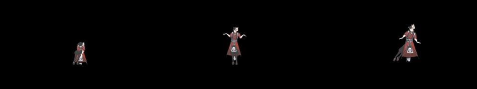

# 実歌声・口形・長尺MP4の検証（2026-11-06）

Issue #187/#81、LIP-001/RENDER-001/006。原本・実作品・バックアップを保持し、隔離作品で保存再読込・実PMXプレビュー・完成MP4を検査する。現在の実作品に採用LIP層は無く、実歌詞54発話は未確認。Ownerは後続回答で「実曲VMDに入っている既存の口形を使う」を選択した。下の30fps工程は回答前の独立した採用層の技術検証であり、選択された既存口形そのものの長尺確認とは区別する。次の29.97fpsでは既存口形を変更せず使う。

## 入力監査で見つかった差

同一hashの実VMDは骨351951キーで230秒まであるが、口5種と瞬きの4760キーはF6359（約211.967秒）で終わる。既存制作reportでもSRT発話51〜54がincluded=false。PV_ALIGNED16kHz WAVは212秒。一方、元の分離歌声ステムは229.84175秒、実SRT54発話は228.365秒まである。入力の既存の切出し制限であり、Studioの出力が最後4発話を削った結果と扱わない。

## 今回の受入れ条件

- PMX/VMD/SRT/歌声WAV/制作reportのhash、尺と口形終端、除外発話を記録する。
- 実歌声ステムを全区間使う。既存制作reportの歌声→PVの5Fずれを配置で区別し、映像・音声の元位置と開始を保存再読込する。
- 実歌詞を確定しない。隔離作品の別SRTに明示した検証用母音だけを確定/候補化/採用する工程は、Ownerの実歌詞・自然さの採用とは別の機械試験として扱う。
- 実曲VMD・実PMXと、採用検証層の開始/中間/終盤の口形をプレビューで照合し、Undoで元口形へ戻ること、Redoと再読込で復元できることを確認する。
- 非0開始の同一作品を約231秒のMP4へ出力し、全フレーム数、複数地点の実画素、実歌声PCMの時刻差1F以内、原本保持を確認する。
- 実歌詞SRTの54発話は未確定のまま、候補生成の拒否が保たれることを確認する。

実歌声と採用口形を使う長尺の技術確認であり、仮読み・検証用母音が実際の歌声に合っているという自然さの合格にしない。最終結果、発見した不具合、未検証、出力先を後続へ記録する。

モデル区分: 原因調査と設計は高性能相当、試験の実装・記録は標準相当。

## 試験作成中の修正

最初の試行は採用値を一定0.8と仮定して失敗した。現在の候補VMDのキーは区間内で線形補間されるため、生成した候補バイトを別読みして得た期待値（例:0.6）と実PMX値を比べるように試験側を直した。次は作品終端を超える232秒のOutをAPIが400で拒否したため、保存クリップの実終端を切り上げた6,931F（30fps、約231.033秒）に修正した。製品の入力検査を緩めてはいない。これらの試験側の失敗を製品の修正や合格へすり替えない。

入力終端の機械可読な監査は [監査JSON](../../qa/lip-real-vocal-input-audit-20261106.json)。歌詞原文や原本の音声/VMD/PMXをGitへ複製していない。

## 30fpsの最終結果（検証用母音の採用層）

隔離Chrome/RTX 4070 SUPER・Direct3D11で1成功・0失敗・0skip。実歌声229.84175秒・実VMD230秒を非0開始で同じ作品へ置き、最終6,931F・約231.033秒、44,558,478 bytesのH.264/AAC MP4を読み戻した。SHA-256 `56fde01bb453c502729aec60fbe19d91dbb2643f896a178629877a2f046db449`。

9時刻のプレビュー/MP4の平均絶対RGB差は0.238〜0.980（320×180）。採用の有無の画像差は計108色チャンネル標本（差5超）で、母音の実PMX値を生成候補VMDキーと照合した。元の口形の復元、Redo、保存再読込も一致。これは仮面付きモデルの限定した画素差であり、全フレームの口の見え方・自然さを保証しない。

全区間に分布する1秒間隔のうち、有音RMS閾値を超えた190窓で、完成AACと独立に配置した元歌声PCMの時刻差は最大2サンプル（8kHz、0.25ms、1F未満）、最低相関0.999289。無音窓は同期の成功窓に数えない。末尾の声も含む実歌声を省略していない。

実PMX/VMD/SRT/歌声/制作reportとモデル/テクスチャの前後hashが一致。ガードdata5ファイル/exports無しも不変。実SRT54件は未確定のまま、元SRTの最終口形候補は54件reading_missingで拒否された。

WindowsとUbuntuの入力/原本区画保持は各17成功。最初のWindows実行15成功/2skipは実データパス不足であり、必要パスを指定した17件の最終実行と区別する。型・JS構文・JSON・差分空白検査も成功。Linuxブラウザー/GPU長尺は未実行。

機械可読な結果: [30fps長尺証拠](../../qa/lip-real-vocal-long-30fps-20261106.json)。ローカル出力は `D:/BAI/BAI_CREATER_STUDIO/_Claude確認画像/2026-11-06-lip-real-vocal-long/engineering-vowels-real-vocal-30fps.mp4`。実歌詞に沿う採用口形の完成動画として扱わない。Eagleへ登録しない。

次はOwnerが選んだ既存VMD口形を、29.97fpsの長尺で実歌声と照合する。入力の最後4発話欠落、実歌詞読み/自然さ、他モデル・物理・Linux長尺GPUは残件。

## Owner選択の既存口形：29.97fpsケース

後続回答「実曲VMDに入っている既存の口形を使う」に従い、`BAI_LIP_LONG_MOUTH=source` のケースを追加した。この場合は検証用SRT、読み確定、口形候補、採用層を作らない。実SRT1件/読み0件/下書き0件/採用0件を保持し、実VMDのモーフ区画を独立に読み、9地点の実PMX値と保存再読込、MP4の実画素を比べる。213秒以後の5口形が0のままであることも確認し、既存入力の末尾欠落を隠さない。歌声は約230秒全区間を使う。

結果JSONには、一時作品ID・モデルID・ジョブID・保存クリップ・In/Out・口形モードも記録する。30fpsの検証用採用層とは異なる選択であり、元の口形を読み替えたり置換しない。結果を下記へ追記する。

前段のPR #255はmain `dc88958`へ反映済み。利用者main/開発ブランチを同期し、8765番のページ/JSがmainと一致、利用者515ファイルと変更一覧は不変（集約hash `89b7599826236e16936fcb87ea33d705d29801d3515c1d8e78474896cfe4286d`）。

### 再実行の入力

| 変数 | 指定内容 |
|---|---|
| BAI_REAL_MMD_DATA | 実登録PMXとテクスチャのdata（読み取りのみ） |
| BAI_REAL_LIP_VMD | KYOKAI_DANCE_MASTER_LIPSYNC_BLINK.vmd（監査JSONのhashと一致） |
| BAI_REAL_LIP_SRT | KYOKAI_LEAD_VOCALS_FORCED_ALIGNED.srt |
| BAI_REAL_LIP_REPORT | 同じVMDのKYOKAI_DANCE_MASTER_LIPSYNC_BLINK_REPORT.json |
| BAI_REAL_LIP_VOCAL | 元の0 Lead Vocals.wav、229.84175秒・hash 8a48e67e…（212秒のPV_ALIGNED版は指定しない）。既存KYOKAI_LEAD_VOCALS_WAVEFORM.jsonのsource_wav.pathで場所を確認できる |
| CHROMIUM_PATH | インストール済みChromeの実行ファイル |
| BAI_LIP_LONG_FPS / BAI_LIP_LONG_MOUTH | 29.97 / source（Ownerが選んだ既存口形） |
| BAI_REAL_GPU / BAI_TEST_CONCURRENCY | Windows実GPUの1 / 1 |
| BAI_LIP_LONG_OUT | Owner確認フォルダー内の今回専用出力先 |

`node tests/run-guarded.cjs tests/studio-v05-lip-real-vocal-long.test.cjs` を使う。元素材を削除・上書きせず、隔離サーバーへ複製する。mouth=source以外の既定は、前段の検証用母音採用層のケースであり、Owner選択の口形と混同しない。

29.97fpsケースの初回は試験の完成物名に含めた「29.97fps」を非MP4拡張子と判定され400で拒否された。出力名へ.mp4を明示して再試験した。既存の形式検査を緩める製品変更はしていない。

入力監査へ最後4発話の元歌声RMSを追加した。各区間は約-21.8〜-25.4dBFSで信号を含む。これは信号エネルギーの測定であり、語の読みや口の自然さの認定ではない。

### 確認用の構図の修正

既存口形の29.97fpsの最初の長尺照合は6,924F/約231.031秒・51,071,799 bytesで成功した。一方、完成映像の3時刻を目視すると、試験用の頭位置から作った固定構図で、深くお辞儀する姿勢などが画面端に切れた。そこでこの既存口形ケースの確認構図は、5秒ごとと比較時刻の実変形境界を、同期的なフレーム評価後に収集して全身が入る固定カメラへ変更し、出力を再検証した。製品カメラ機能・口形・元VMDは変更していない。最初の画像照合の成功を、構図の完成判定と混同しない。前段30fpsの検証母音ケースは既に記録した構図を維持する。

## 29.97fps・既存口形の最終結果

最終隔離再実行はWindows実GPU 1成功・0失敗・0skip（約189秒）。H.264/AAC・1280×720、6,924F・231.031031秒、18,619,285 bytes。SHA-256 `31d6d2aa8c7bc9c7b00d2830a7396435089a6925c0245b56d79b3122be409691`。保存後のMP4を別のffprobeで全フレーム数まで数え、映像2997/100fps・音声AAC、尺とサイズを再確認した。

実作品ではなく一時作品 `10a7a39a-c80d-4f67-afd7-4483ad00d1f2` で、元VMDを作品1秒から230秒、元歌声を1.1667秒から229.8417秒へ配置した。音声の元位置は0。SRT原本1件・読み0件・下書き0件・採用層0件を保持し、元のVMD口形を直接使った。保存再読込後も同じID・配置と口形値だった。実歌詞54件の候補生成は未確定として拒否されたままである。

9地点の実PMX口モーフをVMDキーの独立読取と照合し、プレビュー/MP4の平均絶対RGB差は0.139〜0.291（320×180）。歌声は190有音窓で最大2サンプル/8kHz（0.25ms）、最低相関0.999289。これは音声の保存配置と符号化後の時刻の照合であり、語や音素に合う口形の自然さを認定する測定ではない。

56時刻の実変形境界から作った確認用の固定構図で、完成映像の約5.5/120.5/229.5秒を目視した。代表3姿勢は画面内に収まった。口の自然さ・物理・全フレームの見た目の一般的な完成は未判定。元データの213秒以後の口5種が0のままであることも確認した。最後4発話の歌声は信号を含むが、口形が無い入力制限は補完していない。

[既存口形長尺の機械可読証拠](../../qa/lip-existing-mouth-long-2997fps-20261106.json)に、作品/モデル/ジョブID、配置・In/Out、カメラ、入力hash、9地点、190音声窓を記録した。原本PMX/VMD/SRT/歌声/reportと全モデル/テクスチャ、ガードdata5件は前後不変。構図修正後の途中1回はブラウザーERR_CONNECTION_TIMED_OUTで失敗し、成功件数へ含めない。リクエスト失敗URLを残して隔離再実行し、最終は成功。意図したページ再読込でのERR_ABORTEDと、実際のconsoleエラー監視は分けて扱う。

ローカルの選択口形の確認動画は `D:/BAI/BAI_CREATER_STUDIO/_Claude確認画像/2026-11-06-lip-real-vocal-long/existing-vmd-mouth-real-vocal-29.97fps.mp4`。同じフォルダーに証拠JSONと確認画像を保存する。Eagleへの登録・原本素材のGit追加は行わない。
