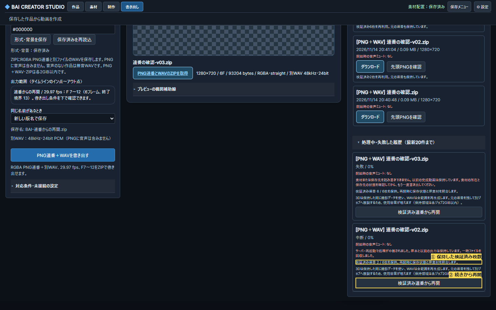

# 検証済みPNG連番からの再開（#327、実装と限定検証）

順3 S3-F3、RENDER-002/005。上位3操作は失敗履歴の確認、同じ保存条件で検証済み連番から再開、完成ZIPの受取。既存履歴に再開ボタンと保持枚数を追加し、別画面は増やさない。

PNG生成中に読み戻し可能な先頭連続区間の寸法/RGBA/SHA-256をatomic記録する。書込中の末尾は次の周期まで採用しない。失敗時は子プロセス停止後に検証し、ジョブ専用checkpointへ保持。サーバー強制停止時は最後に永続化済みの区間だけ使用し、未記録の末尾を成功と推定しない。

再開は別UUIDジョブ。元checkpointを変更せず、検証後にPNGを複製する。作品/FPS/In/Out/解像度/背景/設定revision/配置/シーン/FK補正/音声とミキサー設定/入力とテクスチャhash/描画実装とツールを照合。不一致・改変・欠番は理由付き拒否。PNG合成の出力を検証済み枚数でtrimして次の番号から生成し、WAVは元範囲全体を再生成して絶対標本境界を保持する。3Dは検証済みの元FFV1撮影もhash付きで保持し、同じデータを再利用する。実PMXの物理ONでは独立した再撮影が完全一致しなかったため、再撮影結果を混ぜる初期案を不採用とした。保持した撮影データの欠損/改変も拒否する。完成ZIPは従来の全PNG/WAV/hashと版管理検証を通す。

checkpointは完成ファイルではない。旧出力・旧checkpointを自動削除しない。PNG/WAV/再開用3Dを合わせた各保持領域2GiBと完成ZIP2GiBの上限を維持し、保持領域はジョブ単位で増えることを表示する。旧ジョブでcheckpointがない場合は通常再試行を使用。MP4途中再開/EXR/別codec/長尺と全GPUは今回の完了対象に含めない。

受入：実FFmpegで失敗/再起動→非0In29.97fps連番再開、元PNG不変と再生成されない先頭、全PNGとWAVを通常生成と比較、全枚数保持からの再包装、0枚/欠番/破損/同容量改変/条件変更/並行/保存失敗、API/手動/両MCP、Windows/Linux。未実施はNOT TESTEDとしてJSONへ記録する。

モデル区分：設計と実装は高性能、UIの3視点批評は標準。

## 操作と実装境界

書き出し画面の「処理中・失敗した履歴」内で保持枚数を確認し、「検証済み連番から再開」を押す。形式/背景に未保存の変更があれば保存/再読込を案内する。元のジョブ条件で照合し、別作品・保存変更・描画実装/ツール変更・欠番/改変は先頭からの出力を案内する。元の連番を保持し、新しいジョブ/版名として複製するので使用容量が増える。以前の完成物は置換しない。

再開APIはPOST /api/studio/v05/render/jobsの任意resume_job_id。標準MCP/WebMCPのbai_studio_render_job_startも同じフィールドを使う。作品/範囲/配置/設定/シーンrevisionと出力形式/解像度を指定する。旧MP4の呼出し互換を維持する。新しい保持情報のない過去の失敗ジョブ、MP4の途中再開、3D撮影自体の途中再開は未対応。

checkpoints/<UUID>/checkpoint.jsonは検証済みの先頭連続区間だけを記録。履歴一覧は保存済み情報/存在/容量を読み、再開投入と複製では全PNG/撮影を実再読込/hash照合する。サーバー強制停止後の未記録末尾を勝手に採用しない。WAVは全範囲で再生成し、従来の絶対標本境界と完成ZIP再検査を使う。保管領域の自動削除はしない。

## 検証記録

正本の結果はPNG_RESUME_STATUS_20261114.jsonとqa/png-resume-20261114/。Windows/UbuntuのPython、Windows手動/SDK/ネイティブWebMCP、Ubuntu SDK/Chromium撮影、実PMX物理ONと原本hashを区別する。初期のThread差替え失敗、存在しない依存名を使った試験、履歴再描画中のDOM離脱、独立PMX再撮影のPNG完全一致失敗、Ubuntuの保存中status404は先行失敗として保持する。後続の成功へ合算しない。

実SR/全Tab/200%・長尺/実2GiB負荷・全モデル材質GPU・Linux実PMX/設定UI/ネイティブWebMCP・MP4/EXR/他codec途中再開は未検証または未実装。順3全体の完了ではない。

PythonはWindows85成功・Ubuntu84成功/Windows専用1skip、各追加5subtests。生成RGBA画像+実音声のF7〜12/29.97fpsでは2枚から6枚への再開、6枚保持からの再出力、通常出力の全PNG/WAVバイト一致（絶対標本11211〜20821、9610標本）を確認。実3D3Fは元撮影のSHAを保ち2枚を再利用。実PMX/VMD・物理ON6秒のF120〜122では同じ撮影を保持し、別ジョブへの繰返し再開で全PNG/WAVが一致した。原本とテクスチャは不変。独立した物理再撮影との完全一致を保証する結果ではない。

手動UIは1440/1024/600幅、Enter再開・成功後の新ジョブfocus・履歴開状態、標準MCPと本物のネイティブWebMCPをWindowsで確認。UbuntuはSDKと実Chromium撮影を確認し、設定UI/native/実PMXは未検証。3視点のソース批評は限定PASS、実操作はRootのゲートとして別記する。

## mainと制作画面の同期

PR #328 / main35bbc84。利用者mainをfast-forwardし、更新後HTML/出力JS/CSS/WebMCPの配信バイト一致、PNG/MP4能力、新resume APIの不正ID拒否を確認。待受PID情報を取得できないローカルプロキシ環境だったため、コマンド行で自分の旧/仮サーバーだけを特定し、進行中出力0件を再確認して1つの更新mainサーバーへ揃えた。既存制作タブを再読込し、保存済み設定と完成履歴を確認。Owner作品へ試験ジョブや設定を保存していない。既存の未割当モーションは未割当の理由を保持し、勝手に割り当てていない。素材/作品/旧完成物と既存dirty変更は不変。詳細な画面/保全記録はOwner確認先、公開同期記録はqa/png-resume-20261114/integration.json。
