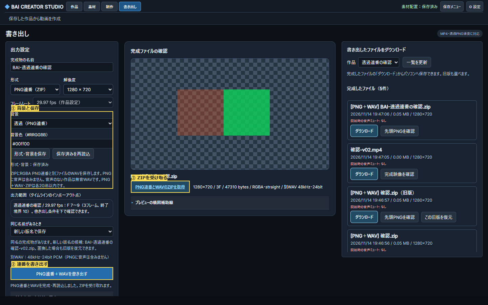

# RGBA PNG連番の保存・受取（実装・限定検証）

RENDER-002/005、O-RENDER-03 A、順3 S3-F3。基点main5b52bcd。既存のsnapshot/revision照合、3D→透過FFV1逐次撮影、版名/旧版復元、完成後hash検査を再利用する。EXR/アルファ動画・途中フレーム再開はこの段階では未実装のまま保持。

## 操作と保存

上位3タスク：①書き出し形式と背景を作品へ保存、②同じ範囲で書き出して進捗/失敗を見る、③完成ZIPを受け取り、PNGと別ファイルのWAVを使う。既存の書き出し設定と完成物一覧を拡張し、別画面は増やさない。

形式は従来MP4または「PNG連番＋WAV（ZIP）」。背景は透過/単色（黒・緑・青・任意色）。MP4では透過を選択できず、APIでも投入拒否する。未対応のEXR等は有効にしない。明示の設定保存→ジョブ作成を経て、設定revisionと保存済み範囲/配置/シーンを固定する。既存APIの省略呼出しは黒背景MP4を維持する。

完成ZIPはRGBA PNG、manifest.json、同じ範囲のPCM WAVを含む。PNGには音声を埋め込めないことと、音声のない作品では無音WAVであることを操作付近に示す。ZIPは動画playerで開かず、取得リンクとフレーム/アルファ方式を表示。MP4の再生・受取・旧版復元は保持する。

## 処理・容量・完成判定

- 保存設定は作品別、revision条件付きatomic書込。色は#RRGGBB、alphaModeはstraight。外部任意パス/FFmpeg文字列を受け取らない。
- 固定フレーム評価と同じ合成順を使い、連番経路ではRGBA/RGB合成で透明・半透明を保持。従来MP4の既定画素/音量/時計の経路は保持する。
- 元の非0In/有理数FPSから、連番indexと作品Fの対応をmanifestへ記録。FFV1からのRGBAはstraightとして透明エッジの実pixelを検査する。
- 既存10分/3D36,000F/中間2GiBに加え、展開したPNG/WAVの合計は2GiB以内。定期監視で超過時停止し、ジョブ専用領域だけを回収する。ZIPも2GiB以内、全量をメモリ保持しない。
- 全PNGを実再読込し、期待枚数/欠番/寸法/RGBA/フレームhash、WAVのサンプル数と区間を照合。manifestはRGB/アルファの検品情報を持つ。全ZIPエントリーを再読込・CRC/hash照合後に別UUIDへ確定。名前台帳確定が失敗したら既存完成物を保持する。
- 完成状態の保存失敗回収・一覧・受取時hash・名前衝突/版管理をMP4と同じサービスに通す。検証済み完成物の回収と、未完成フレームの途中再開は区別する。

## 検証ゲート

Python：設定/競合・形式/透過拒否、PNG欠番/破損/サイズ・改変ZIP、容量/確定失敗・既存MP4/版復元。Chrome：登録/配置済み透過・半透明画像と3D、非0In/29.97fps、保存再読込、設定→実ZIP→RGBA/音声のpixel/sample、手動UI/両MCP、複数幅/キーボード。Windows/Ubuntuで区別し、実モデル/GPUと合成fixtureを分ける。既存MP4/保存障害の回帰を行う。

番号付き変更前後画像と指摘/検証JSONを保存。3視点は初手/作業導線/視覚とアクセシビリティ、Rootを判定役とする。未検証をPASSにしない。モデル区分は設計/実装/調査が高性能、独立批評は既存の標準3名。

## 使い方と実装範囲

「書き出し」で形式を「PNG連番（ZIP）」、背景を「透過」または「単色」にして「形式・背景を保存」→「PNG連番＋WAVを書き出す」→完成欄の「ZIPを取得」。先頭PNGを格子背景で確認できる。MP4は従来通り再生でき、同じ作品名でも `.mp4` と `.zip` は別の完成名として共存・版復元する。透過からMP4へ変える場合は単色背景を選び直して保存する。

設定保存前は出力不可。作品切替の遅延応答やrevision競合は別作品へ保存しない。PNGには音声を含めず、ZIPの `audio.wav` は48kHz/stereo/24bit PCM。音声がない作品も同じ長さの無音WAVを含む。音声端点は作品FPSを分数として `round(InF×48000/FPS)` と `round(endExclusiveF×48000/FPS)`、標本数はその差。Pythonのties-to-even丸めを使い、manifestへ両端点を記録する。29.97は作品値2997/100を保持し、勝手に30000/1001へ変更しない。

依存追加は `python -m pip install -r requirements-render.txt`（Pillow）。FFmpeg/ffprobe、3Dでは既存のNode/Chrome/Three.js/Playwright/FFV1が必要。PNG/WAVは短い実出力と再読込を通った環境だけ有効。未対応環境でも既存MP4は保持する。Linuxの古いFFmpegでは無限colorと複数出力を組み合わせた能力検査が終わらなかったため、有限入力・PNG/WAVを別々の短い検査にした。MCPの能力検査/開始待ちは最大180秒、ジョブ自体は別途の既存時間制限で実行する。

## 検証結果

- Windows Python68成功・Ubuntu67成功/Windows専用1skip、各追加5subtests。設定/競合/欠番/寸法/RGB/破損/音声/容量/台帳書込失敗、検証済みZIPの確定状態回収と同容量改変拒否を含む。
- Windows Chrome/SDK/ネイティブWebMCPのPNG通し1成功、Ubuntu SDK/実Chromium撮影の通し1成功。24/60fpsの非0In・1Fと無音WAV、29.97fpsのF7〜9・3FでPNGと音声を検査。半透明画素はRGBA(200,80,40,128)で原画素と一致し、透明alpha0/不透明255も一致。WAVは絶対標本11211〜16016の4,805標本で原音と全PCM一致。半透明GLBの実3Dはalpha0〜191（Windows）/192（Ubuntu）を保持した。GPU間のバイト一致を保証する測定ではない。
- 保存した緑背景は実MP4の背景画素へ反映。ZIPとMP4の同名共存/旧ZIP復元で元MP4の受取バイト不変。ZIPを動画playerへ渡さず、実先頭PNGを表示する。設定未保存/不正色からの回復/Enter保存・再読込focus/同revisionの別作品GET遅延/ネイティブ設定保存とPNG開始も検査した。
- 実登録PMX/VMD/曲を読取専用で隔離複製した3F透過PNG＋WAVが1成功。F120〜122/29.97fps、RGBA alpha0/255と実表示画素、原本/テクスチャ不変。実素材の画像/ZIPはOwner確認先のみ。
- 既存MP44種類（基本出力、受取一覧、保存障害、保存構図）はそれぞれ成功。最初の5試験ゲートは3成功2失敗のまま記録し、古い非表示作品選択/新しい設定タブ/配置後の派生revisionを参照していなかった2試験を更新して2成功。閾値や画素・PCM検査は緩めていない。型/構文と台帳/JSON/参照・hashは別途検査。

先行失敗はFPS API名の誤り、ページ再読込後のnativeツール登録待ち、試験routeのunroute競合、Linux能力検査/12秒MCP待機、並行ブラウザーのERR_NO_BUFFER_SPACE等。失敗やskipを成功へ合算しない。正本ログ/数値は `qa/png-sequence-20261114/`、機械可読の範囲/指摘IDは同名STATUS JSON。

3視点の必須P2（未保存と形式の案内、不正色/Enter focus、作品切替中の誤保存）を反映し、Rootの実試験範囲で限定PASS。批評者自身はソース確認で実操作未実施。1440/1024/600幅と600幅の取得リンク到達を確認したが、実SR/全Tab/200%・長尺PNG/実2GiB ZIP負荷・全モデル/材質/GPU・Linux実PMX/実GPU/設定画面操作は未検証。EXR/アルファ動画/途中フレーム再開と順3全体は未完。

変更前は同フォルダーの `before.png`。main5b52bcdの出力JSを隔離ページへ読み込んだ基準画像で、元の無効なPNG項目とMP4のみの導線を示す。公開画像は生成素材だけ。

## mainと制作画面の同期

PR #325 / main `744e5ae140ab3c15583cfea2440625ef7869d214`。利用者mainをfast-forwardし、進行中のOwner出力がないことと起動元を確認した8765の所有サーバーを更新。変更HTML/出力JS/CSS/WebMCPの配信バイトがmainと一致し、実能力検査でMP4/PNGが有効。既存Chrome制作タブを再読込し、PNG形式の有効化と背景/保存済み設定を確認した。作品へ試験設定や素材を保存せず、既存の未割当モーションは理由を保持。素材/作品/旧完成物と既存dirty変更は不変。詳細はOwner確認先、公開の同期記録はqa/png-sequence-20261114/integration.json。
