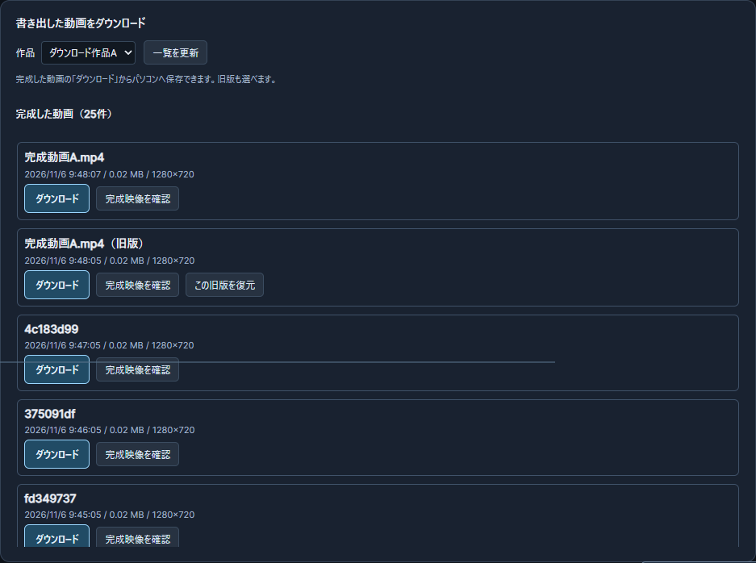

# 完成動画を一覧から選んでダウンロードする（2026-11-06）

Owner追加依頼 [#248](https://github.com/baisound/BAI_CREATER_STUDIO/issues/248)。対象はRENDER-001/006/007、UX-004とロードマップ順3。統計や平均時間の追加ではなく、完成物を受け取る操作を対象とする。過去の未承認候補NF-017のうち完成物一覧とダウンロードの範囲だけが今回の直接指定に含まれる。

## 利用者の操作

1. v0.5の「書き出し」を開く。
2. 「書き出した動画をダウンロード」の作品欄で、受け取りたい作品を選ぶ。
3. 完成した動画の名前・日時・容量を見て、行の「ダウンロード」を押す。旧版は「旧版」と表示する。

20件を超える完成物は「次の20件」「前の20件」で選べる。新しい書き出しができない状態でも、保存済み完成物の一覧とダウンロードは使える。ファイルが失われた履歴には理由を表示し、ダウンロード操作を出さない。削除機能は追加していない。保存先はブラウザーのダウンロード設定に従う。

画像はOwner指定の `D:/BAI/BAI_CREATER_STUDIO/_Claude確認画像/2026-11-06-render-downloads/completed-downloads.png` にも保持。実制作の素材・名前・個人情報を写さない隔離試験画像である。

## 原因と修正

以前からファイル取得APIと「完成映像を確認」の後の保存リンクはあったが、履歴の各行には直接ダウンロードがなかった。また、履歴の取得が新しい書き出し条件の取得後に置かれ、条件確認に失敗すると既存完成物の一覧まで出なくなっていた。

- `render-job-v69.js` は完成物の取得を新規出力の準備から独立させた。作品の選択を出力画面にも表示し、完成物と処理中・失敗した履歴を分ける。各完成行にダウンロード・映像確認を置き、従来の旧版復元も保持する。
- 取得リンクは従来の登録済みジョブIDの `/api/studio/v05/render/file?id=...`。同一オリジンの `download` リンクで保存し、旧版の保存名へ旧版印とIDを付ける。既存MP4は再エンコードしない。
- `list_jobs` とHTTP一覧へ `completed=1`、`limit`（1〜100）、`offset`（0以上）を追加した。既存呼出しは既定の最新20件のまま。返却する `total`、`has_more`、`file_available` で完成物だけをページ表示する。
- 既存の `bai_studio_render_jobs_list` へ `completed_only`、`limit`、`offset` を追加。標準MCP/WebMCPとも同じAPIを読む。ファイル取得は既存の `bai_studio_render_file_link` を使う。
- 作品切替やページ切替の古い応答を画面に反映しない。旧UI・原本素材・保存形式・版管理の規則は保持した。

例: `GET /api/studio/v05/render/jobs?project_id=作品ID&completed=1&offset=20`。MCPは `bai_studio_render_jobs_list` に `{"project_id":"作品ID","completed_only":true,"limit":20,"offset":20}` を渡す。

## 検証

Windows・Chrome156、隔離データ・別ポート。新規試験 `studio-v05-render-downloads.test.cjs` は、画面で書き出した実MP4、明示置換の旧版、別作品の実MP4を使い、ブラウザーのダウンロードイベントから実ファイルを4回保存した。**4回とも保存済み完成物のSHA-256と一致**。再読込、作品切替、25件の完成履歴を20/5件で表示、ファイル欠損、不正なページ指定の拒否、新規出力条件503のときの既存ダウンロード、390px幅でのボタン到達を確認。長い履歴の23件は、検証済みMP4のコピーと過去の保存形式のメタデータによる隔離fixtureで、23回新規に出力した結果ではない。

| 試験 | 結果 |
|---|---|
| 新規ダウンロードブラウザー試験 | 最終1成功・0失敗・0スキップ。約15秒。1280pxの一覧画像も確認 |
| 既存MP4・版管理・停止回収・公式SDK | 4成功・0失敗・1明示スキップ（ネイティブ長尺） |
| 標準MCP/注入WebMCPの対象試験 | 1成功。完了のみ・1件・2ページ目のJSON、旧版ID、ファイル有無が一致 |
| Windows Pythonの版管理・一覧・回収 | 15成功・5 subtests成功。完成物と失敗・別作品の分離、ページ、欠損、読取前後のファイル不変を確認 |
| Ubuntu WSLの版管理・一覧 | 5成功。Linuxブラウザーや実ダウンロードは未検証 |
| 型・Node構文・差分空白・台帳 | 型・構文・空白と、台帳JSON/CSVのID順・件数・既存状態の保持を確認 |

Nodeの正常終了した各ガードは、実data 5ファイル・exports不在の前後一致を確認した。新規試験の初回は9010番が既存プロセスで使用中だったため安全拒否で失敗した。既存プロセスを停止せず、9101〜9110番の空きポートを使う試験に変更して成功した。初回一括ゲートの失敗を成功へ読み替えない。既存回収試験は表示が日本語になったため、保存状態の属性と「中断」の表示をともに確認する形へ更新した。

Safari/Firefox、利用者のブラウザーや保存先設定、Linuxブラウザー、今回追加した一覧パラメーターのネイティブWebMCPでの呼出し、極端に多数の履歴での性能は未検証。MCPは標準stdioと注入WebMCPで確認し、公式SDKの既存呼出し互換性も確認した。大きな機能ID全体の完成とは扱わない。

画面設計にはfrontend-designを適用し、既存の配色・字体を保ちながらファイル名と保存操作を強くした。工数と全体位置の整理は[ロードマップの簡単な説明](../roadmap/CURRENT_POSITION_AND_EFFORT_20261106_JA.md)へ記録する。素材詳細のOGV再生不可表示は今回の直接依頼の後の残件として維持する。

モデル区分: 既存仕様の整理、既存APIへの接続、隔離試験、記録は標準区分。サブエージェントは起動していない。
