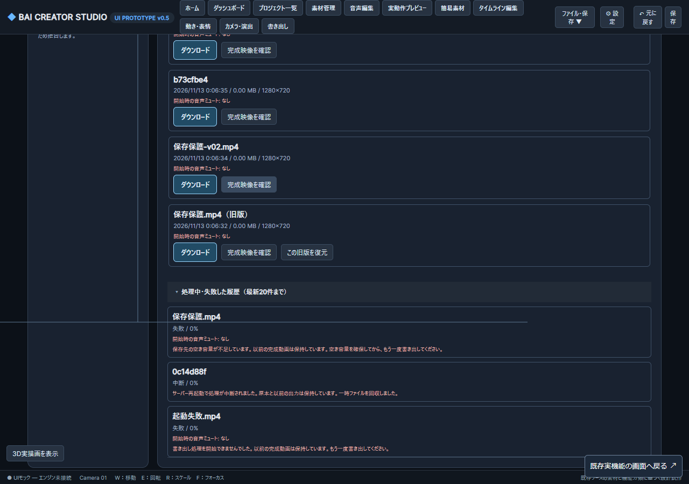

# 順3 G3-D：保存障害からの復旧と完成動画の保護（2026-11-12）

RENDER-001/006・DATA-008、Issue #81/#69/#63。開始6c664d5、基点main44c8afa。既存の強制終了/容量境界/旧版復元は保持し、10分/2GiBの成功を毎回作り直さない。今回の対象は保存障害と確定境界。

## 着手時の確認と契約

- 保存したpending_outputと完成MP4のサイズ/hashが一致しても、名前なし旧APIのジョブは復旧しない。名前ありの復旧成功では一時領域回収より先にreturnする。検証情報が一致する場合だけ成功へ戻し、そのジョブの作業領域を安全に回収する。名前ありは名前台帳の参照も必要。未確認/改変ファイルは昇格しない。
- 完成ファイルの受取は容量一致だけで、同容量の内容変更を検出しない。ダウンロード前に保存SHA-256も照合して拒否し、ファイルや台帳は勝手に修復/置換/削除しない。
- スレッド起動失敗でも実行中フラグを解放し、次ジョブを開始できるようにする。ディスク不足/権限等の保存失敗は対処できる理由を返す。ディスクへ失敗記録自体を書けない間の永続記録を保証しない。
- 一つの中断ジョブの回収結果を保存できなくても、既存の完成物一覧まで読めなくならないことを確認する。読み取れない履歴数を知らせ、再読込できるようにする。

隔離した保存障害注入（ENOSPC/権限/台帳書込/最終ジョブ書込）と実FFmpeg、HTTP/公式SDK/ネイティブWebMCP/手動UIで、旧完成物と名前台帳・原本hash、故障解除後の別ジョブ成功まで確認する。実媒体を使う試験と合成だけの試験を区別。Windows/Ubuntu、未実施のLinuxブラウザー/実ディスク枯渇・電源断/全停止時点を混同しない。

OGV長尺は低優先のまま。G3-D/順3全体の完成判定ではない。モデル区分：高性能（保存安全性・診断・実装・検証）、サブエージェントなし。

## 利用者に見える変化

書き出しに失敗したら、開いた失敗履歴に容量不足・権限・起動失敗の理由が出る。保存先を直して既存の書き出しボタンから再試行する。同名のときは「新しい版名で保存」で別版を作れる。失敗した置換では以前の動画と名前台帳を変更しない。完成物の確認後、最後の状態保存だけ失敗した場合は、保存済み検証情報と実ファイルが一致するものを次の取得時に完成へ戻す。

一部の履歴を書き直せない場合は一覧に警告を出し、読める完成動画を引き続きダウンロードできる。名前台帳が破損・ロック中でも完成ファイル一覧を隠さず、版情報を読めないと表示する。完成MP4の内容が保存SHA-256と違う場合は受取りと旧版復元を拒否する。アプリは破損ファイルを削除したり、元に戻したりしない。

## 実行結果（2026-11-13）

| 確認 | 結果 | 記録 |
|---|---|---|
| Windows Python、実FFmpeg/名前台帳/回収/プロセス保護 | 33成功、5 subtests成功 | [ログ](../../qa/render-protection-unit-windows-final-20261113.log) |
| Ubuntu WSL Python、実FFmpeg | 31成功、Windows固有2 skip | [ログ](../../qa/render-protection-unit-ubuntu-final-20261113.log) |
| Windows Chrome157 UI/HTTP/公式SDK/ネイティブWebMCP、合成画像30F | 保存失敗中の旧版実DL・別版再試行・確定直後の復旧・改変拒否に成功 | [数値](../../qa/render-protection-evidence-20261113.json) |
| Windowsの実録画短区間30Fと既存DL回帰 | 2成功。旧動画4回の実DL/hash、25完成物の20+5ページ、幅390pxも確認 | [ログ](../../qa/render-protection-http-windows-final-real-20261113.log) |
| Ubuntu SDK/API、同じ実録画短区間30F | 1成功。Linuxブラウザーは未実施 | [ログ](../../qa/render-protection-http-ubuntu-final-20261113.log) |
| 既存版管理/SDK・WebMCP/強制再起動と合成新試験 | 4成功、DL1件はERR_NO_BUFFER_SPACE。上の最終2件再実行でDLも成功 | [元ログ](../../qa/render-protection-http-windows-regression-20261113.log) |
| JS型・構文 | typecheck、変更JS/テストCJSのnode --check成功 | [型ログ](../../qa/render-protection-typecheck-20261113.log) |

Python対象は `tests/test_v05_render_failure_protection.py tests/test_studio_v05_render_names.py tests/test_v05_render_recovery.py tests/test_v05_capture_process_cleanup.py`。Windowsは `python -X utf8 -m pytest -q`、Ubuntuはpython3で同じ対象を実行。最後の境界修正は名前台帳statの権限エラーでも完成物を隠さない処理で、両OSの最終Pythonと実録画結合試験で確認した。

Windowsの実Chromeは `C:/Program Files/Google/Chrome/Application/chrome.exe`、157.0.8103.51。新試験は `--enable-features=WebMCP,WebMCPTesting` を使用。以前のWebMCPTestingだけでは登録前に2回時間切れとなり、診断でsupported=falseを確認した。現行有効化名は[Playwright一次資料](https://playwright.dev/docs/next/api/class-webmcp)と照合し、変更後は実native codeと実ツール呼出しを確認。模擬APIで置き換えていない。その次の実行は意図した起動失敗503をエラー監視の許容へ登録しておらず最後に失敗した。これらの先行失敗、制限環境のジャンクション権限失敗、製品修正前の7失敗/1成功はqaのrender-protection-*.logに残す。存在しない単数形downloads試験名で起動前に中止した実行も残す。スキップや未完走を成功に含めない。

実録画は既存214秒480pコピーの1.1秒からの短区間。入力SHA-256 `c895d1da79dfddb4c93210b778b74d727be225ac5c07a2c5d6c5a399093f89d6`。Windows/Ubuntuとも原ファイルと登録後の内容不変、出力は実FFprobeで30Fと保存SHA-256一致。原映像/音声を公開していない。これは同期・聴感の新しい長尺合格証拠ではない。

## 再現と安全境界

`node tests/run-guarded.cjs tests/studio-v05-render-failure-protection.test.cjs` を使う。WindowsはCHROMIUM_PATHを上記Chromeへ、必要時BAI_TEST_CONCURRENCY=1を指定する。`BAI_FAILURE_OUT` は数値JSON先、`BAI_FAILURE_REAL_VIDEO` は読み取りだけで使う実MP4パス。Ubuntuは `BAI_FAILURE_API_ONLY=1` とLinux側パスを指定する。`BAI_FAILURE_SCREENSHOT` は合成素材だけでOwner確認先へ保存する。

障害注入はテスト専用sitecustomizeに限定し、指定マーカー・9260/9261番・bai-p2-から始まるハーネス隔離データが揃う場合だけ有効。製品に障害注入APIを追加せず、8765番やOwnerデータを試験対象にしていない。開始時のENOSPC、worker起動、回収状態の書込不可、名前台帳書込、最終完成状態保存を別々に失敗させ、解除後の再試行まで行う。単体試験ではEACCESと確定直後stat失敗、名前あり/なし、未索引/同容量改変を追加する。

既存の[容量・強制終了試験](RENDER_LIMITS_RECOVERY_20261106_JA.md)と[版管理](RENDER_NAME_VERSIONS_20261105_JA.md)を保持。今回の強制再起動回帰ではcapture/encoding中断後の回収と10F再試行、36001F/600秒超過の拒否を確認した。10分実GPU全量/2GiBストレスは今回再実行していない。

確認原本は `D:/BAI/BAI_CREATER_STUDIO/_Claude確認画像/20261113-render-protection/render-retry.png`。合成青画像だけの作品で、旧完成版・別版と開いた失敗理由を確認。公開用PNGと原本のバイト一致を記録する。

## 残る制限と次の位置

実ディスク/クォータ枯渇、物理故障・電源断・全停止点、Linuxブラウザー、任意長尺実作品は未確認。受取開始ごとに全ファイルhashを再計算するため、大容量では開始待ち時間が増える可能性がある。全サイズの遅延測定、受取中の外部同時改変防止、破損ファイルの自動復元は保証しない。既存データ形式の移行は不要。保存先が回復するまでは失敗履歴自体を書けない場合がある。

次はG3-E1で保存した制作状態・構図の順3必須条件と順6の依存を照合し、G3-Fの終了判定へ証拠をまとめる。G3-A短窓/聴感/既知音量差、G3-C/E/F、順3全体・順4/5・既存ゲート/依存監査は未完のまま。コード・試験の固定hashは[数値証拠](../../qa/render-protection-evidence-20261113.json)。Issue [#81](https://github.com/baisound/BAI_CREATER_STUDIO/issues/81)を閉じない。

## mainと制作画面の同期（2026-11-13）

[PR #288](https://github.com/baisound/BAI_CREATER_STUDIO/pull/288)をmain0afff1aへ統合。実装c602c17、ログ書式ca1d77d。利用者mainと既存codex-nextをfast-forward。8765番と以前のPID34300は停止済みで、競合がないことを確認して利用者main/server.pyをPID4124で非表示起動した。HTML/render-job-v69.js/webmcp.jsは利用者mainと配信内容が全バイト一致し、GET完成物一覧に新しいunreadable_count=0が返る。

Chromeの旧タブ1055946273は取得できず、現在の一覧にも制作URLはなかった。同じChromeに同じURLの新タブ1055946470を開き、書き出し画面で既存作品・完成動画3件（旧版を含む）を確認し保持。既存2クリップへ試験編集を加えていない。CUA画面撮影は5秒で時間切れとなったため、実画面の確認はAX表示による。公開した画像は隔離試験の合成素材だけで、利用者素材は投稿していない。

利用者の素材/作品/完成動画/exports/studio.zipの515ファイルとdirty一覧は前後一致。集約SHA-256は89b7599826236e16936fcb87ea33d705d29801d3515c1d8e78474896cfe4286d。[同期数値](../../qa/render-protection-main-sync-20261113.json)。[IssueのPNG](https://github.com/baisound/BAI_CREATER_STUDIO/issues/81#issuecomment-6827468757)は公開配信のPNG MIME/内容とOwner確認原本の一致も確認。GitHub自動checkの登録はなく、ローカル検証と区別する。次はG3-E1。G3-D/順3全体や既存未解決は維持し、OGV長尺は低優先のまま。
