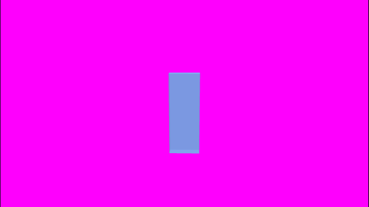
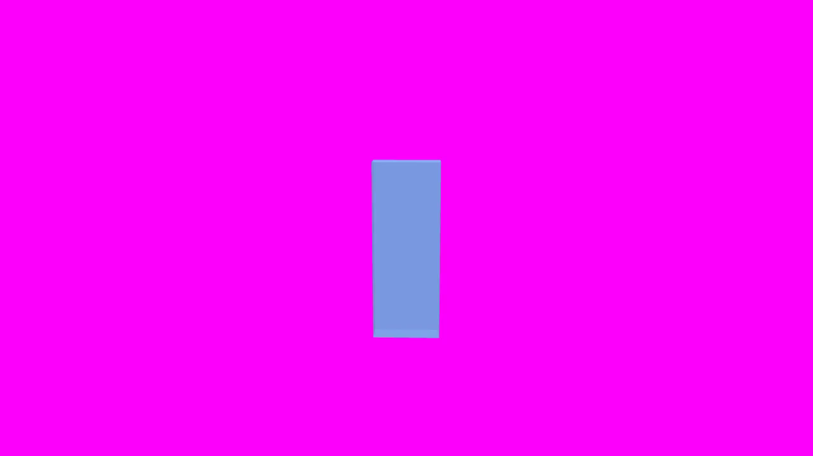

# 順3 G3-E1：保存した制作状態と構図（2026-11-13）

DATA-008、RENDER-001/006、CAM-015依存照合、#81/#63/#69。RENDER-005は内部中間PNG/FFV1との境界照合だけで、PNG連番の利用者向け納品機能は未実装。基点main5e5d0b5、着手9ff3726。既存の合格を繰り返すだけでなく、保存再読込・作品切替と未調査の合成差を確認する。モデル区分：高性能（仕様・複数保存経路と画素診断）、サブエージェントなし。

## 既存証拠と今回の境界

| 対象 | 正本 | 今回の扱い |
|---|---|---|
| 保存ステージ変換と静止カメラ、16:9枠 | SHARED_STATE_OUTPUT_AUDIT_20261104_JA.md | 実PMX/S01の1F合格を保持。今回の新しい合成試験と区別 |
| 自動構図、縦長欄 | AUTO_COMPOSITION_20261105_JA.md | 既に限定合格。スマートフォン全体保証ではない |
| 動作/歌声/保存固定カメラの長尺 | LIP001_REAL_VOCAL_LONG_20261106_JA.md | 一部代表時刻と全フレーム出力の証拠を保持。今回再描画しない |
| 旧モデル/ステージの大きさ | LEGACY_IMPORT_L8A_REAL_DATA_20261104_JA.md | Ownerは旧の大きさを選択済み。大型S01外殻でモデルが見えない初期構図は順6の残件 |
| 旧カメラ・時刻付きカメラ | LEGACY_STATE_TO_V05_MAPPING_DESIGN_20261104_JA.md §所有者判断、WP-L8b | Owner指定は順6で時刻付きに写す。古い文書の「判断待ち」を再度質問しない |
| 照明/レール/DOF/ショット/字幕 | 7段階の順6/7、CAM/LYRIC要件 | 既存要件を削除せず依存として残す |

今回：合成GLBと背景画像を隔離登録し、配置/表示/固定/カメラをUI/API/SDK/ネイティブWebMCPで保存再読込する。別作品から戻って同じ値を復元し、通常と縦長の欄の枠・画素を非0Inの完成MP4と比較。保存カメラの有無と半透明材質を分ける。原本と既存出力のhashを保持する。

構図判定は既存契約のIoU>0.85・重心差<0.01。色は共通3D領域の内側のRGB平均絶対差<=8/255、全枠<=4/255を診断の基準とする。圧縮/小数画素の外縁を除くが背景や薄い材質を誤って除外しない。結果を見て基準を緩めない。任意材質・任意動作・聴感・全GPU/OSを一般化しない。

## 発見した不足と修正

1. **短い3D出力の末尾1フレーム欠け。** 非0Inの15〜17F/30fpsが2Fになり、完成検査で失敗した。保存範囲を縮めて合格にはせず、実FFV1中間動画と製品合成グラフで再現した。24/29.97/30/60fps × 1/3/17Fの12条件のうち、旧コードは3条件失敗・9成功。原因は3D中間層の時刻をマイクロ秒へ切り捨てたことで、末尾の3D時刻が2Dフレームよりわずかに前となり、短い方まで合成する処理で最後が落ちること。`settb=1/fps,setpts=N` とし、FPSの正確な単位でフレーム番号を与えた。中間コンテナのミリ秒時刻をそのまま信用せず、既存の欠落検査は維持した。
2. **正常な3Dでも未読履歴警告。** jobsディレクトリのscene-config/scene-manifestまで壊れたジョブに数えていた。ジョブID形式のJSONだけを履歴対象にし、内部記録は残したまま区別する。壊れた正規UUIDの履歴1件だけを警告することを確認した（修正前は内部2件を足して3件と誤算）。

フレーム時計の試験は完成MP4を全フレーム復号し、1Fずつ違う赤色が繰り返しや逆順になっていないことも確認する。新しいPNG連番出力・カメラ機能・優先順位変更は追加していない。

## 保存状態と構図の確認結果

`tests/studio-v05-state-composition.test.cjs` が合成GLBを基に不透明/半透明（alpha0.5）の別素材を隔離登録する。位置(0.4,0,-0.2)、Y回転25度、拡大率(1.2,0.8,0.7)、表示true/固定trueを保存。保存カメラは位置(3,2.2,5)・注視点(0.4,1,-0.2)・画角38度。MCPから保存し、画面の「撮影視点を保存」と「保存視点へ戻す」も実行する。

別作品へ切替→元へ戻る→ページ再読込後、ネイティブWebMCPと公式SDKが読むシーン全体とrevisionが一致。カメラなしの作品へ切り替えても前作品の保存カメラを引き継がない。F15〜17/30fpsのH.264/AAC完成MP4は3Fで、保存したSHA-256と受取バイトも一致した。

| 条件 | 通常/縦長のIoU | 重心差 | 3D内部RGB平均差 |
|---|---|---|---|
| 保存静止カメラ・不透明 | 0.978 / 0.986 | 0.00286 / 0.00162 | 2.518 / 2.569 |
| カメラなし・自動構図 | 0.973 / 0.972 | 0.00162 / 0.00214 | 1.889 / 1.902 |
| 保存静止カメラ・半透明 | 0.974 / 0.972 | 0.00229 / 0.00209 | 2.047 / 2.045 |

通常は1280×900の窓、縦長は600×950の窓で、試験CSSだけ制作欄を600×700へ指定した。3Dと2Dの枠は通常622×350、縦長600×338で一致。端2画素は重心計算にも同じ除外を適用するよう測定器を整えた。初回の比較器はIoUでは除外していた端を重心だけに数えていた。閾値は変更していない。

全枠RGB平均差は1.864〜2.151/255。今回は合成材質の色を確認した結果で、以前の実S01外殻・全シェーダーの色差を解消した判定ではない。Windows Chrome157.0.8103.51、プレビュー/MP4ともRTX4070SUPER/D3D11。原GLB fixtureと登録後の素材hash、保存状態とrevisionは前後一致。手元のOwner素材や作品へ試験編集を加えていない。

確認原本：`D:/BAI/BAI_CREATER_STUDIO/_Claude確認画像/20261113-state-composition/final/`。公開PNGと原本は全バイト一致。実PMX/S01の確認画像は公開していない。

## 実行と未実施の区別

| 試験 | 結果 | 正本ログ |
|---|---|---|
| Python最終対象6ファイル：フレーム時計/2D FPS/保存障害/回収/scene instances/旧単位 | Windows69成功、Ubuntu68成功・Windows固有1skip | [Windows](../../qa/state-composition-python-windows-final-20261113.log) / [Ubuntu](../../qa/state-composition-python-ubuntu-final-20261113.log) |
| 実Chrome最終：新しい構図比較と既存scene-mp4 | 4成功、0失敗、skipなし。合成6条件、3D/音声、保存カメラ変更と再読込、実PMX/VMDの3F | [最終ログ](../../qa/state-composition-browser-final-20261113.log) |
| 先行回帰：実PMX/S01保存構図、scene-mp4、保存障害保護 | 4成功・1失敗。失敗は以前の履歴見出しを期待する古い試験。現在のmainの見出しへ直し、上の最終scene-mp4で成功 | [先行回帰](../../qa/state-composition-browser-regression-20261113.log) |
| JS型・構文 | typecheck、Nodeの新旧対象構文成功 | [型ログ](../../qa/state-composition-typecheck-20261113.log) |

Windows Pythonは `python -X utf8 -m pytest -q`、Ubuntu WSLはpython3で、対象は `tests/test_v05_scene_frame_clock.py tests/test_v05_render_fractional_fps.py tests/test_v05_render_failure_protection.py tests/test_v05_render_recovery.py tests/test_v05_scene_instances_v57.py tests/test_studio_v05_scene_instances_units.py`。重複する先行22件・色確認12件を最終69件へ足し算しない。

WindowsブラウザーはCHROMIUM_PATHをインストール済みChrome、BAI_REAL_GPU=1、BAI_TEST_CONCURRENCY=1として `node tests/run-guarded.cjs tests/studio-v05-state-composition.test.cjs tests/studio-v05-scene-mp4.test.cjs`。実素材回帰だけBAI_REAL_MMD_DATAをOwner dataの読取元として指定。新しい試験の `BAI_COMPOSITION_OUT` は数値JSON先、`BAI_COMPOSITION_SHOTS` は合成確認画像先。隔離ポート9270、ハーネス一時dataを使用する。

最初の実MP4欠け、時計の3失敗、内部記録の件数誤り、先行見出し不一致はログに保持。ログは行末空白だけ正規化した。既存実PMX/S01の最新回帰はIoU0.85超・重心差0.01未満で合格。実PMX/VMD回帰の入力hash/出力画素変化も元ログに保持するが、新しい長尺の合格とはしない。

Linuxブラウザー/実GPU、任意材質・半透明実ステージ・全姿勢の構図、全操作のUndo/競合は未確認。10分/2GiB・歌声長尺の既存証拠は今回再実行せず保持した。G3-A短窓/聴感/既知音量差とG3-Dの物理枯渇/電源断等も残る。

## 次の終了判定

G3-Eの今回の代表条件は確認できた。次はG3-F1でA〜Eの証拠・順3必須の未達・環境制限・順6/7依存を一つの受け入れ表へ対応付ける。大型ステージの初期構図、旧時刻カメラ、レール/DOFや字幕の未完を、静止カメラが使えるという理由で消さない。順3全体の完了ではない。OGV長尺はOwner指定の低優先を維持する。

固定コード/試験hashと数値：[証拠JSON](../../qa/state-composition-evidence-20261113.json)。前の保存障害試験のhashはその実装コミットc602c17時点の履歴で、今回のコードを試した証拠へ書き換えない。

## main・制作画面の同期（2026-11-13）

[PR #290](https://github.com/baisound/BAI_CREATER_STUDIO/pull/290)をmainf3d93d1へ統合。実装4f2d9d4。利用者mainと既存codex-nextをfast-forwardし、実行中のOwnerジョブが無いことと起動元を確認した8765番のPythonをPID4124から26668へ非表示再起動。変更したPythonモジュールのバイトはmainと一致。HTML/render-job-v69.js/webmcp.jsも利用者mainと配信全バイト一致、既存作品のGETは完成3件・unreadable_count=0を返した。

開いていたChromeタブ1055946470の書き出し画面をそのまま使い、「一覧を更新」で新サーバーへ同期。既存作品・完成3件（旧版を含む）と配置済み2クリップの表示を確認して保持した。既存作品の素材/構図/範囲へ試験編集を加えていない。利用者のdata/exports/studio.zipの515ファイルとdirty一覧は前後一致、集約SHA-256は89b7599826236e16936fcb87ea33d705d29801d3515c1d8e78474896cfe4286d。[同期数値](../../qa/state-composition-main-sync-20261113.json)。

[Issueの合成画像](https://github.com/baisound/BAI_CREATER_STUDIO/issues/81#issuecomment-6828062009)2枚は公開配信のPNG/バイトとOwner確認原本の一致も確認。実素材画像は公開していない。GitHub自動checkの登録なし、ローカル検証と区別する。次はG3-F1。G3-Eの任意条件や順3全体の完了にせず、G3-A/C/D・順6/7依存とOGV低優先を保持する。
