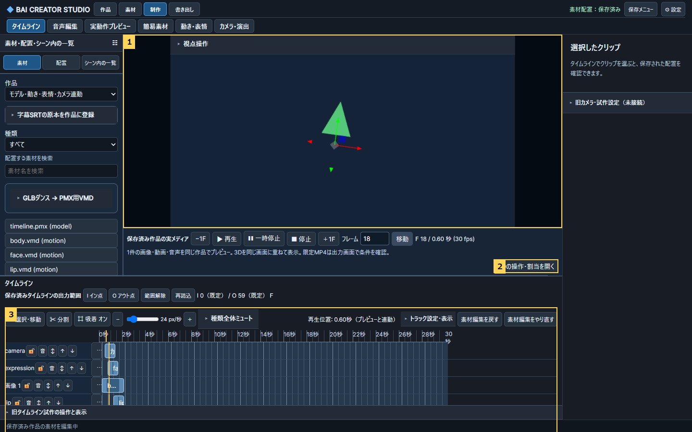
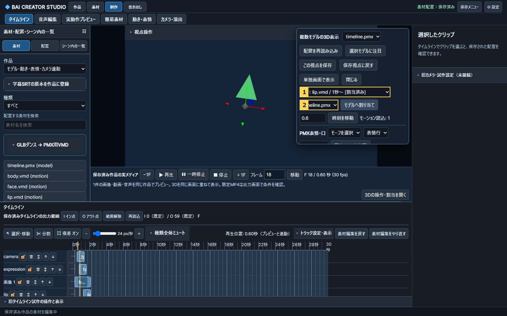

# タイムラインのモデル・カメラ・動き/表情と実プレビュー接続

## 最新の実装・検証結果（2026-11-13）

Issue [#63](https://github.com/baisound/BAI_CREATER_STUDIO/issues/63)。対象ID：DATA-001/006、CAM-001/015、LIP-009、RENDER-006。保全していた7ee8669へmain a6e1b95を統合したba0d74cから再開した。以下は代表経路の検証であり、順3や各ID全体の完成判定ではない。下の「途中保存・未マージ」は再開前の履歴。

モデルをタイムラインへ置くと、同じ作品の画像・動画の上へ自動表示する。開始前・終了後は表示せず、動き・表情・口のVMDは「3Dの操作・割当を開く」で対象モデルへ割り当てる。カメラVMDはカメラ行へ置く。再生・シーク・書き出しは同じ作品時刻を参照し、VMDの元30fpsから配置開始を引いた時刻を評価する。

### 画面で変わった場所（実装済み）

1. 配置したモデルを背景と同じプレビューへ合成。合成前の別画面へのモデル二重追加を不要にした。緑の三角形は公開可能な合成PMX試験素材。
2. 再生操作の近くから対象モデルを割り当てる。未割当・重複・読込失敗は通常画面に具体的理由を表示し、入口に要確認件数を出す。
3. 保存済みのモデル・動き・表情/口・カメラの配置開始/終了が表示と評価に反映される。カメラ区間外は保存視点（未保存なら自動構図）へ戻る。

割当パネルの①は種類・素材名・開始秒・日本語の状態、②は適用するモデル。操作を閉じても3D表示を維持し、キーボードのフォーカスは入口へ戻る。高さは内部スクロールで確保する。[1024pxの実画面](../../studio/v05/reviews/timeline-scene-20261113/timeline-assignment-1024.png)、[未割当の案内](../../studio/v05/reviews/timeline-scene-20261113/timeline-needs-assignment.png)、[重複カメラのエラー](../../studio/v05/reviews/timeline-scene-20261113/timeline-camera-conflict.png)。

### 修正した処理と保持するデータ

- `timeline:<clip ID>`の派生モデルを既存シーンへ読み取り投影する。読取だけではモデルを保存しない。配置削除で消え、Undoで同じID・変換・表情キーへ戻る。旧シーンのモデルと絶対時刻の表情キーは保持する。
- 対象割当を動き/表情/口へ拡張し、既存revision・固定・Undo/Redoを適用する。カメラ/表情のネイティブキーと原本SHAを読込計画に保持し、元VMDは変更しない。手動表情キー・採用済み口形の既存優先順位は維持する。
- カメラ3本重複の見落とし、日本語「カメラ.vmd」の分類、他モデル形式で変わっていたVMDカメラの縮尺、平行投影の視点取得、割当後にパネルが閉じる競合を修正した。
- カメラの透視/平行投影・rollと区間外復帰を共有レンダラーへ接続。カメラ評価失敗でも有効な動きは評価し、視点は復帰する。未割当・重複等は出力前に拒否し、実評価の失敗もキャプチャで拒否する。
- 書き出しの素材スナップショットはモデル/テクスチャ/動き/カメラ/表情VMDのhashを持つ。既存の完成物保護・別版出力を利用する。標準MCPとWebMCPの既存scene読取・対象割当を同じAPIへ接続し、説明を更新した。

### 検証と限界

| 確認 | 結果・証跡 |
|---|---|
| Windows / UbuntuのPython | 各66成功。モデル投影・保存/Undo・割当・ネイティブキー・3本重複・実FFmpegの24/29.97/30/60fps短区間・既存routes。`qa/timeline-scene-20261113/regression-python-elevated.log` / `regression-ubuntu.log` |
| 既存ブラウザー回帰 | 7成功・任意実PMX1skip。カメラ秒時刻3件、旧シーン合成/音声/GLBと配置モデル。skipした実PMX表情/口は別実行で1成功。`regression-browser2.log`。実素材の補完ログはローカル確認フォルダーへ保管 |
| 新しい一つの隔離作品 | 手動割当→保存復元→開始/終端/シーク→表情/口の境界→カメラ透視/平行/roll→60F MP4。6地点のプレビュー合成画素対MP4 RGB平均絶対差は約2.32〜2.36/255（許容4）。`effects/browser.json` / `effects-browser-release4.log` |
| 操作と障害 | 標準STDIO/ChromeネイティブWebMCP読取・解除/再割当、開始移動、終端→先頭再生、未割当3件の案内、1024px横はみ出し、Enter閉じる/フォーカス復帰、重複→出力拒否→Undo、途中distance=0の視点復帰/キャプチャ拒否を確認。同上 |
| 実PMX・実VMD・実GPU | Owner原本の隔離コピー。実頭振り/実ダンスと実カメラVMD、まばたき、再読込と未保存視点の復帰、各3F MP4にモデル画素を確認。Windowsの実GPU。入力とOwner原本hash不変。生の実素材ログ/結果JSON/画面は公開Gitへ置かずOwner確認フォルダーの非公開証跡へ保存 |
| 型・レビュー | `npm run typecheck`成功。3視点批評とRoot Judgeの採否は`qa/timeline-scene-20261113/review.json`。初回失敗と再試験を別ログで保持 |

未検証：Linuxブラウザー/GPU、全モデル形式/全VMD・全モーフ、長尺の動くカメラ/表情を含む全区間、物理・DOF・レール・シフト・高度な投影、任意の複雑な作品、スクリーンリーダー/200%拡大・初見ユーザーテスト。タイムラインの内部英語行名の全体翻訳は残件。合格した短い実MP4から長尺品質へ一般化しない。既存の順3 G3-F1等の残件は保持する。

初回の失敗は、誤った試験名/旧ヘッダーを操作した試験、試験側のボタン名/API項目/浮動小数厳密比較/区間外期待値/ネイティブWebMCP呼出し、sandboxのソケット拒否と、上記の実装不具合を区別して記録する。`regression-browser.log`は旧UI選択や初期自動表示競合で5失敗/1成功/1skip、修正後の`regression-browser2.log`は7成功/1skip。`regression-python.log`のソケット拒否4件は、実行権限を変えた同じ試験で66成功。失敗を合格件数へ含めない。

### 次のタスク

Ownerの追加指定で、統合・8765・開いている制作画面の同期後は **CAM-019-B1：Blenderカメラ取込**へ進む。[既存承認設計と最新の差込み](../roadmap/CINEMAOPERATOR_BLENDER_ADDON_IMPORT_DESIGN_20261106_JA.md)、[Issue #238](https://github.com/baisound/BAI_CREATER_STUDIO/issues/238)。未マージ設計145a54dを正本へ戻し、追加アドオン不要の既存Blenderカメラを最初の単位にした。Blender取込の実装・実機検証は未着手。CinemaOperator実アドオン利用はその後へ保持する。

モデル区分：高性能（設計/診断/実装/検証）、同モデル継続。BAI UX Guard指定の独立3視点批評を実施。Impeccableの補助エンジンは起動不可のため既存Operate/設計資料を直接使用した。

---

## 再開前の履歴

Ownerの2026-11-13追加指定（Issue #63）：モデルをタイムラインへ置いても表示されない。以前からモデル表示・VMD再生はあるので、それを同じ作品へ接続する。カメラ・動き・表情も配置した時刻と長さで連動させる。実動作プレビューは外側/内側のヘッダー・ナビが高さを圧迫しているため圧縮する。原本や保存済み配置を保持する。

## 現在確認できた境界

- `project-media-preview-v68.js` の対応種類は画像/動画/音声/楽曲のみ。モデルクリップは未接続として表示する。
- `scene-media-bridge-v70.js` はボタンで既存multi-model GPU sceneを開く。モデルは別のscene-instancesへ保存する必要があり、タイムライン上のmodelクリップだけでは追加されない。
- 既存sceneにはモデルのtransform/camera/face_keysがあり、motion-plan等の評価基盤もある。この経路を再利用し、新たなモデル/アニメーションエンジンを重複作成しない。
- 実動作プレビューの内側は既存workspace/10の独立音楽・ダンス状態。外側ヘッダーと内側アプリのナビが重複している。

## 確認すること

タイムラインへ置く→同じ画面でモデル/背景画像を合成→動作/VMD・カメラ・表情を対象へ割り当て→配置開始/終了・シーク・途中再生→保存再読込まで通す。未対応形式は理由を表示し、成功扱いにしない。実機能のヘッダーとサイドナビは埋込時に整理し、全機能への到達を保つ。代表GLB/PMX・VMD・カメラ・モーフで隔離試験を行い、Owner原本を変更しない。

設計・実装・検証中。VST/ミキサーと素材一覧はPR #298でmain統合/8765/開いているChromeへ同期済み。これは今回の3D連動の完成証拠には使わない。

## 2026-11-13 途中保存（未マージ）

OwnerのVST固有画面が開かない追加報告を優先するため、この作業は開発ブランチに保持する。承認済み3D連動の依頼は未完のまま継続対象。

- `timeline:<clip UUID>`で配置モデルを既存sceneへ読み取り専用投影。生のinstances配列へ自動保存せず、空のモデルが残らない。transform/表情キー編集はtimeline_overridesへ保存し、削除Undoで同じモデル・値を復元。
- 保存済み旧sceneと絶対時刻face_keysは保持。既存のmotion-targetを派生モデルへ割り当て可能にし、割当も配置Undoへ記録。
- モデルを置くだけで画像上へ自動合成。操作・割当パネルは明示ボタンから開く。配置前/終了後は非表示。小数終端の誤差も修正。
- Python基盤28件合格。`qa/timeline-scene-20261113/foundation-native.log`。Chromeのモデル自動表示/前後実画素/画像合成/15フレーム実MP4/削除Undoが合格：`model-browser4.log`。
- カメラVMDと表情VMDの読込計画、評価、平行投影・roll、対象割当の拡張はコード作業中。**まだ試験しておらずmainへ入れない**。旧3D/表情/FK/出力の広い回帰、3視点レビュー、実PMX/VMDとカメラ・表情の実画素、MCP拡張、台帳同期も必要。
- 内部書き出しブラウザーが旧画面整理後に制作タブへ移動できず75秒待つ依存不具合を修正。モデル試験は修正後に実MP4まで合格。

次にVST固有画面をmainへ統合・同期した後、この開発ブランチを安全に再開する。前後の画像・失敗ログは診断履歴として保持し、合格と混同しない。
