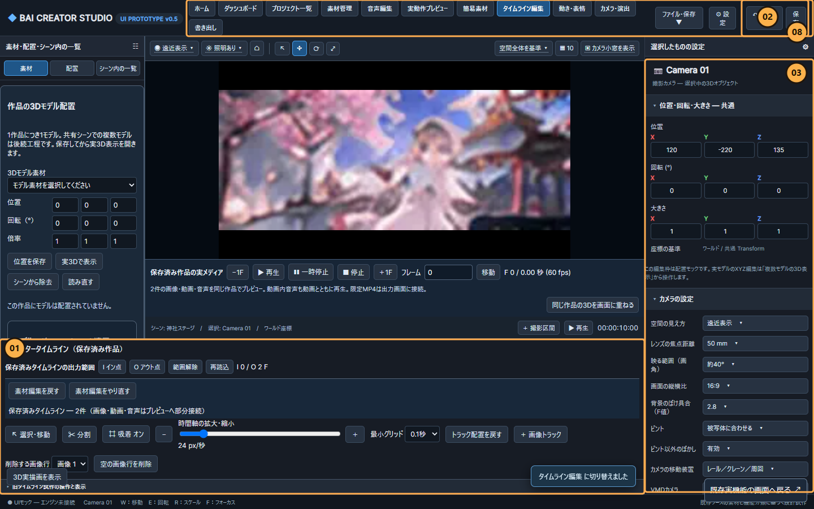
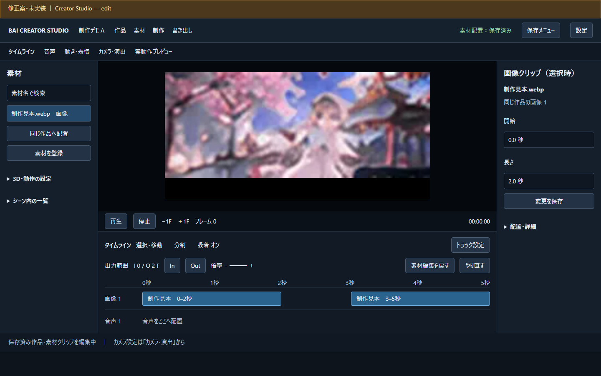

# Creator Studio UI監査と修正案（2026-11-13）

**監査・提案のみ。製品UIへの修正は未実装。** 保存対象の誤認、初期表示で見えないタイムライン、背後の操作へ移るフォーカスを先に直す案とした。8件（P1:6、P2:2、P0/P3:0）。実MP4の生成・ダウンロード・旧版保持は既存の接続を維持する。

[ブラウザ比較レポート](../../studio/v05/reviews/ui-audit-20261113/index.html) / [監査JSON](../../qa/ui-audit-20261113/audit.json) / [DOM・キーボード実測](../../qa/ui-audit-20261113/measurements.json) / [報告画面の検証](../../qa/ui-audit-20261113/review-validation.json)。main同期後のURLは `http://127.0.0.1:8765/studio/v05/reviews/ui-audit-20261113/index.html`。

## 対象と方法

現行main `f62a74c250c49dda4fce87c28d68b51534fceecb` と同じ製品コードを、隔離データのChrome157で撮影。1440×900でホーム・素材・編集・書き出し、1024×768で編集を確認した。公開済み見本画像、架空の作品2件、画像クリップ2件、3Fの実MP4を使用。利用者の本番作品を変更していない。原画像と番号付き画像はOwner確認画像フォルダー `D:/BAI/BAI_CREATER_STUDIO/_Claude確認画像/20261113-ui-audit/` にも保存した。

BAI UX Guard（情報構造）、Impeccable audit/Operate（操作画面の階層・計測）、Vercel現行ガイド（フォーカス・入力名・可読性）を併用。単一エージェントが「初見の一手」「作業と到達性」「視覚とアクセシビリティ」の3視点で確認したもので、独立した3名の批評・判定ではない。重要な製品改修を採用した段階で、同スキルの3視点の批評と最終判定を行う。

上位3タスクは承認済み最短制作経路から設定した：素材を登録・選択して同じ作品へ置く、編集して同時刻をプレビューする、保存範囲を書き出して動画を受け取る。新機能の追加やロードマップの変更は提案していない。

## 現状と変更案

画像の番号は今回の監査ローカルID `UX-01`〜`UX-08`。機能台帳の正式要件 `UX-001`〜`UX-008` と区別する。

|目印/重要度|実画面で確認した問題|変える案|
|---|---|---|
|08 / P1|上部の「保存」は試作objects/tracksのJSON出力。「元に戻す」は未接続の通知で、実クリップ保存・Undoとは別。|保存対象をメニューに明記し、素材配置の保存状態と実Undo/Redoを編集領域に表示。試作JSONと共通Undoの入口は詳細に保持。|
|01 / P1|275pxのタイムラインが操作群で埋まり、配置した2クリップが初期表示で見えない。|常用操作を2行にまとめ、行の追加・削除等をトラック設定へ。クリップと再生位置を手前に出す。|
|02 / P1|同階層の11タブと右側操作が競合し、1024pxで「元に戻す」「設定」が縦に折れる。|作品・素材・制作・書き出しへ大分類。音声・動き・カメラは制作内のタブに整理。11入口の移動先を対応表で保持。|
|03 / P2|画像編集中でも右欄はCamera01の試作設定。全体の「エンジン未接続」表示も接続済み経路と混同しやすい。|右欄を選択対象へ連動。旧カメラ・試作設定は専用の入口に保持し、未接続をその箇所で示す。|
|04 / P1|ホームのTab28〜32で、画面に覆われた編集操作へフォーカスが移る。編集用境界も他画面に出る。|全画面のホーム・素材・書き出しでは背後をinert/非表示にし、編集用ハンドルも隠す。保存寸法は維持。|
|05 / P1|素材カテゴリが左と上で重複。検索・カテゴリ・並び順にlabel/aria-labelがない。|カテゴリを一つの系統へ整理し、入力名を付ける。お気に入り・PMX/VMD登録・再リンクを保持。|
|06 / P2|書き出し実行の後に名前・衝突時操作が続き、動画が大きく完成履歴が下へ隠れる。|名前・範囲・形式を実行前に並べ、完成物・旧版・再試行を隣の一覧へ。既存APIを維持。|
|07 / P1|主ボタン文字の実スタイルは約4.45:1。通常文字AAの4.5:1に僅かに届かない。11px前後の操作文字も多い。|暗色と青を保ち、ボタン文字を白へ（同背景で約5.50:1）。文字の役割に応じて大きさを調整。|

編集の現状（01/02/03/08）：

編集の修正案・未実装：

素材管理：[現状の目印付き画像](../../studio/v05/reviews/ui-audit-20261113/marked-assets.png) / [修正案](../../studio/v05/reviews/ui-audit-20261113/proposal-assets.png)。書き出し：[現状の目印付き画像](../../studio/v05/reviews/ui-audit-20261113/marked-export.png) / [修正案](../../studio/v05/reviews/ui-audit-20261113/proposal-export.png)。04の根拠はホームのキーボード実測、狭い画面の根拠は[1024pxの現状](../../studio/v05/reviews/ui-audit-20261113/edit-1024.png)も参照。

## 計測・判定

Impeccableの5領域のうち計測した4領域の暫定値は7/16。性能は未計測なので分母から除外し、20点換算や総合評価帯への当てはめは行わない。

|領域|暫定値|根拠・限界|
|---|---|---|
|アクセシビリティ|2/4|基本ナビの2pxフォーカス表示は確認。背後へのTab移動・入力名・文字コントラストに欠落。|
|性能|NOT TESTED|実行時プロファイルを未取得。|
|テーマ|2/4|暗色/青は一貫。共通変数と局所の直書きスタイルが混在。テーマ切替全体は未確認。|
|幅への対応|1/4|横スクロールは出ないが、1024pxの文字折返しとタイムラインの可視領域に問題。|
|実装の整合性|2/4|実出力と試作保存・共通Undoが混在。|

BAI UX Guardのゲートは、主編集領域の初期表示、可視操作へのキーボード移動、素材入力名、主ボタン文字コントラストをFAILとした。ページ横スクロールなしは撮影5条件に限りPASS。初見ユーザーの5秒理解と提案の全機能到達性はNOT TESTED。**製品全体の完成や改修後の合格を意味しない。**

静的検出器は36候補、終了コード2（指摘あり）。機能上必要なタイムラインの目盛りグリッドと既存フォントを、装飾の誤検出として修正対象から除外した。「12px未満は一律WCAG違反」とは判定していない。DOM上に矩形がある操作数には覆われた背面操作が含まれるため、総数を「画面に見えるボタン数」として使っていない。

現行保存ボタンの隔離クリックで `BAI_UI_mock_project.json` のキーobjects/tracksを確認し、保存済みarrangementの前後一致を確認。共通Undoの通知も記録した。実クリップの自動保存・Undo/Redoとは区別する。これは本番作品への保存操作ではない。

未検証：性能、スクリーンリーダーでの通し操作、物理タッチ端末、初見ユーザーテスト、大量素材・全状態、提案の1024px表示と実操作。本番データでの操作は未実施。これらをPASSとしていない。

成果物の検証は、比較レポート3タブ・目印切替・JavaScriptエラー0、12画像のSHA-256、ローカル参照28件、公開用と正本の監査JSON一致、製品コード/機能台帳の変更なしを確認した。初回撮影はWebPをPNG名で登録して失敗し、正しい拡張子へ修正後の最終5キャプチャでエラー0。初回ログも保持した。これらは報告成果物の合格であり、指摘した製品不具合の解消ではない。[成果物検証JSON](../../qa/ui-audit-20261113/artifact-validation.json)を参照。

## 提案を採用する場合の順序

1. 保存対象の明示、編集領域の確保、ヘッダーと背後フォーカス（08/01/02/04）。`impeccable clarify/layout/harden`相当。既存パネル寸法と保存を回帰確認する。
2. 選択対象連動、素材のラベル、文字とコントラスト（03/05/07）。`impeccable clarify/typeset`相当。旧機能と未接続機能の入口を保持する。
3. 書き出し設定と完成物一覧（06）。`impeccable layout`相当。名前・旧版・復旧APIを変えずに整理する。
4. 実装後に同条件で再監査し、最後に`impeccable polish`相当の確認を行う。

小さなPRごとに確認する提案であり、一括刷新の実施決定ではない。全11入口の移動先、ヘッダー保存とUndoの扱い、指摘別のソース行・受け入れ条件・検証状態は監査JSONを正本とする。今回は正式要件・機能台帳151IDの状態を変更していない。対応要件はUX-001/002/003/004/005/006/008、保存対象の説明はDATA-008の既存要求に関連する。

## 導入と進行位置

Impeccable 4.8.2、既存のWeb Interface Guidelinesラッパーと取得し直した現行ガイド、BAI UX Guard1.0.0を利用可能にした。共通 `C:/Users/user/.codex/AGENTS.md` の既存内容を保ち、UIを扱う場合の適用方針を追記。[導入証跡JSON](../../qa/ui-audit-20261113/installation.json)に上流コミット・SHA-256・原本維持を記録。Owner ZIPや共通AGENTS全文は公開リポジトリへコピーしない。

Owner指定でこの監査を先に実施した。順3 G3-F1「終了条件と残件整理」は未完のまま保持する。順3全体、順4〜7の完成へ昇格しない。OGV長尺も低優先のまま。

関連Issue：[制作UI横断 #69](https://github.com/baisound/BAI_CREATER_STUDIO/issues/69)、[順3媒体操作 #81](https://github.com/baisound/BAI_CREATER_STUDIO/issues/81)。モデル区分：調査・監査・提案と文書作成は標準区分（単一エージェント）。
